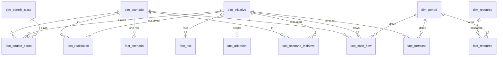

# BI package: reusable metric model for ChangeWorks (P09-ART-06)

Dataset `cw-20261026-20261026` (generator `dataset_hash` `6bf7ebaad6bf75084c82c41de1031d6d585af730c8a22979ed7c77df2a38e3a9`), contract v1, code revision `29948f9`, as-of 2026-10-05T00:00:00Z. **Synthetic data only**: nothing is a claim about a real organisation. Plan estimates (every cash flow, NPV, payback and benefit total: constructed by the generator's scenarios), observed values (adoption, training, benefit observations, actual costs, allocations in this one draw) and hypothetical benefits to a real organisation (not claimed) are kept apart; every measure row says which in its `scope`.
The decision the model serves: **which transformation initiative should be funded, and how will success be established?** (P09-GOAL-01).

## Verification status (stated plainly)
* **No `.pbix` was produced.** Power BI Desktop is not available here and was not run; no DAX engine, Power Query engine or Excel was run. The measures in section 4 are **pseudocode** (DAX-like), **not executed** in any engine.
* What was verified: the dimension and fact CSV files were written by SQL (`data/sql/analysis/bi_*.sql`) from the scratch database; every measure of section 5 was **recomputed in Python from the CSV files alone** (`run_all.py`, `bi_measures`: exact `Fraction` arithmetic over the decimal strings, no database, no domain code) and compared with the analysis SQL, `data/sql/reference_metrics.sql` and the Python domain (rows E of the reconciliation in `sql-analysis.md`: all equal). The NPV of each of the 30 scenarios is recomputed from the exact `net_cash_flow` of `fact_cash_flow` and the exact `period_rate` of `dim_scenario`, not read from a fact.
* A reader can import the CSV files into Power BI, Excel Power Query or any tool and compare with section 5; whether the DAX below evaluates as written is **unverified**. DAX arithmetic is binary floating point, so an NPV computed in Power BI can differ from the exact figure in the last cent; the exact figure is the one in `measures_recomputed.csv`.

## 1. How to read or use it without installing anything
Read this file and the CSV files in `artifacts/bi/` (plain UTF-8, comma-separated, a header row, `\n` line ends). Section 5 lists the value of each measure; `artifacts/bi/measures_recomputed.csv` carries every row with numerator, denominator, a **status**, the **scope** of the figure (scenario, horizon, rate, population, as-of) and a note. Nothing is withheld silently: an initiative with no adoption observation has an empty adoption rate with the status `null: no adoption observation by the as-of`, a payback that never happens is empty with `null: NOT_RECOVERED`, never 0. Amounts in the facts are exact decimals (trailing zeros are not significant); `discounted_cash_flow` is rounded to 2 places for display only.

## 2. Star schema and relationships

Relationships are many-to-one from fact to dimension, single direction, filtering the fact. `fact_cash_flow` and `fact_scenario_initiative` relate to both `dim_scenario` and `dim_initiative`; a report that is not filtered to one scenario must say so, because the 30 scenarios hold the same initiative under different rates, horizons and pins and **must never be summed across scenarios**.

## 3. Tables, grain and Power Query
| Table | Grain | Key | Source query | File | Rows |
|---|---|---|---|---|---|
| `dim_initiative` | one initiative with its roadmap (feasible start, delay, binding dependency, the deployment warning) | `initiative_id` | `bi_dimensions.sql` `dim_initiative` | `artifacts/bi/dim_initiative.csv` | 24 |
| `dim_scenario` | one scenario version (declared rate, exact period rate, source, horizon) | `scenario_id` | `bi_dimensions.sql` `dim_scenario` | `artifacts/bi/dim_scenario.csv` | 30 |
| `dim_benefit_class` | one benefit class and whether it enters the cash flow | `class_code` | `bi_dimensions.sql` `dim_benefit_class` | `artifacts/bi/dim_benefit_class.csv` | 6 |
| `dim_period` | one monthly period from 2026-01 (start, end exclusive, matured at the as-of) | `period_index` | `bi_dimensions.sql` `dim_period` | `artifacts/bi/dim_period.csv` | 36 |
| `dim_resource` | one shared resource and its capacity | `resource_id` | `bi_dimensions.sql` `dim_resource` | `artifacts/bi/dim_resource.csv` | 8 |
| `fact_scenario` | one scenario: costs, the classes apart, plain and attributable totals, NPVs | `scenario_id` | `bi_fact_scenario.sql` | `artifacts/bi/fact_scenario.csv` | 30 |
| `fact_scenario_initiative` | one scenario x initiative: classes, NPV with its exact rational, both paybacks with reasons, capacity released, cost variance | (`scenario_id`, `initiative_id`) | `bi_fact_scenario_initiative.sql` | `artifacts/bi/fact_scenario_initiative.csv` | 210 |
| `fact_cash_flow` | one scenario x initiative x period inside the horizon | (`scenario_id`, `initiative_id`, `period_index`) | `bi_fact_cash_flow.sql` | `artifacts/bi/fact_cash_flow.csv` | 7,212 |
| `fact_double_count` | one claim on a source key shared by two or more initiatives in one period (money and hours apart) | (`scenario_id`, `rule`, `benefit_id`) | `bi_fact_double_count.sql` | `artifacts/bi/fact_double_count.csv` | 240 |
| `fact_realisation` | one scenario x initiative x benefit type with a matured row | (`scenario_id`, `initiative_id`, `benefit_type`) | `bi_fact_realisation.sql` | `artifacts/bi/fact_realisation.csv` | 264 |
| `fact_adoption` | one initiative: adoption and training with their own denominators | `initiative_id` | `bi_fact_adoption.sql` | `artifacts/bi/fact_adoption.csv` | 24 |
| `fact_forecast` | one forecast row (initiative, version, period); version 1 is the original | (`initiative_id`, `version_number`, `period_index`) | `bi_fact_forecast.sql` | `artifacts/bi/fact_forecast.csv` | 144 |
| `fact_resource` | one resource x period with an allocation | (`resource_id`, `period_index`) | `bi_fact_resource.sql` | `artifacts/bi/fact_resource.csv` | 155 |
| `fact_risk` | one risk item with its exact expected loss | `risk_id` | `bi_fact_risk.sql` | `artifacts/bi/fact_risk.csv` | 120 |
| `measures_recomputed` | one measure x slice, recomputed from the files above, with status and scope | (`measure`, `slice`) | `run_all.py` `bi_measures` | `artifacts/bi/measures_recomputed.csv` | 486 |

**Power Query (M), pseudocode, not executed.** One query per file, with the folder path as a parameter:
```
let
    Source   = Csv.Document(File.Contents(DataFolder & "fact_cash_flow.csv"), [Delimiter = ",", Encoding = 65001, QuoteStyle = QuoteStyle.Csv]),
    Promoted = Table.PromoteHeaders(Source, [PromoteAllScalars = true]),
    Typed    = Table.TransformColumnTypes(Promoted, {{"period_index", Int64.Type}, {"costs", type number}, {"cash", type number}, {"revenue", type number},
                                                     {"avoided_cost_realised", type number}, {"capacity_converted", type number}, {"net_cash_flow", type number}}),
    Kept     = Table.SelectRows(Typed, each [scenario_id] <> null)
in
    Kept
```
Types: counts and periods `Int64.Type`; money, hours and rates `type number` (or `Currency.Type` for money; the files are exact decimals, so a consumer that needs exactness should use Decimal); empty strings stay null: never convert an empty payback, adoption rate or realisation to 0.

## 4. Measures (DAX-like pseudocode, not executed)
`Selected Scenario = SELECTEDVALUE(dim_scenario[scenario_id], "scn-025")`
`Period Rate = SELECTEDVALUE(dim_scenario[period_rate])`
`Planned Costs = SUM(fact_cash_flow[costs])`
`Cash Benefits = SUM(fact_cash_flow[cash])`
`Revenue Benefits = SUM(fact_cash_flow[revenue])`
`Avoided Cost Realised = SUM(fact_cash_flow[avoided_cost_realised])`
`Capacity Converted = SUM(fact_cash_flow[capacity_converted])`
`Avoided Cost Beside = SUM(fact_scenario_initiative[avoided_cost_beside])`
`Capacity Hours Not Converted = SUM(fact_scenario_initiative[capacity_hours_not_converted])`
`Planned Benefits = [Cash Benefits] + [Revenue Benefits] + [Avoided Cost Realised] + [Capacity Converted] + [Avoided Cost Beside]`
`Double Counted Amount = CALCULATE(SUM(fact_double_count[amount]), fact_double_count[rule] = "money", fact_double_count[retained] = 0)`
`Attributable Benefits = [Planned Benefits] - [Double Counted Amount]`
`Hours Residual = CALCULATE(SUM(fact_double_count[amount]), fact_double_count[rule] = "hours", fact_double_count[retained] = 0)`
`NPV Sum Of Initiatives = SUMX(FILTER(fact_cash_flow, RELATED(fact_scenario_initiative[has_flows]) = 1), fact_cash_flow[net_cash_flow] / POWER(1 + [Period Rate], fact_cash_flow[period_index]))`
`Double Counted PV = SUMX(FILTER(fact_double_count, fact_double_count[rule] = "money" && fact_double_count[retained] = 0 && fact_double_count[enters_cash_flow] = 1), fact_double_count[amount] / POWER(1 + [Period Rate], fact_double_count[period_index]))`
`Attributable NPV = IF(ISBLANK([NPV Sum Of Initiatives]), BLANK(), [NPV Sum Of Initiatives] - [Double Counted PV])`
`Initiatives Never Paying Back = CALCULATE(COUNTROWS(fact_scenario_initiative), fact_scenario_initiative[simple_payback_period] = BLANK())`
`Simple Payback = IF(ISBLANK(MAX(fact_scenario_initiative[simple_payback_period])), BLANK(), MAX(fact_scenario_initiative[simple_payback_interpolated]))`
`Discounted Payback = IF(ISBLANK(MAX(fact_scenario_initiative[discounted_payback_period])), BLANK(), MAX(fact_scenario_initiative[discounted_payback_interpolated]))`
`Cost Variance = SUM(fact_scenario_initiative[cost_variance])`
`Benefit Realisation = DIVIDE(SUM(fact_realisation[observed_comparable]), SUM(fact_realisation[planned_comparable]))`
`Baseline Trend Share = DIVIDE(SUM(fact_realisation[baseline_trend]), SUM(fact_realisation[observed_comparable]))`
`Adoption Rate = DIVIDE(SUM(fact_adoption[adopted]), CALCULATE(SUM(fact_adoption[adoption_eligible]), fact_adoption[adoption_status] = "value"))`
`Training Completion = DIVIDE(SUM(fact_adoption[training_completed]), CALCULATE(SUM(fact_adoption[training_eligible]), fact_adoption[training_status] = "value"))`
`Adoption Gap = [Training Completion] - [Adoption Rate]`
`Forecast Total = SUM(fact_forecast[amount])`
`Forecast Revision Change = CALCULATE([Forecast Total], fact_forecast[version_number] = MAX(fact_forecast[version_number])) - CALCULATE([Forecast Total], fact_forecast[version_number] = 1)`
`Resource Periods At Capacity = CALCULATE(COUNTROWS(fact_resource), fact_resource[at_capacity] = 1)`
`Resource Periods Over Capacity = CALCULATE(COUNTROWS(fact_resource), fact_resource[over_capacity] = 1)`
`Risk Exposure = SUM(fact_risk[expected_loss])`

Rules the measures keep: DIVIDE returns BLANK on a zero denominator, and a BLANK is shown as "no value", never 0; the four classes are separate measures and no measure adds hours to dollars; every scenario measure needs a single scenario in context (`[Selected Scenario]`), because initiatives recur across scenarios; benefit realisation is computed within one benefit type (filter `fact_realisation[benefit_type]`) and is "observed, not attributed". The model has no `funded` status: a scenario is at most `proposed`.

## 5. Measure values (recomputed from the CSV files; nothing withheld silently)
The scenario rows below are `scn-025` (24 initiatives, 36 monthly periods, period rate 0.006434); the other 29 scenarios are in `measures_recomputed.csv` with the same columns, and section E of the reconciliation checks all 30 against the analysis and the domain.

<!-- BEGIN:bi_measures_scn025 -->
| measure | slice | value | numerator | denominator | status | scope | note |
|---|---|---|---|---|---|---|---|
| Planned Costs | scn-025 | 25914200.00 |  |  | value | scenario scn-025: 24 initiatives, 36 monthly periods, period rate 0.006434 (conversion:a-conv-monthl-2); plan estimate in USD | planned cost rows inside the horizon, recurring rows expanded over [start, end) |
| Cash Benefits | scn-025 | 15288067.20 |  |  | value | scenario scn-025: 24 initiatives, 36 monthly periods, period rate 0.006434 (conversion:a-conv-monthl-2); plan estimate in USD | enters the net cash flow; ramped |
| Revenue Benefits | scn-025 | 6074000.13 |  |  | value | scenario scn-025: 24 initiatives, 36 monthly periods, period rate 0.006434 (conversion:a-conv-monthl-2); plan estimate in USD | enters the net cash flow; ramped |
| Avoided Cost Realised | scn-025 | 5516433.35 |  |  | value | scenario scn-025: 24 initiatives, 36 monthly periods, period rate 0.006434 (conversion:a-conv-monthl-2); plan estimate in USD | enters the net cash flow; ramped |
| Capacity Converted | scn-025 | 1774010.55 |  |  | value | scenario scn-025: 24 initiatives, 36 monthly periods, period rate 0.006434 (conversion:a-conv-monthl-2); plan estimate in USD | enters the net cash flow; ramped |
| Avoided Cost Beside | scn-025 | 4025383.47 |  |  | value | scenario scn-025: 24 initiatives, 36 monthly periods, period rate 0.006434 (conversion:a-conv-monthl-2); plan estimate in USD | reported beside the cash flow, never in it |
| Capacity Hours Not Converted | scn-025 | 145045.62 |  |  | value | scenario scn-025: 24 initiatives, 36 monthly periods, period rate 0.006434 (conversion:a-conv-monthl-2); plan estimate in hours | hours, never added to dollars |
| Planned Benefits | scn-025 | 32677894.70 |  |  | value | scenario scn-025: 24 initiatives, 36 monthly periods, period rate 0.006434 (conversion:a-conv-monthl-2); plan estimate in USD | the plain sum of the money claims (four classes entering plus the avoided cost beside); hours excluded |
| Double Counted Amount | scn-025 | 207146.32 |  |  | value | scenario scn-025: 24 initiatives, 36 monthly periods, period rate 0.006434 (conversion:a-conv-monthl-2); plan estimate in USD | claims sharing a source key in one period, beyond the largest |
| Attributable Benefits | scn-025 | 32470748.38 |  |  | value | scenario scn-025: 24 initiatives, 36 monthly periods, period rate 0.006434 (conversion:a-conv-monthl-2); plan estimate in USD |  |
| Hours Residual | scn-025 | 5974.80 |  |  | value | scenario scn-025: 24 initiatives, 36 monthly periods, period rate 0.006434 (conversion:a-conv-monthl-2); plan estimate in hours |  |
| NPV Sum Of Initiatives | scn-025 | 1438382.25 |  |  | value | scenario scn-025: 24 initiatives, 36 monthly periods, period rate 0.006434 (conversion:a-conv-monthl-2); plan estimate in USD | from the exact net_cash_flow and the exact period_rate, not from the rounded discounted column |
| Double Counted PV | scn-025 | 195233.20 |  |  | value | scenario scn-025: 24 initiatives, 36 monthly periods, period rate 0.006434 (conversion:a-conv-monthl-2); plan estimate in USD |  |
| Attributable NPV | scn-025 | 1243149.05 |  |  | value | scenario scn-025: 24 initiatives, 36 monthly periods, period rate 0.006434 (conversion:a-conv-monthl-2); plan estimate in USD | the headline: the plain sum less the present value counted twice |
| Initiatives Never Paying Back | scn-025 | 6 |  | 24 | value | scenario scn-025: 24 initiatives, 36 monthly periods, period rate 0.006434 (8 % annual converted); plan estimate | simple payback null (NOT_RECOVERED); never 0 |
| Simple Payback | init-001/scn-025 | 9.2751 |  |  | value | scenario scn-025: 24 initiatives, 36 monthly periods, period rate 0.006434 (8 % annual converted); plan estimate | period 10, interpolated |
| Simple Payback | init-002/scn-025 | 9.9761 |  |  | value | scenario scn-025: 24 initiatives, 36 monthly periods, period rate 0.006434 (8 % annual converted); plan estimate | period 10, interpolated |
| Simple Payback | init-003/scn-025 | 11.1517 |  |  | value | scenario scn-025: 24 initiatives, 36 monthly periods, period rate 0.006434 (8 % annual converted); plan estimate | period 12, interpolated |
| Simple Payback | init-004/scn-025 | 13.0991 |  |  | value | scenario scn-025: 24 initiatives, 36 monthly periods, period rate 0.006434 (8 % annual converted); plan estimate | period 14, interpolated |
| Simple Payback | init-005/scn-025 | 18.4347 |  |  | value | scenario scn-025: 24 initiatives, 36 monthly periods, period rate 0.006434 (8 % annual converted); plan estimate | period 19, interpolated |
| Simple Payback | init-006/scn-025 |  |  |  | null: NOT_RECOVERED | scenario scn-025: 24 initiatives, 36 monthly periods, period rate 0.006434 (8 % annual converted); plan estimate | the last crossing from below zero |
| Simple Payback | init-007/scn-025 | 10.2556 |  |  | value | scenario scn-025: 24 initiatives, 36 monthly periods, period rate 0.006434 (8 % annual converted); plan estimate | period 11, interpolated |
| Simple Payback | init-008/scn-025 | 12.3875 |  |  | value | scenario scn-025: 24 initiatives, 36 monthly periods, period rate 0.006434 (8 % annual converted); plan estimate | period 13, interpolated |
| Simple Payback | init-009/scn-025 |  |  |  | null: NOT_RECOVERED | scenario scn-025: 24 initiatives, 36 monthly periods, period rate 0.006434 (8 % annual converted); plan estimate | the last crossing from below zero |
| Simple Payback | init-010/scn-025 | 17.3724 |  |  | value | scenario scn-025: 24 initiatives, 36 monthly periods, period rate 0.006434 (8 % annual converted); plan estimate | period 18, interpolated |
| Simple Payback | init-011/scn-025 | 20.5648 |  |  | value | scenario scn-025: 24 initiatives, 36 monthly periods, period rate 0.006434 (8 % annual converted); plan estimate | period 21, interpolated |
| Simple Payback | init-012/scn-025 | 26.2243 |  |  | value | scenario scn-025: 24 initiatives, 36 monthly periods, period rate 0.006434 (8 % annual converted); plan estimate | period 27, interpolated |
| Simple Payback | init-013/scn-025 | 10.3102 |  |  | value | scenario scn-025: 24 initiatives, 36 monthly periods, period rate 0.006434 (8 % annual converted); plan estimate | period 11, interpolated |
| Simple Payback | init-014/scn-025 | 14.9491 |  |  | value | scenario scn-025: 24 initiatives, 36 monthly periods, period rate 0.006434 (8 % annual converted); plan estimate | period 15, interpolated |
| Simple Payback | init-015/scn-025 |  |  |  | null: NOT_RECOVERED | scenario scn-025: 24 initiatives, 36 monthly periods, period rate 0.006434 (8 % annual converted); plan estimate | the last crossing from below zero |
| Simple Payback | init-016/scn-025 | 16.4576 |  |  | value | scenario scn-025: 24 initiatives, 36 monthly periods, period rate 0.006434 (8 % annual converted); plan estimate | period 17, interpolated |
| Simple Payback | init-017/scn-025 | 21.7597 |  |  | value | scenario scn-025: 24 initiatives, 36 monthly periods, period rate 0.006434 (8 % annual converted); plan estimate | period 22, interpolated |
| Simple Payback | init-018/scn-025 | 27.3606 |  |  | value | scenario scn-025: 24 initiatives, 36 monthly periods, period rate 0.006434 (8 % annual converted); plan estimate | period 28, interpolated |
| Simple Payback | init-019/scn-025 |  |  |  | null: NOT_RECOVERED | scenario scn-025: 24 initiatives, 36 monthly periods, period rate 0.006434 (8 % annual converted); plan estimate | the last crossing from below zero |
| Simple Payback | init-020/scn-025 | 26.2203 |  |  | value | scenario scn-025: 24 initiatives, 36 monthly periods, period rate 0.006434 (8 % annual converted); plan estimate | period 27, interpolated |
| Simple Payback | init-021/scn-025 |  |  |  | null: NOT_RECOVERED | scenario scn-025: 24 initiatives, 36 monthly periods, period rate 0.006434 (8 % annual converted); plan estimate | the last crossing from below zero |
| Simple Payback | init-022/scn-025 |  |  |  | null: NOT_RECOVERED | scenario scn-025: 24 initiatives, 36 monthly periods, period rate 0.006434 (8 % annual converted); plan estimate | the last crossing from below zero |
| Simple Payback | init-023/scn-025 | 21.3888 |  |  | value | scenario scn-025: 24 initiatives, 36 monthly periods, period rate 0.006434 (8 % annual converted); plan estimate | period 22, interpolated |
| Simple Payback | init-024/scn-025 | 19.7406 |  |  | value | scenario scn-025: 24 initiatives, 36 monthly periods, period rate 0.006434 (8 % annual converted); plan estimate | period 20, interpolated |
<!-- END:bi_measures_scn025 -->

People, forecast, capacity and risk measures (portfolio and per-initiative slices):

<!-- BEGIN:bi_measures_portfolio -->
| measure | slice | value | numerator | denominator | status | scope | note |
|---|---|---|---|---|---|---|---|
| Benefit Realisation | init-001/cash | 1.039443 | 233147.05 | 224300.00 | value | scn-025, matured periods 0..8 at the as-of 2026-10-05; observed, not attributed |  |
| Baseline Trend Share | init-001/cash | 0.070000 | 16320.29 | 233147.05 | value | scn-025, matured periods 0..8 at the as-of 2026-10-05; observed, not attributed | the recorded pre-deployment trend over the raw observed change; shown beside it, never in place of it |
| Benefit Realisation | init-002/cash | 1.030184 | 265890.46 | 258100.00 | value | scn-025, matured periods 0..8 at the as-of 2026-10-05; observed, not attributed |  |
| Baseline Trend Share | init-002/cash | 0.197400 | 52486.77 | 265890.46 | value | scn-025, matured periods 0..8 at the as-of 2026-10-05; observed, not attributed | the recorded pre-deployment trend over the raw observed change; shown beside it, never in place of it |
| Benefit Realisation | init-003/cash | 0.667307 | 105568.01 | 158200.05 | value | scn-025, matured periods 0..8 at the as-of 2026-10-05; observed, not attributed |  |
| Baseline Trend Share | init-003/cash | 0.113300 | 11960.84 | 105568.01 | value | scn-025, matured periods 0..8 at the as-of 2026-10-05; observed, not attributed | the recorded pre-deployment trend over the raw observed change; shown beside it, never in place of it |
| Benefit Realisation | init-004/cash | 1.023305 | 52472.86 | 51277.82 | value | scn-025, matured periods 0..8 at the as-of 2026-10-05; observed, not attributed |  |
| Baseline Trend Share | init-004/cash | 0.214200 | 11239.69 | 52472.86 | value | scn-025, matured periods 0..8 at the as-of 2026-10-05; observed, not attributed | the recorded pre-deployment trend over the raw observed change; shown beside it, never in place of it |
| Benefit Realisation | init-008/cash | 0.975795 | 169593.13 | 173800.00 | value | scn-025, matured periods 0..8 at the as-of 2026-10-05; observed, not attributed |  |
| Baseline Trend Share | init-008/cash | 0.848744 | 143941.18 | 169593.13 | value | scn-025, matured periods 0..8 at the as-of 2026-10-05; observed, not attributed | the recorded pre-deployment trend over the raw observed change; shown beside it, never in place of it |
| Benefit Realisation | init-013/cash | 0.855768 | 383883.31 | 448583.46 | value | scn-025, matured periods 0..8 at the as-of 2026-10-05; observed, not attributed |  |
| Baseline Trend Share | init-013/cash | 0.215600 | 82765.25 | 383883.31 | value | scn-025, matured periods 0..8 at the as-of 2026-10-05; observed, not attributed | the recorded pre-deployment trend over the raw observed change; shown beside it, never in place of it |
| Benefit Realisation | init-014/cash | 0.747375 | 92781.29 | 124142.91 | value | scn-025, matured periods 0..8 at the as-of 2026-10-05; observed, not attributed |  |
| Baseline Trend Share | init-014/cash | 0.145600 | 13508.96 | 92781.29 | value | scn-025, matured periods 0..8 at the as-of 2026-10-05; observed, not attributed | the recorded pre-deployment trend over the raw observed change; shown beside it, never in place of it |
| Benefit Realisation | init-015/cash | 0.961240 | 103693.76 | 107875.00 | value | scn-025, matured periods 0..8 at the as-of 2026-10-05; observed, not attributed |  |
| Baseline Trend Share | init-015/cash | 0.094500 | 9799.06 | 103693.76 | value | scn-025, matured periods 0..8 at the as-of 2026-10-05; observed, not attributed | the recorded pre-deployment trend over the raw observed change; shown beside it, never in place of it |
| Benefit Realisation | init-016/cash | 0.877626 | 7509.96 | 8557.13 | value | scn-025, matured periods 0..8 at the as-of 2026-10-05; observed, not attributed |  |
| Baseline Trend Share | init-016/cash | 0.213900 | 1606.38 | 7509.96 | value | scn-025, matured periods 0..8 at the as-of 2026-10-05; observed, not attributed | the recorded pre-deployment trend over the raw observed change; shown beside it, never in place of it |
| Adoption Rate | pooled | 0.532881 | 3063 | 5748 | value | the latest record of each initiative at or before the as-of 2026-10-05; observed (11 initiatives with an adoption series) |  |
| Training Completion | pooled | 0.888443 | 6427 | 7234 | value | the latest record of each initiative at or before the as-of 2026-10-05; observed (15 initiatives with a training record) | a separate series, never a substitute for adoption |
| Training Completion | common population | 0.963778 | 5561 | 5770 | value | the latest record of each initiative at or before the as-of 2026-10-05; observed (11 initiatives with both series) |  |
| Adoption Rate | init-005 |  |  |  | null: no adoption observation by the as-of | the latest record of each initiative at or before the as-of 2026-10-05; observed |  |
| Adoption Rate | init-006 |  |  |  | null: no adoption observation by the as-of | the latest record of each initiative at or before the as-of 2026-10-05; observed |  |
| Adoption Rate | init-010 |  |  |  | null: no adoption observation by the as-of | the latest record of each initiative at or before the as-of 2026-10-05; observed |  |
| Adoption Rate | init-011 |  |  |  | null: no adoption observation by the as-of | the latest record of each initiative at or before the as-of 2026-10-05; observed |  |
| Adoption Rate | init-012 |  |  |  | null: no adoption observation by the as-of | the latest record of each initiative at or before the as-of 2026-10-05; observed |  |
| Adoption Rate | init-017 |  |  |  | null: no adoption observation by the as-of | the latest record of each initiative at or before the as-of 2026-10-05; observed |  |
| Adoption Rate | init-018 |  |  |  | null: no adoption observation by the as-of | the latest record of each initiative at or before the as-of 2026-10-05; observed |  |
| Adoption Rate | init-019 |  |  |  | null: no adoption observation by the as-of | the latest record of each initiative at or before the as-of 2026-10-05; observed |  |
| Adoption Rate | init-020 |  |  |  | null: no adoption observation by the as-of | the latest record of each initiative at or before the as-of 2026-10-05; observed |  |
| Adoption Rate | init-021 |  |  |  | null: no adoption observation by the as-of | the latest record of each initiative at or before the as-of 2026-10-05; observed |  |
| Adoption Rate | init-022 |  |  |  | null: no adoption observation by the as-of | the latest record of each initiative at or before the as-of 2026-10-05; observed |  |
| Adoption Rate | init-023 |  |  |  | null: no adoption observation by the as-of | the latest record of each initiative at or before the as-of 2026-10-05; observed |  |
| Adoption Rate | init-024 |  |  |  | null: no adoption observation by the as-of | the latest record of each initiative at or before the as-of 2026-10-05; observed |  |
| Forecast Total | init-003/v1 | 745800.06 |  |  | value | init-003 forecast versions as stored; version 1 is the original | cash benefit forecast |
| Forecast Total | init-003/v2 | 598900.05 |  |  | value | init-003 forecast versions as stored; version 1 is the original | cash benefit forecast |
| Forecast Total | init-003/v3 | 534207.54 |  |  | value | init-003 forecast versions as stored; version 1 is the original | cash benefit forecast |
| Forecast Revision Change | init-003/latest minus original | -211592.52 |  |  | value | init-003 forecast versions as stored |  |
| Resource Periods At Capacity | res-03 | 5 |  |  | value | allocations as stored (2.00 FTE capacity) | periods 12,13,14,15,16 |
| Resource Periods Over Capacity | all resources | 0 |  |  | value | allocations as stored | refused at ingest; none is stored |
| Risk Exposure | portfolio | 7485779.58 |  |  | value | 120 risk items; probability x impact; a scenario estimate, not a forecast |  |
<!-- END:bi_measures_portfolio -->
