# ChangeWorks: entity-relationship diagram (P09-ART-03)

**Synthetic data only.** Dataset `cw-20261026-20261026` (generator `dataset_hash` `6bf7ebaad6bf75084c82c41de1031d6d585af730c8a22979ed7c77df2a38e3a9`), contract v1, code revision `29948f9`. The tables of `data/sql/migrations/0001_schema.sql` and `0003_review9.sql` with every column; the grain, counts and policies are in `data-dictionary.md`.

Read the text lists below the diagram if the diagram does not render (GitHub renders Mermaid; any Markdown viewer shows the lists).

```mermaid
erDiagram
    initiatives ||--o{ process_baselines : "measured by"
    process_baselines ||--o{ baseline_approvals : "approved as"
    initiatives ||--o{ assumption_versions : "assumes"
    initiatives ||--o{ opportunity_scores : "scored"
    scenario_versions ||--o{ scenario_initiatives : "contains"
    initiatives ||--o{ scenario_initiatives : "in"
    scenario_versions ||--o{ scenario_pins : "pins"
    assumption_versions ||--o{ scenario_pins : "pinned"
    assumption_versions ||--o{ scenario_versions : "rate conversion"
    initiatives ||--o{ cost_items : "costs"
    initiatives ||--o{ benefit_items : "plans"
    benefit_items ||--o{ benefit_observations : "observed"
    scenario_versions ||--o{ expanded_costs : "expands"
    cost_items ||--o{ expanded_costs : "expanded"
    initiatives ||--o{ dependencies : "depends"
    initiatives ||--o{ dependencies : "prerequisite of"
    stakeholder_groups ||--o{ impact_mappings : "affected"
    initiatives ||--o{ impact_mappings : "changes"
    resources ||--o{ resource_allocations : "allocated"
    initiatives ||--o{ resource_allocations : "uses"
    stakeholder_groups ||--o{ readiness_assessments : "assessed"
    initiatives ||--o{ adoption_observations : "adopted"
    initiatives ||--o{ training_completions : "trained"
    initiatives ||--o{ risk_items : "risks"
    initiatives ||--o{ forecast_versions : "forecast"
    dataset_config {
        INT id
        TEXT period_basis
        DATE period_start
        TIMESTAMPTZ as_of
    }
    initiatives {
        TEXT initiative_id
        TEXT title
        TEXT sponsor_id
        TEXT status
        TEXT baseline_version
        INT requested_start_period
        INT duration_periods
        INT deployment_period
        TEXT eligibility_rule_version
        INT version
        TIMESTAMPTZ created_at
        TEXT created_by
    }
    process_baselines {
        TEXT baseline_id
        TEXT initiative_id
        TEXT baseline_version
        BIGINT volume
        INT minutes_per_case
        NUMERIC_7_6 error_rate
        TEXT evidence_ref
        TIMESTAMPTZ measured_at
        TEXT reason
        TIMESTAMPTZ created_at
        TEXT created_by
    }
    baseline_approvals {
        TEXT approval_id
        TEXT initiative_id
        TEXT baseline_version
        TEXT approved_by
        TIMESTAMPTZ approved_at
        TEXT reason
    }
    assumption_versions {
        TEXT assumption_id
        TEXT initiative_id
        TEXT name
        INT version_number
        TEXT value
        JSONB value_list
        TEXT unit
        TEXT rationale
        TEXT author_id
        TEXT evidence_ref
        TEXT staffing_change_evidence_ref
        TIMESTAMPTZ created_at
    }
    opportunity_scores {
        TEXT score_id
        TEXT initiative_id
        INT version_number
        JSONB criteria
        NUMERIC_10_4 weighted_score
        TEXT weighted_exact
        TEXT rationale
        TEXT author_id
        TIMESTAMPTZ created_at
    }
    resources {
        TEXT resource_id
        TEXT name
        NUMERIC_20_6 capacity_per_period
        TEXT unit
    }
    scenario_versions {
        TEXT scenario_id
        TEXT baseline_version
        NUMERIC_7_6 discount_rate
        TEXT rate_basis
        TEXT rate_conversion_assumption_id
        INT horizon_periods
        TEXT status
        TIMESTAMPTZ created_at
        TEXT created_by
        TIMESTAMPTZ proposed_at
        TEXT proposed_by
        JSONB comparison
        TEXT residual_explanation
        INT initiatives_expected
        INT pins_expected
        TEXT snapshot_hash
    }
    scenario_initiatives {
        TEXT scenario_id
        TEXT initiative_id
    }
    scenario_pins {
        TEXT scenario_id
        TEXT assumption_id
    }
    cost_items {
        TEXT cost_id
        TEXT initiative_id
        TEXT cost_key
        TEXT cost_type
        TEXT cost_basis
        NUMERIC_20_6 amount
        INT period_index
        INT start_period
        INT end_period
        TEXT baseline_version
        TIMESTAMPTZ recorded_at
    }
    expanded_costs {
        TEXT scenario_id
        TEXT cost_id
        TEXT initiative_id
        INT period_index
        NUMERIC_20_6 amount
    }
    benefit_items {
        TEXT benefit_id
        TEXT initiative_id
        TEXT benefit_type
        NUMERIC_20_6 amount
        INT period_index
        INT starts_period
        TEXT unit
        BOOLEAN cash_realisation
        TEXT evidence_ref
        TEXT benefit_source_key
        NUMERIC_20_6 baseline_trend_per_period
        TIMESTAMPTZ recorded_at
    }
    dependencies {
        TEXT dependency_id
        TEXT initiative_id
        TEXT prerequisite_id
        TEXT dependency_type
        INT lag_periods
    }
    stakeholder_groups {
        TEXT group_id
        TEXT group_name
        TEXT owner_id
        INT affected_count
        TEXT impact_level
    }
    impact_mappings {
        TEXT mapping_id
        TEXT initiative_id
        TEXT group_id
        TEXT operating_change
        TEXT impact_level
    }
    resource_allocations {
        TEXT allocation_id
        TEXT resource_id
        TEXT initiative_id
        INT period_index
        NUMERIC_20_6 amount
    }
    readiness_assessments {
        TEXT assessment_id
        TEXT group_id
        TEXT dimension
        INT score
        NUMERIC_20_6 weight
        TIMESTAMPTZ assessed_at
        TEXT assessed_by
    }
    adoption_observations {
        TEXT observation_id
        TEXT initiative_id
        INT eligible_count
        INT adopted_count
        TIMESTAMPTZ observed_at
        TEXT eligibility_rule_version
        TEXT recorded_by
        TIMESTAMPTZ recorded_at
    }
    training_completions {
        TEXT training_id
        TEXT initiative_id
        INT eligible_trainees
        INT completed
        TIMESTAMPTZ recorded_at
        TEXT eligibility_rule_version
        TEXT recorded_by
        TIMESTAMPTZ entered_at
    }
    benefit_observations {
        TEXT benefit_observation_id
        TEXT benefit_id
        NUMERIC_20_6 measured_value
        TEXT evidence_ref
        TIMESTAMPTZ observed_at
        TEXT recorded_by
        TIMESTAMPTZ recorded_at
    }
    risk_items {
        TEXT risk_id
        TEXT initiative_id
        NUMERIC_7_6 probability
        NUMERIC_20_6 impact
        TEXT mitigation
    }
    forecast_versions {
        TEXT forecast_id
        TEXT initiative_id
        INT version_number
        INT period_index
        NUMERIC_20_6 amount
        TEXT reason
        TIMESTAMPTZ created_at
        TEXT created_by
    }
    rejected_records {
        BIGINT seq
        TEXT batch_id
        TEXT entity
        TEXT id
        TEXT reason_code
        JSONB details
        JSONB raw_row
        INT ordinal
        TIMESTAMPTZ created_at
    }
    audit_events {
        TEXT event_id
        TEXT entity_type
        TEXT entity_id
        TEXT action
        TEXT actor_id
        TEXT actor_role
        TIMESTAMPTZ occurred_at
        INT before_version
        INT after_version
        TEXT reason
        TEXT request_id
        JSONB details
    }
    command_results {
        TEXT idempotency_key
        TEXT payload_hash
        TEXT actor_id
        TEXT actor_role
        TEXT command_id
        TEXT status
        JSONB result
        TIMESTAMPTZ created_at
    }
    dataset_versions {
        TEXT dataset_version
        TEXT dataset_hash
        TEXT contract_version
        TIMESTAMPTZ as_of
        TIMESTAMPTZ created_at
    }
    schema_migrations {
        TEXT version
        TEXT checksum
        TIMESTAMPTZ applied_at
    }
```

## Relationships (text)
* `process_baselines` -> `initiatives` (measured by), many to one
* `baseline_approvals` -> `process_baselines` (approved as), many to one
* `assumption_versions` -> `initiatives` (assumes), many to one
* `opportunity_scores` -> `initiatives` (scored), many to one
* `scenario_initiatives` -> `scenario_versions` (contains), many to one
* `scenario_initiatives` -> `initiatives` (in), many to one
* `scenario_pins` -> `scenario_versions` (pins), many to one
* `scenario_pins` -> `assumption_versions` (pinned), many to one
* `scenario_versions` -> `assumption_versions` (rate conversion), many to one
* `cost_items` -> `initiatives` (costs), many to one
* `benefit_items` -> `initiatives` (plans), many to one
* `benefit_observations` -> `benefit_items` (observed), many to one
* `expanded_costs` -> `scenario_versions` (expands), many to one
* `expanded_costs` -> `cost_items` (expanded), many to one
* `dependencies` -> `initiatives` (depends), many to one
* `dependencies` -> `initiatives` (prerequisite of), many to one
* `impact_mappings` -> `stakeholder_groups` (affected), many to one
* `impact_mappings` -> `initiatives` (changes), many to one
* `resource_allocations` -> `resources` (allocated), many to one
* `resource_allocations` -> `initiatives` (uses), many to one
* `readiness_assessments` -> `stakeholder_groups` (assessed), many to one
* `adoption_observations` -> `initiatives` (adopted), many to one
* `training_completions` -> `initiatives` (trained), many to one
* `risk_items` -> `initiatives` (risks), many to one
* `forecast_versions` -> `initiatives` (forecast), many to one

## Tables and columns (text)
* `dataset_config`: `id`, `period_basis`, `period_start`, `as_of`
* `initiatives`: `initiative_id`, `title`, `sponsor_id`, `status`, `baseline_version`, `requested_start_period`, `duration_periods`, `deployment_period`, `eligibility_rule_version`, `version`, `created_at`, `created_by`
* `process_baselines`: `baseline_id`, `initiative_id`, `baseline_version`, `volume`, `minutes_per_case`, `error_rate`, `evidence_ref`, `measured_at`, `reason`, `created_at`, `created_by`
* `baseline_approvals`: `approval_id`, `initiative_id`, `baseline_version`, `approved_by`, `approved_at`, `reason`
* `assumption_versions`: `assumption_id`, `initiative_id`, `name`, `version_number`, `value`, `value_list`, `unit`, `rationale`, `author_id`, `evidence_ref`, `staffing_change_evidence_ref`, `created_at`
* `opportunity_scores`: `score_id`, `initiative_id`, `version_number`, `criteria`, `weighted_score`, `weighted_exact`, `rationale`, `author_id`, `created_at`
* `resources`: `resource_id`, `name`, `capacity_per_period`, `unit`
* `scenario_versions`: `scenario_id`, `baseline_version`, `discount_rate`, `rate_basis`, `rate_conversion_assumption_id`, `horizon_periods`, `status`, `created_at`, `created_by`, `proposed_at`, `proposed_by`, `comparison`, `residual_explanation`, `initiatives_expected`, `pins_expected`, `snapshot_hash`
* `scenario_initiatives`: `scenario_id`, `initiative_id`
* `scenario_pins`: `scenario_id`, `assumption_id`
* `cost_items`: `cost_id`, `initiative_id`, `cost_key`, `cost_type`, `cost_basis`, `amount`, `period_index`, `start_period`, `end_period`, `baseline_version`, `recorded_at`
* `expanded_costs`: `scenario_id`, `cost_id`, `initiative_id`, `period_index`, `amount`
* `benefit_items`: `benefit_id`, `initiative_id`, `benefit_type`, `amount`, `period_index`, `starts_period`, `unit`, `cash_realisation`, `evidence_ref`, `benefit_source_key`, `baseline_trend_per_period`, `recorded_at`
* `dependencies`: `dependency_id`, `initiative_id`, `prerequisite_id`, `dependency_type`, `lag_periods`
* `stakeholder_groups`: `group_id`, `group_name`, `owner_id`, `affected_count`, `impact_level`
* `impact_mappings`: `mapping_id`, `initiative_id`, `group_id`, `operating_change`, `impact_level`
* `resource_allocations`: `allocation_id`, `resource_id`, `initiative_id`, `period_index`, `amount`
* `readiness_assessments`: `assessment_id`, `group_id`, `dimension`, `score`, `weight`, `assessed_at`, `assessed_by`
* `adoption_observations`: `observation_id`, `initiative_id`, `eligible_count`, `adopted_count`, `observed_at`, `eligibility_rule_version`, `recorded_by`, `recorded_at`
* `training_completions`: `training_id`, `initiative_id`, `eligible_trainees`, `completed`, `recorded_at`, `eligibility_rule_version`, `recorded_by`, `entered_at`
* `benefit_observations`: `benefit_observation_id`, `benefit_id`, `measured_value`, `evidence_ref`, `observed_at`, `recorded_by`, `recorded_at`
* `risk_items`: `risk_id`, `initiative_id`, `probability`, `impact`, `mitigation`
* `forecast_versions`: `forecast_id`, `initiative_id`, `version_number`, `period_index`, `amount`, `reason`, `created_at`, `created_by`
* `rejected_records`: `seq`, `batch_id`, `entity`, `id`, `reason_code`, `details`, `raw_row`, `ordinal`, `created_at`
* `audit_events`: `event_id`, `entity_type`, `entity_id`, `action`, `actor_id`, `actor_role`, `occurred_at`, `before_version`, `after_version`, `reason`, `request_id`, `details`
* `command_results`: `idempotency_key`, `payload_hash`, `actor_id`, `actor_role`, `command_id`, `status`, `result`, `created_at`
* `dataset_versions`: `dataset_version`, `dataset_hash`, `contract_version`, `as_of`, `created_at`
* `schema_migrations`: `version`, `checksum`, `applied_at`

`dataset_config`, `rejected_records`, `audit_events`, `command_results`, `dataset_versions` and `schema_migrations` stand alone (no foreign key). The analysis adds no table to the database: its `cw_*` tables are TEMPORARY and vanish with the session.

