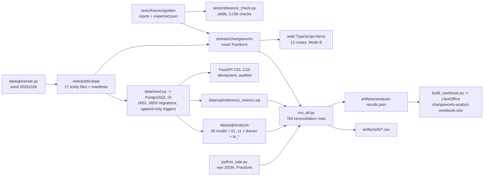

# ChangeWorks: technical case study (P09-ART-09)

**Synthetic data only.** Dataset `cw-20261026-20261026` (generator `dataset_hash` `6bf7ebaad6bf75084c82c41de1031d6d585af730c8a22979ed7c77df2a38e3a9`), contract v1, code revision `29948f9` (`29948f92f0c3839f070e4b6499b99f3810d1361b`). The product answers **which transformation initiative should be funded, and how will success be established?** without funding anything. Every figure here is a plan estimate or an observation of one synthetic draw; no benefit to a real organisation is claimed.

**How to read it without installing anything:** architecture, trade-offs, recovery behaviour, the review defects and their fixes, a reproducible setup with the exact commands, the measured evidence with the runs that produced it, and the open gaps.

## Architecture

* **Mode A** (verified on hosted runners): the Python domain (`domain/changeworks/`: ingest, cash flow, measures, people, roadmap, metrics, snapshot), PostgreSQL 16 (`data/sql/migrations/0001_schema.sql`, `0002_constraints.sql`, `0003_review9.sql`), the FastAPI commands C01..C10 and reads under `/api/v1/changeworks`, and an independent SQL recomputation (`data/sql/reference_metrics.sql`).
* **Mode B** (the public site): a TypeScript mirror of the domain over the published snapshot; its sensitivity lab, roadmap edits and proposals are simulations in browser memory.
* **This package** adds a third SQL formulation of the model (`00_portfolio_model.sql`: 23 temporary tables written from the contracts), ten investigations on the snapshot and one on the golden database, a plain-Python recomputation from the raw JSON (`python_side.py`), the BI facts and a formula-driven workbook.

## Trade-offs
* **Exact rationals over speed.** NPV is an exact rational in the domain; the analysis SQL builds q^k by multiplication and divides once, then reduces the rational with `gcd`, so the SQL can publish the same `n/d` as the domain (all 210 initiative NPVs and 30 portfolio totals equal). The reference SQL keeps a documented bound of 0.000001 USD on its 6-place NPV instead (R9-20).
* **Classes apart over one headline.** Four benefit classes plus hours mean more columns in every view; the plain sum is still shown, beside the attributable figure (R9-02).
* **The roadmap reports, it does not re-time.** Moving a cash flow to the feasible start would change recorded plan rows; the product flags `DEPLOYMENT_BEFORE_FEASIBLE_START` instead (R9-06).
* **No resource levelling.** Allocations that cross capacity are refused at the write; the resource-constrained start equals the dependency-feasible one. `res-02` at capacity for 18 periods shows the cost of that choice.
* **Workbook formulas over pasted results.** The workbook recomputes the cash flow, NPV, paybacks and the double-count rule with spreadsheet formulas for any scenario; only the choice of assumption version per scenario is typed (W-02), and floating point limits its checks to 0.005 USD.

## Recovery behaviour
* A command runs in one transaction with its audit row and stored result; every row is checked before the first write, so a refusal writes nothing except the deliberate refusal audit (`test_a_failure_after_the_write_rolls_the_command_and_its_audit_back`).
* Deadlocks and serialisation failures are retried three times, then 409 `CONCURRENT_UPDATE` (`test_a_deadlock_is_retried_three_times_then_409_concurrent_update`); an interrupted command leaves no idempotency record (`test_an_interrupted_command_leaves_no_idempotency_record_so_the_retry_runs`).
* The twelve adversarial cases are detected and recovered (`tests/test_adversarial.py`, P09-TEST-01..12).
* The artifact scripts are restartable: `prepare_snapshot.py` resets only the project's tables in an `artifacts09_*` database and refuses any other name; `run_all.py` creates and drops its own scratch databases when none is given; the workbook is rebuilt from scratch on every run.

## The review defects and their fixes (D-09)
Review R9 (assignment A-074, a disproof pass) found 14 defects; the fixes R9-01..R9-22 (assignment A-078) were accepted at `29948f9`. The ones that change figures this package reports: **R9-01** a scenario's figures come from the rows recorded by its `created_at` and its pins; **R9-02** the portfolio NPV is attributable (1,243,149.05 in `scn-025`, not 1,438,382.25); **R9-03** the hours residual (5,974.80); **R9-07** exact sums rounded once (the DR-01 hours are 2,920.48, not a sum of rounded rows); **R9-08** the specialist is at capacity in periods 12..16; **R9-09** the DR-03 ratio names its scenarios (0.531465 / 0.620043); **R9-12** payback is the last crossing, null with `NO_INVESTMENT`, `NOT_RECOVERED` or `NO_FLOWS`; **R9-13** partial trend coverage. The rest (R9-04, R9-05, R9-10, R9-11, R9-14..R9-22) harden validation, wording and the site. `uat-evidence.md` section 2 shows which this package re-checked.

## Reproducible setup
```
cd apps/changeworks
pip install -r requirements.txt -r requirements-artifacts.txt          # openpyxl==3.1.5; LibreOffice Calc (soffice) for --recalc
export PGPASSWORD=<password>
createdb -h 127.0.0.1 -U <user> artifacts09_snapshot && createdb -h 127.0.0.1 -U <user> artifacts09_golden
export ARTIFACTS_DATABASE_URL=postgresql://<user>:<password>@127.0.0.1:5432/artifacts09_snapshot
export ARTIFACTS_GOLDEN_DATABASE_URL=postgresql://<user>:<password>@127.0.0.1:5432/artifacts09_golden
python data/sql/analysis/run_all.py --json artifacts/analysis-results.json --bi-out artifacts/bi     # RESULT: OK (763 reconciliation rows, 763 equal; ...)
python artifacts/render_sql_analysis.py
python artifacts/build_workbook.py --recalc
python artifacts/checksums.py --table
DATABASE_URL=postgresql://<user>:<password>@127.0.0.1:5432/changeworks python -m pytest -q -ra       # the whole suite, artifact tests included
sha256sum -c artifacts/CHECKSUMS.txt
python -I tests/reference_check.py
```
The CI workflow `.github/workflows/changeworks-ci.yml` does the same on a GitHub-hosted runner (postgres:16 service, LibreOffice Calc, the two scratch databases, full history for the provenance test, the portfolio case study copied to `changeworks/project.json`) and fails on any skipped test (the junit no-skip gate, `skipped="0"`).

## Measured evidence
| What | Result | Where it ran |
|---|---|---|
| Independent reference check | ALL OK, 3,156 checks, 7 fixture hashes | `python -I tests/reference_check.py`, this pass (session container) and CI 40474351325 |
| The whole Python suite at `29948f9` | 454 passed, 0 skipped | CI 40474351325 (GitHub-hosted, both modes green); coordinator's local run (ledger entry of 2026-10-27T08:33:31Z) |
| The suite with this package | see `release-package.md` "What this artifact pass ran" | session container, local PostgreSQL 16, LibreOffice |
| SQL reconciliation | **763 reconciliation rows**, all equal; 48,476 snapshot leaves and 167 golden leaves equal the reference SQL and the domain | `run_all.py`, this pass |
| Workbook | `Checks!B2` TRUE after LibreOffice headless recalculation, for `scn-025` and four other scenarios | this pass |
| Site | 81 Playwright tests expected, 0 unexpected; 65 screenshots without horizontal overflow | coordinator's local run 2026-10-27T08:30Z; CI Mode B 40474351325 |
| Live site | live code_sha `29948f92f0c3839f070e4b6499b99f3810d1361b`, release 8b9bcd3 | live check 40474949237 (2026-10-27T08:41:13Z) |

Excel and Power BI Desktop were not run; no hosted run of `tests/test_artifacts.py` is recorded yet (the package is not committed by this pass).

## Open gaps
* Resource levelling, declared uncertainty ranges and the proposal transition under a database trigger are not built (D-06, R9-19).
* The analysis SQL does not recompute readiness and risk exposure from its own model (the reference SQL and the domain do; risk is reconciled through the BI facts).
* The double-count rule finds claims that share a key; a claim on the same capacity under a different key is invisible to it.
* The workbook types the assumption version each scenario uses (W-02) and checks to 0.005 USD; the DAX of the BI package is unexecuted pseudocode.
