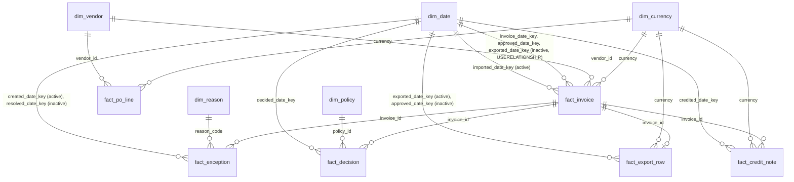

# BI package: reusable metric model for InvoiceBridge (P05-ART-06)

**Synthetic data only.** The model is a reusable metric layer over the observed synthetic history of `ib-20261026-20261026` (seed 20261026, generator `dataset_hash`
`1f001a43a7031d4260f5abb3b9f7a83f6e1b48397e85cf8b04e0b4d9e052162e`, contract v1, code revision `2dcc460`) as of **2026-10-01T02:00:00Z**. Nothing in it is a measured effect on a real accounts-payable team and no benefit is claimed.
Every table is OBSERVED; there is no simulated table (the only simulation is the seeded generator that produced the history, and its outcome-selected choices (approves only uninterrupted matches, rejects only never-matched invoices, closes each period with an export of everything approved) are not findings).
**Money is per currency.** The contract has no dated conversion rate, so every money measure below returns BLANK unless the filter context holds exactly one currency; counts and units may be summed across currencies, money may not.

## Verification status (stated plainly)
* **No `.pbix` was produced.** Power BI Desktop is not available here and was not run; no DAX engine evaluated any measure below. The DAX is **pseudocode in DAX syntax** (DAX-like) written to be pasted into a model, and it has not been executed.
* **What was checked instead:** the fact and dimension tables are the CSV exports of `data/sql/analysis/bi_fact_*.sql` and `bi_dimensions.sql` under `artifacts/bi/` (produced by `run_all.py --bi-out artifacts/bi`); the **definition of every measure was re-implemented in Python over those CSV files** (`run_all.py` `bi_measures`, not the domain) and the results reconciled with `data/sql/reference_metrics.sql` and the Python domain: the `E BI measure...` rows of the reconciliation in `sql-analysis.md` section 10 (including the derived status of every one of the 2,800 invoices against the domain's). `artifacts/bi/measures_recomputed.csv` is that result; section 5 renders it.
  That proves the definitions and the exports; it does not prove that a DAX engine returns the same figures.
* **Not checked:** DAX syntax and evaluation context, Power Query typing in Desktop, visual layout, refresh. Anyone with Power BI Desktop can load the CSV files (the M below), paste the measures and compare each one with the expected table in section 5.

## 1. How to read or use it without installing anything
Read this file; open any CSV in `artifacts/bi/` in a spreadsheet application (they are plain UTF-8, comma separated, header row, `\n` line ends, empty cell = absent, never 0). With Power BI Desktop: Get Data > Text/CSV for each file, apply the types of section 3, create the relationships of section 2 and paste the measures of section 4 into a measures table.

## 2. Star schema and relationships

All relationships are many-to-one from the fact to the dimension with single-direction filtering (dimension filters fact); `fact_exception`, `fact_decision`, `fact_export_row` and `fact_credit_note` reach `dim_vendor` and `dim_currency` through `fact_invoice` (one-to-many, single direction, so a vendor or currency slicer filters their rows).
The date relationships on `fact_invoice` are **role-playing**: imports use the active imported-date relationship; approvals and exports use `USERELATIONSHIP` on the approved and exported dates. `dim_date` is a day-grain table of 366 UTC calendar days (2025-10-01 to 2026-10-01).
The currency dimension is what makes the model honest: a visual that has no currency in context must not add money, and the measures below return BLANK there.

## 3. Tables, grain and Power Query

| Table | Grain | Rows | CSV | Key columns |
|---|---|---|---|---|
| `fact_invoice` | one imported invoice, state as of the as-of | 2,800 | `artifacts/bi/fact_invoice.csv` | `invoice_id`; `vendor_id`, `currency`, `invoice_date_key`, `imported_date_key`, `approved_date_key`, `exported_date_key`; `subtotal`, `tax`, `total`, `declared_total`, `credit_total`, `approved_payable` (own currency); `status_at_asof`; flags `in_book`, `matched`, `ever_excepted`, `approved`, `exported` (1 / 0); `open_reasons` (reasons joined by `\|`, empty when none); `seconds_to_approval` (integer) |
| `fact_po_line` | one purchase-order line at the as-of | 3,000 | `artifacts/bi/fact_po_line.csv` | `po_line_id`; `vendor_id`, `currency`, `ordered_quantity`, `unit_price`, `net_received_quantity`, `accepted_invoiced_quantity` |
| `fact_exception` | one stored exception (resolved ones included) | 660 | `artifacts/bi/fact_exception.csv` | `exception_id`; `invoice_id`, `reason_code`, `created_date_key`, `resolved_date_key`, `open_at_asof`, `owner_at_asof` (empty = unowned), `assignments`, `hours_to_first_assignment` |
| `fact_decision` | one approve or reject decision | 2,356 | `artifacts/bi/fact_decision.csv` | `approval_id`; `invoice_id`, `actor_id`, `decision`, `decided_date_key`, `policy_id`, `policy_version`, `valid`, `refusal_code` |
| `fact_export_row` | one invoice exported by a non-repeat request after its approval | 2,299 | `artifacts/bi/fact_export_row.csv` | `invoice_id`; `batch_id`, `exported_date_key`, `approved_date_key`, `currency`, `amount` (own currency) |
| `fact_credit_note` | one credit note | 117 | `artifacts/bi/fact_credit_note.csv` | `credit_id`; `invoice_id`, `currency`, `credit_amount`, `credited_date_key`, `applied` |
| `dim_vendor` | one vendor | 40 | `artifacts/bi/dim_vendor.csv` | `vendor_id`, `vendor_name`, `currency`, `active`, `vendor_group` (ven-02x, ven-007, other vendors) |
| `dim_date` | one UTC day | 366 | `artifacts/bi/dim_date.csv` | `date_key` (yyyymmdd), `date`, `year`, `month`, `year_month`, `iso_weekday`, `in_last_three_days_of_month` |
| `dim_currency` | one currency | 3 | `artifacts/bi/dim_currency.csv` | `currency` (EUR, GBP, USD), `note` |
| `dim_policy` | one approval policy version | 2 | `artifacts/bi/dim_policy.csv` | `policy_id`, `version_number`, `amount_limit`, `reviewer_role`, `escalation_role`, `effective_from` |
| `dim_reason` | one exception reason | 5 | `artifacts/bi/dim_reason.csv` | `reason_code`, `description` |

Power Query (M) for one table; the others differ only in the file name and the type list:
```m
let
    Source = Csv.Document(File.Contents("artifacts/bi/fact_invoice.csv"), [Delimiter = ",", Encoding = 65001, QuoteStyle = QuoteStyle.Csv]),
    Promoted = Table.PromoteHeaders(Source, [PromoteAllScalars = true]),
    Typed = Table.TransformColumnTypes(Promoted, {
        {"invoice_id", type text}, {"vendor_id", type text}, {"currency", type text}, {"status_at_asof", type text}, {"open_reasons", type text},
        {"invoice_date_key", Int64.Type}, {"imported_date_key", Int64.Type}, {"approved_date_key", Int64.Type}, {"exported_date_key", Int64.Type},
        {"subtotal", Currency.Type}, {"tax", Currency.Type}, {"total", Currency.Type}, {"declared_total", Currency.Type},
        {"credit_total", Currency.Type}, {"approved_payable", Currency.Type},
        {"in_book", Int64.Type}, {"matched", Int64.Type}, {"ever_excepted", Int64.Type}, {"approved", Int64.Type}, {"exported", Int64.Type},
        {"seconds_to_approval", Int64.Type}})
in
    Typed
```
Money columns are fixed-decimal (two places) and **each row's amount is in the currency of its own row**: never sum them without the currency in context. Empty cells are absent values (a blank date key is not 0).

## 4. Measures (DAX-like pseudocode, not executed)
Naming: a measure that returns money is **currency-safe**: it returns BLANK unless exactly one currency is in context. Ratios use `DIVIDE`, so an empty population is BLANK, never 0 (P05-MET-06 behaviour on a zero denominator).
```dax
Is One Currency = HASONEVALUE ( dim_currency[currency] )

-- counts (may be summed across currencies)
Invoices In Book      = CALCULATE ( COUNTROWS ( fact_invoice ), fact_invoice[in_book] = 1 )
Matched Invoices      = CALCULATE ( COUNTROWS ( fact_invoice ), fact_invoice[status_at_asof] IN { "matched", "approved", "exported", "adjusted" } )
Obligations           = CALCULATE ( COUNTROWS ( fact_invoice ), fact_invoice[status_at_asof] IN { "approved", "exported", "adjusted" } )
Approved Invoices     = CALCULATE ( COUNTROWS ( fact_invoice ), fact_invoice[approved] = 1 )
Pending Invoices      = [Invoices In Book] - CALCULATE ( COUNTROWS ( fact_invoice ), fact_invoice[in_book] = 1, fact_invoice[approved] = 1 )
Duplicates Merged     = CALCULATE ( COUNTROWS ( fact_invoice ), fact_invoice[status_at_asof] = "merged" )
Open Exceptions       = CALCULATE ( COUNTROWS ( fact_exception ), fact_exception[open_at_asof] = 1 )          -- by reason with dim_reason in context
Unowned Exceptions    = CALCULATE ( COUNTROWS ( fact_exception ), fact_exception[open_at_asof] = 1, fact_exception[owner_at_asof] = "" )

-- money (currency-safe)
Matched Total         = IF ( [Is One Currency], CALCULATE ( SUM ( fact_invoice[total] ), fact_invoice[status_at_asof] IN { "matched", "approved", "exported", "adjusted" } ) )
Obligations Total     = IF ( [Is One Currency], CALCULATE ( SUM ( fact_invoice[total] ), fact_invoice[status_at_asof] IN { "approved", "exported", "adjusted" } ) )
Credit Total          = IF ( [Is One Currency], CALCULATE ( SUM ( fact_invoice[credit_total] ), fact_invoice[approved] = 1 ) )
Approved Payable      = IF ( [Is One Currency], [Obligations Total] - [Credit Total] )
Accepted Export Total = IF ( [Is One Currency], SUM ( fact_export_row[amount] ) )
Export Difference     = IF ( [Is One Currency], [Accepted Export Total] - [Obligations Total] )                -- 0.00 by construction of the generator, never a finding

-- rates (6 decimals in the contract; ROUND ( ..., 6 ) when compared)
Exception Rate          = DIVIDE ( CALCULATE ( COUNTROWS ( fact_invoice ), fact_invoice[in_book] = 1, fact_invoice[open_reasons] <> "" ), [Invoices In Book] )
Straight Through Rate   = DIVIDE ( [Invoices In Book] - CALCULATE ( COUNTROWS ( fact_invoice ), fact_invoice[in_book] = 1, fact_invoice[open_reasons] <> "" ), [Invoices In Book] )   -- NOT blocked at the cutoff (D-09.10)
Ever Excepted Rate      = DIVIDE ( CALCULATE ( COUNTROWS ( fact_invoice ), fact_invoice[in_book] = 1, fact_invoice[ever_excepted] = 1 ), [Invoices In Book] )
Never Excepted Rate     = 1 - [Ever Excepted Rate]
Mean Minutes To Approval = DIVIDE ( CALCULATE ( SUM ( fact_invoice[seconds_to_approval] ), fact_invoice[approved] = 1 ), 60 * [Approved Invoices] )

-- quantities (units; money value is currency-safe)
Ordered Quantity            = SUM ( fact_po_line[ordered_quantity] )
Net Received Quantity       = SUM ( fact_po_line[net_received_quantity] )
Accepted Invoiced Quantity  = SUM ( fact_po_line[accepted_invoiced_quantity] )
Open To Receive Quantity    = SUMX ( fact_po_line, MAX ( fact_po_line[ordered_quantity] - fact_po_line[net_received_quantity], 0 ) )
Open To Invoice Quantity    = SUMX ( fact_po_line, MAX ( fact_po_line[ordered_quantity] - fact_po_line[accepted_invoiced_quantity], 0 ) )
Received Not Invoiced Qty   = SUMX ( fact_po_line, MAX ( fact_po_line[net_received_quantity] - fact_po_line[accepted_invoiced_quantity], 0 ) )
Received Not Invoiced Value = IF ( [Is One Currency], SUMX ( fact_po_line, MAX ( fact_po_line[net_received_quantity] - fact_po_line[accepted_invoiced_quantity], 0 ) * fact_po_line[unit_price] ) )
```
`Ever Excepted Rate` carries a trap the model states instead of hiding: "open" (`open_reasons`) and "ever" (`ever_excepted`) are different populations with the same denominator, and the published straight-through rate is the first, not the second. `fact_invoice[approved]` is 1 only for an invoice with a policy-valid approval at the as-of, so a pending invoice contributes nothing to `seconds_to_approval`.

## 5. Expected values (recomputed from the CSV facts by `run_all.py`; reconciled to `reference_metrics.sql` and the Python domain)
Currency is blank for counts, rates and units, and a currency code for money. Reasons appear in the currency column for `open_exceptions` by reason. These are the figures a model built from the CSV files and the measures above must return at the as-of.
<!-- BEGIN:bi_measures -->
| measure | currency | value |
|---|---|---|
| matched_invoices |  | 2413 |
| obligations |  | 2299 |
| matched_invoices | EUR | 474 |
| matched_total | EUR | 531691.91 |
| obligations | EUR | 447 |
| approved_total | EUR | 457320.65 |
| credit_total | EUR | 6734.62 |
| approved_payable | EUR | 450586.03 |
| accepted_export_total | EUR | 457320.65 |
| export_difference | EUR | 0.00 |
| received_not_invoiced_value | EUR | 49602.39 |
| matched_invoices | GBP | 324 |
| matched_total | GBP | 347369.86 |
| obligations | GBP | 305 |
| approved_total | GBP | 286543.12 |
| credit_total | GBP | 5434.95 |
| approved_payable | GBP | 281108.17 |
| accepted_export_total | GBP | 286543.12 |
| export_difference | GBP | 0.00 |
| received_not_invoiced_value | GBP | 38609.28 |
| matched_invoices | USD | 1615 |
| matched_total | USD | 1608460.47 |
| obligations | USD | 1547 |
| approved_total | USD | 1448006.25 |
| credit_total | USD | 31969.26 |
| approved_payable | USD | 1416036.99 |
| accepted_export_total | USD | 1448006.25 |
| export_difference | USD | 0.00 |
| received_not_invoiced_value | USD | 135134.34 |
| open_exceptions | QUANTITY_BLOCKED | 193 |
| open_exceptions | PRICE_VARIANCE | 32 |
| open_exceptions | NO_PO_LINE | 0 |
| open_exceptions | ROUNDING_EXCEPTION | 4 |
| open_exceptions | CURRENCY_MISMATCH | 3 |
| open_exceptions |  | 232 |
| unowned_exceptions |  | 29 |
| eligible_invoices |  | 2645 |
| exception_rate |  | 0.087713 |
| straight_through_rate |  | 0.912287 |
| ever_excepted_rate |  | 0.227599 |
| never_excepted_rate |  | 0.772401 |
| approved_invoices |  | 2299 |
| mean_minutes_to_approval |  | 5466.7066 |
| pending_invoices |  | 346 |
| duplicates_merged |  | 98 |
| ordered_quantity |  | 202310.2500 |
| net_received_quantity |  | 191431.0000 |
| accepted_invoiced_quantity |  | 176112.2500 |
| open_to_receive_quantity |  | 10879.2500 |
| open_to_invoice_quantity |  | 26198.0000 |
| received_not_invoiced_quantity |  | 15318.7500 |
<!-- END:bi_measures -->

## 6. Limits
* **A snapshot at one instant.** The facts are the state at 2026-10-01T02:00:00Z; another cutoff needs the `bi_*.sql` files re-run with another literal (they read the same `00_book.sql` tables). `fact_exception` keeps the created and resolved dates, so a backlog at a date can be built from it, but no such measure is reconciled here.
* **The status is derived, not stored.** `status_at_asof` is the derivation of the book from facts (the same as `invoicebridge.book.derive`, compared for all 2,800 invoices); the stored `invoices.status` is a workflow copy that may lag.
* **A policy limit has no currency**: `fact_decision.valid` compares a total in its own currency with a number.
* **Export reconciliation is zero by construction**; `Export Difference` is a check, not a finding.
* **No row-level security, refresh schedule, incremental load or `.pbix`** is designed; the package is a metric model and the exports that feed it.
