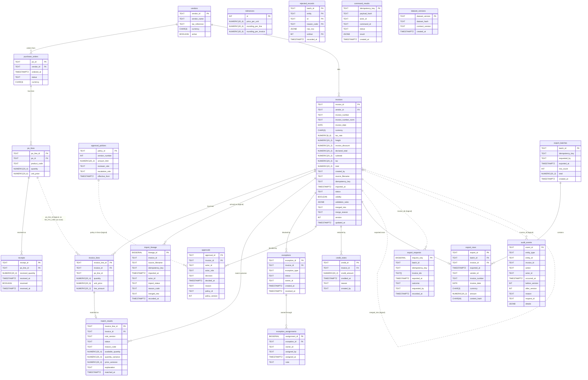

# Entity-relationship diagram (P05-ART-03)

Derived from `data/migrations/0001_schema.sql`, `0002_constraints.sql` and `0003_review_status.sql` (dataset `ib-20261026-20261026`, generator `dataset_hash` `1f001a43a7031d4260f5abb3b9f7a83f6e1b48397e85cf8b04e0b4d9e052162e`, contract v1, code revision `2dcc460`; **synthetic data only**). Solid lines are enforced foreign keys; dotted lines are logical joins the contract relies on (D-01, D-05, D-06) that the database does not enforce, so that an invoice line naming no PO line can exist and be an exception instead of a load error. Field detail, grain, update semantics and the deletion policy are in `data-dictionary.md`.
How to read it without installing anything: any Markdown viewer that renders Mermaid draws the diagram; otherwise the field lists below are the whole model. Types are those of the migration with the comma of a precision written as an underscore (`NUMERIC(20_2)` is `NUMERIC(20,2)`, because Mermaid attribute types cannot contain a comma). `PK` marks the primary key (a composite key marks every member), `FK` an enforced foreign key. The 21 tables are those of `0001`; `schema_migrations` is created by `data/migrate.py` and has no relationship, so it is not drawn.

## Reading notes

* **Money is per currency.** `vendors.currency`, `purchase_orders.currency`, `invoices.currency` and `export_rows.currency` carry the unit of every amount of their row; there is no exchange-rate table, so no relationship and no query converts or sums across currencies (`CURRENCY_MISMATCH` is the exception raised instead).
* **Immutable and append-only:** `invoice_lines`, `import_lineage`, `approvals`, `export_rows`, `credit_notes`, `exception_assignments` and `audit_events` refuse UPDATE, DELETE and TRUNCATE; `invoices` refuse DELETE and any change to the extracted source; `receipts` can only be reversed. Lineage is therefore append-only: the same bytes arriving again adds a lineage row and a merged invoice, it never edits the first.
* **One obligation per document:** `export_rows` has `UNIQUE (invoice_id)` (an invoice exports once) and `credit_notes.credit_id` is the key (a credit applies once). The identity used for duplicates (vendor, normalised number, date, computed total) is derived, not a column; `invoices.merged_into` and `import_lineage.merged_into` point at the canonical copy.
* **Logical joins (dotted):** `invoice_lines.po_line_id` to `po_lines` (a missing line is `NO_PO_LINE`); `approvals.policy_id` to `approval_policies` (the policy in force at `decided_at`); `export_requests.invoice_ids[]` to `invoices`; `invoices.merged_into` to `invoices`; `import_lineage.invoice_id` to `invoices`; `audit_events.invoice_id` to `invoices`.
* **Derived, rebuildable tables:** `match_results`, `export_batches`, `export_rows` and the open part of `exceptions` are written from the domain's derivation at one as-of; the metrics never read them (D-06).
* **Not drawn:** the temporary tables of the analysis (`ib_run`, `ib_facts`, `data/sql/analysis/00_book.sql`) and the BI star schema (`bi-package.md`).
