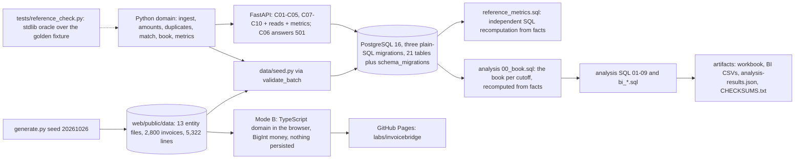

# Technical case study: InvoiceBridge (P05-ART-09)

A synthetic accounts-payable product built around one question: **which invoices may advance and which require exception review?** (P05-GOAL-01). It is a **business-data-lab** project, not a customer system: all data is generated, nothing is persisted from the public site, no payment or bank connection exists and no result describes a real company (P05-DOMAIN-01, P05-GOAL-12).
Dataset `ib-20261026-20261026` (generator hash `1f001a43a7031d4260f5abb3b9f7a83f6e1b48397e85cf8b04e0b4d9e052162e`, seed 20261026), contract v1, code revision `2dcc460`.
Observed results, simulated outcomes and hypothetical benefits are kept apart: observed = the synthetic history, reconciled to an independent SQL reference; simulated = nothing but the seeded generator itself, whose choices are listed in "Trade-offs"; hypothetical = nothing is claimed. Money is per currency throughout.
How to read it without installing anything: the sections are Architecture, Trade-offs, Recovery behaviour, Reproducible setup, Measured evidence and Open gaps; commands are listed so anyone can reproduce a number, but none is needed to read the text.

## Architecture

* **Mode A (verified on hosted runners):** the standard-library Python domain (`domain/invoicebridge`), PostgreSQL migrations (`data/migrations`), FastAPI commands and reads (`api/`), prefix `/api/v1/invoicebridge`. Not served by GitHub Pages.
* **Mode B (public):** the same contract in TypeScript (`web/src/domain`) over the published snapshot, with BigInt money and no float; the intake desk replays imports in browser memory and nothing is persisted; a refresh restores the snapshot.
* **One contract** (`docs/contracts.md`, v1, D-01..D-09) with a **golden fixture** whose answers are hand-derived (`tests/fixtures/golden/CALCULATION.md`: 6 x 20.00 = 120.00, tax 12.00, total 132.00, the second invoice for 4 blocked, the re-sent first invoice merged).
* **Independent implementations of the same numbers:** the Python domain, the TypeScript domain, `data/sql/reference_metrics.sql` (recursive chains over the facts), the analysis SQL, the stdlib oracle `tests/reference_check.py`, `data/sql/analysis/python_side.py` (the domain's book with exact arithmetic) and the workbook's spreadsheet formulas. They check each other: `run_all.py` prints 286 reconciliation rows, all equal (`sql-analysis.md` section 10).
* **The committed-first derivation (D-09).** The book is derived from facts at a cutoff, never from stored statuses. An invoice with a **policy-valid approval** (an approver who is not the creator, a role the policy in force at the decision allows for the total, decided no earlier than the import) is *committed*. Committed invoices **consume received quantity first**, by commit instant, then the others in `(invoice_date, imported_at, invoice_id)` order, and a committed copy is **never displaced as the canonical copy of a duplicate group** by a later import, even one stamped earlier; an invoice named by a valid export row stays exported when a receipt is reversed afterwards (the reversal is an exception on it).
  Before this rule the review found that a back-dated invoice arriving late could take the receipt from an invoice that was already approved and exported (R5-01), and that a later import with an earlier client-supplied time could displace an exported canonical copy so the same invoice could be paid twice (R5-02). Policy validity does not depend on the match, so the rule is not circular; the SQL reference and the TypeScript mirror implement it identically and are held to the same hand-derived values (`tests/review_cases.json`).

## Trade-offs
* **Facts, not statuses (D-06).** Every metric is derived from recorded facts at a cutoff; the stored `invoices.status` is a workflow copy that may lag, and the API says so per invoice (`WORKFLOW_STATE_DIFFERS`). Cost: each metric needs a re-derivation (the SQL reference takes about 110 seconds for the as-of with its three cutoffs on 2,800 invoices). Benefit: three implementations agree on any population, and a status can be scrambled without changing a figure (`test_sql_is_independent_of_every_stored_status_and_derived_column`).
* **Committed-first consumption (D-09).** A later fact cannot drop an earlier committed one. Cost: the match order is not plain document order, which is harder to explain. Benefit: no invoice that was approved or exported can be displaced by a back-dated or re-stamped import.
* **Same bytes first, then identity (D-01, D-06).** Identity is vendor, normalised number, date and the **computed** total; a byte-twin with other extracted fields is held for review (`needs_review`) rather than merged. Cost: a held invoice has **no command that resolves it** in this milestone (C06 is 501). Benefit: no silent merge of two different documents (R5-20).
* **Exact arithmetic, one rounding.** Decimal and Fraction in Python, BigInt integers in TypeScript, exact numerics in SQL; tax once per invoice on the unrounded subtotal, half up; quantities 4 dp, prices and rates 6 dp, minutes 4 dp; floats, non-ASCII digits and over-precise decimals are refused, not rounded (R5-17). Cost: stricter inputs. Benefit: three languages agree to the digit.
* **Money per currency, no conversion.** The contract has no dated rate, so a foreign-currency line is `CURRENCY_MISMATCH` and every aggregate carries `by_currency`; policy limits are compared with the invoice total in its own currency. Cost: no cross-currency view and a limit with no currency. Benefit: no figure is a meaningless sum (R5-11).
* **Idempotency bound to actor, role, payload and dataset version.** The same key and payload replays the stored response; another payload, actor or role is 409; a stale dataset version is 409 before the handler runs. Cost: a client must re-read the version. Benefit: no replay under another identity (R5-19).
* **The server stamps the decision.** A client-supplied `decided_at` is 422 `FIELD_UNEXPECTED` and a future `imported_at` is clamped to the server clock (warning `IMPORTED_AT_CLAMPED`). Benefit: a back-dated decision cannot pick the looser policy (R5-04).
* **Append-only and immutable by trigger.** The extracted source of an invoice, its lines, the import lineage, approvals, export rows, credit notes, exception assignments and audit events cannot be updated or deleted; a receipt can only be reversed. Cost: corrections need a versioned row (C06, not built). Benefit: lineage is evidence.
* **Different methods for independent checks.** The analysis SQL builds the book with the reference's recursive chain but aggregates with different queries; `python_side.py` uses the domain's derivation and exact rationals; the workbook uses spreadsheet formulas over typed facts; the BI measures are re-implemented over CSV facts. One wrong idea is unlikely to be shared, though the workbook shares the typed match outcome with the domain (limit W-02).
* **The generator's choices are outcome-selected.** It **approves only invoices that matched without interruption**, **rejects only invoices that were exceptions in every run** and **closes each period with a batch that exports everything approved**; the reconciliation difference of 0.00 is therefore by construction, and the approval and rejection mix are not findings. Cost: the snapshot does not exercise self-approval, racing approvals, a double credit, a correction or a paid flag (five of the twelve injected defects are replay-only, held by the adversarial tests). Benefit: a deterministic world whose designed relationships are published.
* **Static public mode.** Cost: no backend authorization is claimed on Pages. Benefit: nothing can be persisted or leaked; the backend is exercised in hosted CI against a transient PostgreSQL.

## Recovery behaviour (observed in tests)
| Situation | Behaviour | Test |
|---|---|---|
| The same bytes under another file name | merged into the first import (`DUPLICATE_SOURCE_BYTES`); one obligation; both imports in the lineage | `test_same_bytes_under_two_filenames_leave_one_obligation`, `test_the_same_invoice_bytes_imported_concurrently_under_different_keys_make_one_invoice` |
| A reused invoice number from another vendor | not a duplicate; both accepted | `test_a_reused_invoice_number_across_vendors_is_not_a_duplicate` |
| Same bytes, other extracted fields | held as `needs_review` (`BYTES_FIELDS_CONFLICT`), not merged | `test_same_bytes_with_other_extracted_fields_are_held_for_review` |
| A second invoice for a fully consumed line | `QUANTITY_BLOCKED`; consumes nothing; matches once a receipt arrives | `test_partial_receipts_and_cumulative_consumption_block_the_second_invoice`, `test_a_late_receipt_resolves_the_exception_on_the_next_match` |
| A back-dated invoice after an export | cannot take the exported invoice's quantity; C04 gives `exception`, C07 and C09 give 409 | `test_a_back_dated_invoice_cannot_take_the_quantity_of_an_exported_one` |
| A receipt reversed after approval or export | before export the approval is flagged and the obligation dropped; after export the invoice stays exported with an exception on it; C09 and C10 give 409 `STALE_MATCH` | `test_a_reversed_receipt_after_approval_flags_the_approval_and_drops_the_obligation`, `test_an_exported_invoice_stays_exported_when_its_receipt_is_reversed_afterwards`, `test_a_reversed_receipt_refuses_export_and_credit_and_never_un_exports` |
| The creator approves or rejects their own invoice | 403 `SELF_APPROVAL` / `SELF_DECISION`, refusal audited, invoice stays matched | `test_self_approval_is_refused_403_and_the_refusal_is_audited`, `test_the_creator_cannot_reject_their_own_invoice_and_the_refusal_is_audited` |
| A role or amount the policy in force does not allow | 403 `ROLE_OR_LIMIT`; no policy means 403 `NO_POLICY` | `test_the_policy_in_force_at_decision_time_decides_role_and_limit`, `test_the_escalation_role_approves_over_the_limit_and_no_policy_means_no_approval` |
| Two approvals racing for one invoice | exactly one succeeds; the other is 409 | `test_two_concurrent_approvals_leave_exactly_one_approval`, `test_many_concurrent_approvals_from_many_threads_still_leave_one` |
| The same idempotency key and payload | the stored result is returned and nothing is written; another payload, actor or role is 409 `IDEMPOTENCY_KEY_REUSED` | `test_the_same_key_and_payload_replays_the_stored_response`, `test_the_same_key_with_another_payload_or_actor_is_409`, `test_the_idempotency_key_is_bound_to_the_role_as_well_as_the_actor` |
| A stale dataset version | 409 `STALE_DATASET_VERSION` before the handler runs, nothing written | `test_a_stale_dataset_version_is_409_for_every_command` |
| A deadlock between commands | rolled back and retried up to three times, then 409 `CONCURRENT_UPDATE`, never 500 | `test_a_deadlock_is_retried_and_after_three_attempts_is_409_concurrent_update` |
| Any failed command | no partial write and no audit row: the effect, the audit row and the stored result are one transaction | `test_a_command_and_its_audit_row_are_atomic`, `test_every_successful_command_writes_its_audit_rows` |
| An export repeated after a timeout | the same key or batch id returns the prior batch and is counted as a repeat; a batch id names one set of invoices (409 otherwise) | `test_export_batch_idempotency_under_concurrency_same_key`, `test_a_batch_id_names_one_set_of_invoices_and_an_invoice_exports_once` |
| An export stamped before the approval | refused 422 `EXPORTED_BEFORE_APPROVAL`; a stored row cannot predate its approval | `test_an_export_cannot_be_stamped_before_the_approval` |
| A credit note sent again under new keys | applies once (409 `CREDIT_ALREADY_APPLIED`); the payable is reduced once; no cash movement | `test_a_credit_note_applies_once_even_when_sent_again_under_new_keys`, `test_concurrent_credit_notes_for_one_credit_id_apply_once` |
| A paid flag on an export | refused 422 `FIELD_UNEXPECTED`; there is no paid status and no command can mark an invoice paid | `test_a_paid_flag_attempt_is_refused_and_no_command_can_mark_an_invoice_paid` |
| A correction that would overwrite the original | refused (409 `DUPLICATE_ID`; the database trigger refuses the UPDATE too); C06 is routed and answers 501 | `test_a_correction_never_overwrites_the_original_extraction`, `test_the_database_refuses`, `test_c06_correct_extraction_is_routed_and_answers_501` |
| A client-chosen decision instant | 422 `FIELD_UNEXPECTED`; the server stamps the decision | `test_a_decision_instant_chosen_by_the_client_is_refused` |
| Non-ASCII digits, floats or excess precision in a decimal | rejected (422 `FIELD_INVALID` through the API, `MALFORMED_RECORD` in the domain), nothing stored | `test_non_ascii_digits_in_a_decimal_are_refused_by_the_schema`, `test_floats_and_excess_precision_are_refused_not_rounded` |
| An empty population | rates and means are null, never 0; the API answers honestly | `test_empty_variant_is_honest_not_zero_filled`, `test_an_empty_database_answers_honestly` |

Error envelope: `{error: {code, message, details[]}, request_id}`; `details[].rule_id` carries the domain reason code. Commands need `X-Actor-Id` and `X-Actor-Role` (`clerk`, `reviewer`, `admin`).
The analysis scripts add their own recovery rules: `prepare_snapshot.py` refuses any database whose name does not start with `artifacts05_`, and `run_all.py` drops the scratch databases it created even when a check fails.

## Reproducible setup
```sh
python -m venv .venv && .venv/bin/pip install -r requirements.txt            # Mode A; add -r requirements-artifacts.txt for the workbook
export DATABASE_URL=postgresql://<user>:<password>@127.0.0.1:5432/<scratch db>
python data/migrate.py && python data/seed.py tests/fixtures/golden/inputs.json
python data/generate.py                                                      # deterministic: dataset_hash 1f001a43...2162e (the committed files are byte-identical)
python -I tests/reference_check.py                                           # stdlib oracle, ALL OK
python -m pytest -q                                                          # database tests skip cleanly without DATABASE_URL
(cd web && npm ci && npm run check && npm run build:pages && npm run e2e)    # Mode B: typecheck + 227 golden + 41 review checks; 71 Playwright tests
# artifacts
../../.venv/bin/python data/sql/analysis/run_all.py --json artifacts/analysis-results.json --bi-out artifacts/bi    # creates and drops its scratch databases
../../.venv/bin/python artifacts/render_sql_analysis.py && ../../.venv/bin/python artifacts/build_workbook.py --recalc
../../.venv/bin/python artifacts/checksums.py --table && sha256sum -c artifacts/CHECKSUMS.txt
../../.venv/bin/python -m pytest -q tests/test_artifacts.py
```
Tests that reset the schema must run against a scratch database, never one that holds work in progress (`tests/support_db.py` drops the project's tables). The artifact pass used databases named `artifacts05_*` and never the shared `invoicebridge` database for its own work.

## Measured evidence
Hosted runs and ledger entries (`docs/program/verification-ledger.json`):

| Evidence | Result | Code | Run |
|---|---|---|---|
| Mode A (reference check, domain, PostgreSQL, API, adversarial; 285 tests, `postgres:16` service) | Mode A success on the hosted runner | `a381e53` | https://github.com/mrrishit909/projects-site/actions/runs/40395845883 |
| Mode A with the generator tests (320 tests, SQL reference equals the domain at three cutoffs) | success | `ba922a1` | https://github.com/mrrishit909/projects-site/actions/runs/40402231716 |
| Mode A and Mode B (227 TypeScript golden checks, 71 Playwright tests at 360 / 768 / 1280 / 1920 and 200 % zoom) | both jobs success; evidence artifact uploaded | `be20031` | https://github.com/mrrishit909/projects-site/actions/runs/40405870287 |
| Live site: 11 routes 200, manifest served, case study links to the site and the site links back, 360 / 1280 browser journey with no console errors | all jobs success (deploy-wait matched code `be20031`) | `be20031`, portfolio `3cff603` | https://github.com/mrrishit909/projects-site/actions/runs/40406631388 |
| Reviewer findings R5-01..R5-22 fixed (T-05-07): `reference_check.py` ALL OK (412); 402 passed; 227 golden + 41 review checks; 71 e2e; reviewer harness: 15 cases agree Python, SQL and TypeScript; fuzz 60 seeds clean | local, recorded in the ledger at `2026-10-26T23:12:14Z` | `2dcc460` | `docs/uat-evidence.md` (local commands); **no hosted run recorded yet** |
| Generator: byte-identical output under three `PYTHONHASHSEED` values, 3,735,251 bytes, twelve injections (seven replay events through the API) | local, ledger `ba922a1` | `ba922a1` | `data/README-generator.md`, `tests/test_generator.py` |

Measured in this artifact pass (local, scratch PostgreSQL 16 databases `artifacts05_*`; commands, exit codes and counts are in `release-package.md`): `run_all.py` exit 0 with 286 reconciliation rows all equal (the eleven golden metric keys equal in the SQL reference, the domain and `expected.json`; the snapshot's headline figures equal in the analysis SQL, the reference and the domain, per currency; every one of the 42 snapshot result sets equal to the Python side cell by cell and the 3 golden ones equal to `expected.json`; vendor and currency groups equal to the domain's `group_metrics`; the March and June month-ends equal to the reference at those instants; the injected defects and designed relationships equal to the manifest; the BI measures recomputed from the CSV facts equal to the reference and the domain);
the workbook recalculated by LibreOffice headless with its switch on all three cutoffs, the total of every one of 2,800 invoices equal to the domain; `tests/test_artifacts.py`. Excel and Power BI Desktop were not run; no `.pbix` exists.
Timings (this container): the book of `00_book.sql` about two minutes, the SQL reference about 110 seconds for the as-of, the whole `run_all.py` about six minutes, one LibreOffice recalculation about 20 seconds.

## Open gaps
* **Hosted evidence for the republished release.** The release `188e409` (code `2dcc460`) has local evidence only; the manifest records "CI and live check pending". The hosted artifact tests are not part of `invoicebridge-ci.yml`.
* **C06 `correct-extraction` returns 501** and a `needs_review` invoice has no resolving command; the intake, exceptions, approvals and exports screens of the public site act on nothing.
* **No receipt command**; a reversal is the one UPDATE the schema allows and the derived view warns when the stored workflow has fallen behind (D-06). The stored canonical copy of concurrent same-bytes imports can still differ from the derived one (warned, counts agree).
* **Policy limits have no currency**, there is no dated conversion rate, and no escalation role exists, so matched invoices above the limit (12 at the as-of) have nobody who may approve them.
* **The SQL reference is slow** (about 110 seconds for the as-of with three cutoffs); no performance change was attempted.
* **Replay-only defects** (INJ-06, 07, 08, 10, 12) leave no row in the snapshot; their evidence is the adversarial tests and the replay events, not the analysis SQL.
* **Artifacts:** the workbook types the per-invoice match outcome at each cutoff from the domain (limit W-02); its `Domain reference` and `SQL results` sheets are pastes; no Excel run; the BI model is a design with DAX pseudocode and no `.pbix`; the analysis is one seed.
