# Entity-relationship diagram (P02-ART-03)

Derived from `data/migrations/0001_schema.sql` and `0002_constraints.sql`. Solid lines are enforced foreign keys; dotted lines are logical joins the contract
relies on (D-01, D-02) that the database does not enforce. Field detail, grain and update semantics are in `data-dictionary.md`. Synthetic data only.

```mermaid
erDiagram
    organizations {
        TEXT organization_id PK
        TEXT organization_name
        TEXT segment
        TEXT region
        TIMESTAMPTZ created_at
    }
    workflow_versions {
        TEXT workflow_version_id PK
        TEXT template_id
        INT version_number
        TIMESTAMPTZ published_at "NULL = draft; immutable once set"
        TEXT definition_hash
    }
    step_definitions {
        TEXT step_definition_id PK
        TEXT workflow_version_id FK
        TEXT step_name
        BOOLEAN required
        TEXT role_key
        INT sequence
    }
    dependencies {
        TEXT dependency_id PK
        TEXT step_definition_id FK
        TEXT prerequisite_id FK
        TEXT dependency_type
        TIMESTAMPTZ created_at
    }
    workflow_requirements {
        TEXT workflow_version_id PK, FK
        TEXT document_type PK
    }
    sla_rules {
        TEXT sla_rule_id PK
        TEXT workflow_version_id FK "unique"
        NUMERIC business_minutes
        TEXT_ARRAY pause_policy
        TEXT calendar_id "logical"
    }
    calendar_intervals {
        TEXT calendar_interval_id PK
        TEXT calendar_id
        TIMESTAMPTZ starts_at
        TIMESTAMPTZ ends_at
        TEXT timezone
        TEXT kind "working or holiday"
    }
    cases {
        TEXT case_id PK
        TEXT organization_id FK
        TEXT workflow_version_id FK
        TEXT status
        TIMESTAMPTZ opened_at
        TIMESTAMPTZ completed_at
        TEXT linked_case_id FK
        INT version
    }
    step_instances {
        TEXT step_instance_id PK
        TEXT case_id FK
        TEXT step_definition_id FK
        TEXT status
        INT version_number
        TIMESTAMPTZ ready_at
        TIMESTAMPTZ started_at
        TIMESTAMPTZ approved_at
    }
    assignments {
        TEXT assignment_id PK
        TEXT step_instance_id FK
        TEXT assignee_id
        TIMESTAMPTZ assigned_at
        TIMESTAMPTZ ended_at "NULL = open"
    }
    document_versions {
        TEXT document_version_id PK
        TEXT case_id FK
        TEXT document_type
        INT version_number
        TEXT content_hash
        TEXT review_status
        TIMESTAMPTZ submitted_at
        TIMESTAMPTZ reviewed_at
    }
    document_reviews {
        TEXT review_id PK
        TEXT document_version_id FK
        TEXT decision
        TEXT reason
        TEXT reviewer_id
        TIMESTAMPTZ decided_at
    }
    approvals {
        TEXT approval_id PK
        TEXT step_instance_id FK
        TEXT reviewer_id
        TEXT decision
        TIMESTAMPTZ decided_at
        TEXT reason
        INT version_number "unique with step_instance_id"
    }
    waiting_intervals {
        TEXT waiting_interval_id PK
        TEXT case_id FK
        TEXT reason_code
        TIMESTAMPTZ starts_at
        TIMESTAMPTZ ends_at "NULL = open"
    }
    case_events {
        TEXT event_id PK
        TEXT case_id FK
        TEXT event_type
        TEXT actor_id
        TIMESTAMPTZ occurred_at
    }
    raw_batches {
        TEXT batch_id PK
        TIMESTAMPTZ received_at
        TEXT idempotency_key "unique"
        TEXT payload_hash
        JSONB payload
        TEXT status
    }
    rejected_records {
        TEXT batch_id PK, FK
        TEXT entity PK
        TEXT id PK
        TEXT reason_code PK
        JSONB raw_row
    }
    quarantined_records {
        TEXT entity PK
        TEXT id PK
        TEXT reason_code
        JSONB raw_row
        TEXT batch_id
    }
    audit_events {
        TEXT event_id PK
        TEXT entity_type
        TEXT entity_id
        TEXT action
        TEXT actor_id
        TIMESTAMPTZ occurred_at
        INT before_version
        INT after_version
        TEXT reason
        TEXT request_id
    }
    command_results {
        TEXT idempotency_key PK
        TEXT payload_hash
        TEXT command_id
        TEXT status
        JSONB result
        TIMESTAMPTZ created_at
    }
    dataset_versions {
        TEXT dataset_version PK
        TEXT dataset_hash
        TEXT contract_version
        TIMESTAMPTZ created_at
    }

    organizations ||--o{ cases : "has"
    workflow_versions ||--o{ cases : "binds (fixed at creation)"
    workflow_versions ||--|{ step_definitions : "defines"
    workflow_versions ||--o{ workflow_requirements : "requires"
    workflow_versions ||--|| sla_rules : "has one"
    step_definitions ||--o{ dependencies : "waits for"
    step_definitions ||--o{ dependencies : "is prerequisite of"
    cases ||--o{ step_instances : "contains"
    step_definitions ||--o{ step_instances : "instantiated as"
    step_instances ||--o{ assignments : "held by"
    step_instances ||--o{ approvals : "decided by"
    cases ||--o{ document_versions : "collects"
    document_versions ||--o{ document_reviews : "reviewed by"
    cases ||--o{ waiting_intervals : "waits"
    cases ||--o{ case_events : "records"
    cases |o--o{ cases : "linked correction"
    raw_batches ||--o{ rejected_records : "refused rows"
    sla_rules }o..o{ calendar_intervals : "calendar_id (logical)"
```

## Reading notes
* **Immutable:** `workflow_versions` after `published_at`, with its `step_definitions`, `dependencies` and `workflow_requirements` (triggers). A case's `workflow_version_id` never changes.
* **Append-only:** `document_versions`, `document_reviews`, `audit_events` (triggers). `approvals` is protected by its unique `(step_instance_id, version_number)`.
* **Logical joins (dotted):** `sla_rules.calendar_id` to `calendar_intervals.calendar_id` (no FK; query 00 relies on it); `quarantined_records.batch_id` has no FK; `audit_events.entity_id`, `rejected_records.id` and `command_results.idempotency_key` point at rows by value.
* **Not drawn:** `schema_migrations` (created by `data/migrate.py`: `version` PK, `checksum`, `applied_at`).
* **Analysis grain:** the case is the fact grain for query 00 (`os_case_facts`, one row per case); step queries use `step_instances` joined to `step_definitions`.
