# Pipeline Observatory: entity-relationship diagram (P08-ART-03)

Dataset `po-20261026-20261026` (hash `0a90687778634365c402c5431661b56625de20785e28d9b2388d36c0cad19aab`), code revision `ed7eb5a`. **Synthetic data only.** The diagram is Mermaid (it renders on GitHub); **Read the text lists below the diagram** if it does not render: they carry the same relationships, keys and cardinalities in words.
Names and keys are the migrations' (`data/sql/migrations/0001..0003`); `data-dictionary.md` describes every column.

**How to read it without installing anything:** open this file on GitHub (the diagram renders there) or read the lists; nothing needs installing.

## Diagram

```mermaid
erDiagram
    source_contracts ||--o{ source_expectations : "declares"
    source_contracts ||--o{ ingestion_batches : "is fetched into"
    source_contracts ||--o{ checkpoints : "versions"
    source_contracts ||--o{ accepted_records : "owns keys"
    source_contracts ||--o{ backfill_requests : "is backfilled by"
    source_contracts ||--o{ fetch_log : "is fetched by"
    ingestion_batches ||--o{ raw_records : "carries"
    ingestion_batches ||--o{ quarantine_records : "refuses"
    ingestion_batches ||--o| checkpoints : "commits with"
    raw_records ||--o| accepted_records : "accepted as"
    ingestion_batches ||--o{ accepted_records : "accepted in"
    backfill_requests ||--o{ pipeline_runs : "rides on"
    pipeline_runs ||--o{ task_runs : "has attempts"
    task_runs ||--o{ quality_results : "records"
    pipeline_runs ||--o| publications : "publishes"
    publications ||--o| publication_pointer : "is current"
    pipeline_runs ||--o{ incidents : "opens"
    pipeline_runs ||--o{ incidents : "recovers"
    pipeline_runs ||--o{ model_outputs : "builds"
    pipeline_runs ||--o| evidence_archives : "is archived as"
    ingestion_batches ||--o{ processing_measurements : "is measured by"
    source_contracts {
        text source_id PK
        text source_name
        text schema_version
        text expected_frequency
        text owner_id
        int freshness_target_seconds
    }
    source_expectations {
        text source_id PK,FK
        text partition PK
        int expected_records
    }
    ingestion_batches {
        text batch_id PK
        text source_id FK
        text source_cursor
        timestamptz started_at
        text status
        text next_cursor
        text schema_version
        timestamptz validated_at
        text fetch_session
    }
    raw_records {
        text raw_record_id PK
        text batch_id FK
        text source_key
        text payload_hash
        jsonb payload_json
        text disposition
        text reason_code
    }
    accepted_records {
        text source_id PK,FK
        text source_key PK
        text raw_record_id FK,UK
        text batch_id FK
        timestamptz accepted_at
        text deleted_in_batch FK
    }
    quarantine_records {
        text quarantine_id PK
        text batch_id FK
        text source_key
        text reason_code
        text payload_hash
    }
    checkpoints {
        text checkpoint_id PK
        text source_id FK,UK
        text batch_id FK,UK
        text committed_cursor
        timestamptz committed_at
        int version_number UK
    }
    fetch_log {
        bigint fetch_id PK
        text source_id FK
        text cursor_value
        text session_id
        text status
        text next_cursor
        int retry_after_seconds
        timestamptz fetched_at
        text batch_id
    }
    model_definitions {
        text model_id PK
        text model_name UK
        text grain
        int version_number UK
        text definition
        text definition_hash
    }
    backfill_requests {
        text backfill_id PK
        text source_id FK
        timestamptz start_at
        timestamptz end_at
        text status
        jsonb partitions
        text requested_by
        timestamptz requested_at
        timestamptz settled_at
    }
    pipeline_runs {
        text run_id PK
        timestamptz started_at
        timestamptz finished_at
        text status
        text code_sha
        text backfill_id FK
        text[] included_batch_ids
        timestamptz scope_from
    }
    task_runs {
        text task_run_id PK
        text run_id FK,UK
        text task_name UK
        text status
        int attempt UK
    }
    quality_results {
        text quality_result_id PK
        text task_run_id FK
        text rule_name
        text severity
        int eligible_count
        int failure_count
    }
    publications {
        text publication_id PK
        text run_id FK,UK
        text dataset_name
        timestamptz published_at
        timestamptz watermark
        text[] source_ids
        text[] included_batch_ids
        text content_hash
    }
    publication_pointer {
        int id PK
        text publication_id FK
        timestamptz updated_at
    }
    incidents {
        text incident_id PK
        text run_id FK
        text severity
        text status
        timestamptz opened_at
        timestamptz closed_at
        text recovery_run_id FK
        text reason
    }
    model_outputs {
        bigint output_id PK
        text run_id FK
        text model_name
        text source_id
        text record_key
        text batch_id
        text day
        numeric amount
        text payload_hash
    }
    processing_measurements {
        bigint measurement_id PK
        text source_id FK
        text batch_id FK
        numeric measured_seconds
        text hardware
        text cache_state
        timestamptz recorded_at
    }
    rejected_records {
        text batch_id PK
        text entity PK
        text id PK
        text reason_code PK
        jsonb raw_row
        int ordinal PK
        timestamptz created_at
    }
    fault_injections {
        text fault_id PK
        text fault_type
        text target_id
        text injected_by
        timestamptz injected_at
        bool armed
        timestamptz consumed_at
        text note
    }
    evidence_archives {
        text archive_id PK
        text run_id FK,UK
        timestamptz created_at
        text created_by
        jsonb manifest
        text manifest_hash
        jsonb retention
    }
    audit_events {
        text event_id PK
        text entity_type
        text entity_id
        text action
        text actor_id
        text actor_role
        timestamptz occurred_at
        int before_version
        int after_version
        text reason
        text request_id
        jsonb details
    }
    command_results {
        text idempotency_key PK
        text payload_hash
        text actor_id
        text actor_role
        text command_id
        text status
        jsonb result
        timestamptz created_at
    }
    dataset_versions {
        text dataset_version PK
        text dataset_hash
        text contract_version
        timestamptz as_of
        timestamptz created_at
    }
    schema_migrations {
        text version PK
        text checksum
        timestamptz applied_at
    }
```

## Relationships in words (foreign keys, child to parent)

* `accepted_records.batch_id` references `ingestion_batches.batch_id`.
* `accepted_records.deleted_in_batch` references `ingestion_batches.batch_id`.
* `accepted_records.raw_record_id` references `raw_records.raw_record_id`.
* `accepted_records.source_id` references `source_contracts.source_id`.
* `backfill_requests.source_id` references `source_contracts.source_id`.
* `checkpoints.batch_id` references `ingestion_batches.batch_id`.
* `checkpoints.source_id` references `source_contracts.source_id`.
* `evidence_archives.run_id` references `pipeline_runs.run_id`.
* `fetch_log.source_id` references `source_contracts.source_id`.
* `incidents.recovery_run_id` references `pipeline_runs.run_id`.
* `incidents.run_id` references `pipeline_runs.run_id`.
* `ingestion_batches.source_id` references `source_contracts.source_id`.
* `model_outputs.run_id` references `pipeline_runs.run_id`.
* `pipeline_runs.backfill_id` references `backfill_requests.backfill_id`.
* `processing_measurements.batch_id` references `ingestion_batches.batch_id`.
* `processing_measurements.source_id` references `source_contracts.source_id`.
* `publication_pointer.publication_id` references `publications.publication_id`.
* `publications.run_id` references `pipeline_runs.run_id`.
* `quality_results.task_run_id` references `task_runs.task_run_id`.
* `quarantine_records.batch_id` references `ingestion_batches.batch_id`.
* `raw_records.batch_id` references `ingestion_batches.batch_id`.
* `source_expectations.source_id` references `source_contracts.source_id`.
* `task_runs.run_id` references `pipeline_runs.run_id`.

## Keys and cardinalities
* One source has many batches; a **committed** batch has exactly one checkpoint (unique `batch_id`), an aborted or quarantined batch has none. A source's checkpoint versions are consecutive from 1.
* One batch has many raw rows; a source key is accepted **once** per source (`accepted_records` primary key `(source_id, source_key)`), whichever batch carried it.
* One run has many task attempts (unique `(run_id, task_name, attempt)`); the gate's results hang on the `quality_gate` attempt. A run has at most one publication (unique `run_id`); the single pointer row references one publication.
* An incident references the run that opened it and, once closed, the run that recovered it (`recovery_run_id`); both are runs.
* A backfill request is for one source and a half-open range of UTC-midnight partitions; at most one run rides on it. A refused request is not a row of `backfill_requests`: it is a row of `rejected_records` with its raw row.
* The tables of runtime state (`command_results`, `audit_events`, `fault_injections`, `evidence_archives`, `model_outputs`, `rejected_records`, `dataset_versions`, `schema_migrations`) are empty or nearly empty in the loaded world; `fetch_log` is published but not loaded by the seeder.

## Scratch-only tables (analysis)
`artifact_batch_summaries (batch_id PK, source_id, kind, status, sampled, written_rows, received, accepted_unique, duplicate, quarantined, deleted, quarantine_by_reason)`, `artifact_model_output_totals (run_id PK, output_rows, total_amount)`, `artifact_recorded_freshness (source_id PK, latest_accepted_event_at, recorded_freshness_seconds, recorded_ingestion_age_seconds)` and `artifact_recorded_residual (run_id PK, day, source_total, exclusions_total, published_total, residual)` exist only in the `artifacts08_*` scratch databases (`data/sql/analysis/artifact_tables.sql`); none is a migration.
