# Technical case study: Pipeline Observatory (P08-ART-09)

Dataset `po-20261026-20261026` (generator `dataset_hash` `0a90687778634365c402c5431661b56625de20785e28d9b2388d36c0cad19aab`), contract v1, code revision `ed7eb5a` (the app content published as `b326690`). **Synthetic data only.** The organising question: **is this dataset safe, complete, and fresh enough to publish?** (P08-GOAL-01.) The thesis: the delivery guarantee is **proven at a boundary instead of claimed**.

**How to read it without installing anything:** the architecture and trade-offs describe the system, the review table what was found and fixed, the recovery list names the tests that show the behaviour, and the last sections give the commands and the measured results.

## Architecture

```mermaid
flowchart LR
    S[Six synthetic sources] -->|C01 fetch page: cursor, retry-after| ST[(staged batch + raw rows)]
    ST -->|C02 validate: key check, then contract| V[verdict per row: accepted / duplicate / quarantined / deleted]
    V -->|C03 commit: rows + checkpoint v+1, ONE transaction| AR[(accepted_records: PK source_id, source_key)]
    AR -->|C04 transform: key + relationship tests| MO[(model_outputs)]
    MO -->|C05 gate: 6 critical checks + 1 warning, fail closed| G{allowed?}
    G -->|yes| P[C06 publish + move the pointer in one transaction]
    G -->|no| I[incident opened, pointer unmoved]
    I -->|C09 close only on a verified recovery| P
    P --> PUB[(publications + publication_pointer)]
    PUB --> W[static snapshot for Pages]
    BF[C08 backfill request: half-open range] --> ST
```

* **Pure Python domain** (`domain/pipeline_observatory/`): `ingest.py` (entity import with rejection codes), `classify.py` (the per-row verdict and the checkpoint order), `fetch.py` (cursor pagination, retry-after, `CURSOR_LOOP`, `judge_fetch`), `backfill.py` (half-open ranges, overlap against active requests), `gate.py` (the fail-closed gate and the pointer rule), `reconcile.py` (signed exclusions, late events, verified recovery), `metrics.py` (the full tree in the nesting of `expected.json`), `hashing.py`, `redaction.py`, `workflow_guard.py`, `scope.py`. Exact `Fraction` and `Decimal`, no float.
* **PostgreSQL 16** (`data/sql/migrations/0001..0003`): the idempotency boundary is a primary key, the checkpoint order and the commit pairing are triggers, evidence is append-only, the pointer moves only to a successful run with an allowed gate.
* **FastAPI** (`api/`, prefix `/api/v1/pipeline-observatory`): ten commands C01..C10 with idempotency keys bound to actor, role and payload, server-stamped instants, one transaction per command, lock order idempotency key then source rows then run rows.
* **Independent checkers:** `tests/reference_check.py` (standard library only, hand-written parsers, 742 checks), `data/sql/reference_metrics.sql` (recomputes every metric family from the raw rows, never from a stored classification), the TypeScript mirror (`web/src/domain`, rational arithmetic only) and, for this package, `data/sql/analysis/python_side.py` (plain Python from the raw JSON).
* **Static site** (`web/`, Mode B): React 18 + Vite over the published snapshot `web/public/data`; the quarantine desk, backfill console and fault injection simulate their actions in browser memory.

## The delivery guarantee at the key boundary
The claim is **at-least-once with idempotent apply, proven at the `(source_id, source_key)` boundary, never exactly-once** (P08-DOMAIN-04, D-01). A batch commits with its checkpoint in one transaction: the accepted rows, the quarantine rows and the checkpoint row (`committed_cursor`, version previous + 1) land together or not at all. A crash after the data write and before the checkpoint rolls back; in the backend the batch stays `staged` (a dying transaction cannot write `aborted`); the fixture's `b-003` and the generated world's eight crashed ingests record the same state as `aborted` (rows written, no checkpoint, counted for nothing). A replay from the last committed cursor classifies each key against what is already accepted, so it adds nothing it already added. Three independent demonstrations: a hook that raises after the staging write, a killed backend mid-commit and an armed `crash_before_checkpoint` fault (`tests/test_api_commands.py::test_c03_*`); concurrent replays accept each key once (`tests/test_adversarial.py::test_03`). **In the generated world** the eight crashed ingests wrote 273 rows and no checkpoint; their eight replays classified those 273 rows exactly once (255 accepted, 12 duplicates, 6 quarantined), each at checkpoint version previous + 1 (`sql-analysis.md` section 1; INJ-01 `b-0596`: 71 rows, replay `b-0597` accepted 69). The golden crash case is vacuous by itself, because every key of its crashed batch is already known; the test that proves the guarantee crashes a batch carrying a **new** key (D-09 R8-16).

## Trade-offs
| Decision | Chosen | Rejected | Why |
|---|---|---|---|
| Duplicate rule | a key already accepted is a duplicate whatever the payload hash; the key check runs before the contract check | a "changed" class for a changed payload | a changed payload under a known key must not create a second business record (D-P8-01) |
| Freshness | cutoff minus the latest **accepted** event, beside ingestion age (cutoff minus the last committed batch) | one "last updated" clock | a green job on a stale source is invisible to the job clock (P08-TEST-06) |
| Gate | fail closed: a critical check fails or no critical result exists means blocked | open on missing evidence | a run that cannot show its checks must not publish; D-09 added `scope_complete` and `late_events_included` so the gate cannot be skipped by omission |
| Watermark | disclosed per publication, never moving back (`WATERMARK_REGRESSION`) | trust the caller's batch ids | a late event must land in the next publication, never be lost |
| Loop detection | a repeated cursor inside one fetch session; a new session may fetch again (a `refetch`) | a repeated cursor anywhere in history | the stale-source polls, replays and backfills of the world legitimately re-read a cursor (R8-06) |
| Overlap | judged against requests still requested or running | against all history | a settled backfill must not block the re-request of a partition it left unverified (R8-12) |
| Scope of figures | every figure tagged complete world, 2,000-row sample or recorded | one undifferentiated number | the published raw rows are a sample; the sample's duplicate rate (0.012247) is less than a quarter of the pipeline's (0.052655) |
| Raw rows in the published files | a 2,000-row sample of whole batches plus per-batch counts over all rows | all 40,191 rows | the 5 MB budget of a static site; the cost is that freshness, late events and residuals are recorded, not found |
| Identity | asserted by headers, stated as such | a pretend authentication | no claim the system does not earn (R8-14) |
| Sandbox | off unless `PIPELINE_ENVIRONMENT=sandbox` | on by default | fault injection must be explicit (R8-13) |
| Exactly-once | never claimed | claimed on the strength of the tests | a boundary proof is the only honest basis (P08-DOMAIN-04) |

## The review (R8) and what it found
Review A-073 (an independent reviewer briefed to disprove the site and its case study) confirmed **eight defects (R8-01..R8-08)** and eight documentation findings (R8-09..R8-16); all were fixed at `ed7eb5a` (A-076) with the decisions of `contracts.md` D-09.
| ID | Defect | Fix | Test |
|---|---|---|---|
| R8-01 | one future-dated event beat freshness (negative) and kept the gate green | `EVENT_IN_FUTURE`; freshness null with a reason, never negative | `test_review_fixes.py::test_a_future_dated_row_is_quarantined_and_cannot_mask_a_stale_source` |
| R8-02 | a publication could omit committed batches, so late events were lost while the gate allowed | `scope_complete`, `late_events_included`, `WATERMARK_REGRESSION` | `::test_a_publication_that_omits_a_committed_batch_is_blocked_by_scope_complete`, `::test_a_watermark_never_goes_back` |
| R8-03 | a repeated batch id silently sent a source's accepted count to zero | `DUPLICATE_ID` at import in Python, TypeScript and the reference | `test_domain_rules.py::test_r8_03_*` |
| R8-04 | Python, SQL and TypeScript classified Unicode digits and trailing newlines differently | one ASCII full-match pattern set; `3.0` and integers above 2^53 refused | `tests/test_divergence.py` (44 cases) |
| R8-05 | the SQL reference crashed on an impossible date and rounded sub-microsecond fractions | date validation and truncation in SQL | `tests/test_divergence.py` |
| R8-06 | a re-fetch was refused as a loop by the application while the world relied on it | a session is required; a loop is a repeated cursor inside one session; a new session is a refetch (48 in the world) | `::test_a_to_b_to_a_is_a_loop_inside_one_session_and_a_refetch_across_sessions` |
| R8-07 | "25 blocked" was false (10 at the gate, 15 before it) | the funnel 1,343 / 1,328 / 1,318 / 10 / 15 is computed by the domain and stated everywhere | `test_generator.py` funnel check |
| R8-08 | the TypeScript mirror did not reproduce the non-object payload crash | `INVALID_FIELD` in both | `test_domain_rules.py::test_a_payload_that_is_not_an_object_is_quarantined_and_the_pipeline_does_not_crash` |
Consequences: the world was regenerated under the new gate checks (quality results 6,640 to 9,296; dataset hash `d9f0aa18...` to `0a906877...`); the refused backfills were re-timed to overlap running requests; the golden fixture gained a pinned future-dated row; migration `0003_review_fixes.sql` added `scope_from`, `requested_at`, `settled_at`, the `refetch` fetch status and `NUMERIC(20,6)` money. The coordinator re-ran everything before accepting (ledger A-076: reference check 742 checks, 529 Python tests with no skips, 1,180 + 255 TypeScript checks, 90 browser tests).

## Recovery behaviour (observed in tests and in the world)
* **Crash before the checkpoint:** nothing is left behind, the replay is idempotent (`test_c03_crash_*`, `test_01_replay_storm_the_accepted_count_never_moves`); in the world 8 of 8.
* **Failed or blocked run:** the pointer does not move; a blocked run has no publication row (`test_07_publishing_a_blocked_run_never_moves_the_pointer_in_any_way`, `test_the_pointer_refuses_*`); in the world 25 of 25 (`run-1187` stayed on `pub-1186`).
* **Incident closure:** only on a verified recovery with residual 0.00 (`test_c09_recovery_is_verified_before_the_incident_closes`); in the world 25 of 25, mean 60.6827 minutes.
* **Rate limit:** a retry sooner than the hint is `RETRY_TOO_SOON` with `Retry-After`; in the world 49 of 49 honoured (`test_c01_p08_test_03_*`).
* **Schema change:** the batch is quarantined whole until the expected version is bumped on purpose; the window is fetched again (`b-0847`, `b-0848`).
* **Overlapping backfills:** four concurrent requests, one winner (`test_06_overlapping_backfills_cannot_run_together_even_at_the_same_instant`); in the world 2 refused, kept with their raw rows.
* **Late event:** counted, included in the next publication, none lost (`test_p08_test_09_late_event_rules`).
* **Deadlock or serialization failure:** retried three times, then 409 `CONCURRENT_UPDATE` (`test_api_protocol.py`).

## Reproducible setup
```
# from apps/pipeline-observatory (Python 3.11; PostgreSQL 16 reachable; LibreOffice for the workbook)
../../.venv/bin/python -I tests/reference_check.py                  # independent oracle: ALL OK (742 checks)
export PIPELINE_ENVIRONMENT=sandbox DATABASE_URL=<a scratch database URL>
../../.venv/bin/python -m pytest -q -ra                            # domain, migrations, SQL reference, API, generator (about nine minutes)
# artifacts (scratch databases are created and dropped by run_all.py; names start with artifacts08_)
../../.venv/bin/python data/sql/analysis/run_all.py --json artifacts/analysis-results.json --bi-out artifacts/bi
../../.venv/bin/python artifacts/render_sql_analysis.py
../../.venv/bin/python artifacts/build_workbook.py --recalc
../../.venv/bin/python artifacts/checksums.py --table && sha256sum -c artifacts/CHECKSUMS.txt
# the package's own tests: both scratch URLs let the database tests run; without them they skip with a printed reason
ARTIFACTS_DATABASE_URL=<.../artifacts08_snapshot> ARTIFACTS_GOLDEN_DATABASE_URL=<.../artifacts08_golden> ../../.venv/bin/python -m pytest -q -ra tests/test_artifacts.py
```
The scratch databases are `artifacts08_*` only: `prepare_snapshot.py` refuses any other name, so the shared `pipeline_observatory` development database is never reset. Credentials are not written in any document; the CI workflow's throwaway `postgres:16` service provides the local login. Hosted: `.github/workflows/pipeline-observatory-ci.yml` (job `reference-and-domain` installs LibreOffice Calc, creates `artifacts08_snapshot` and `artifacts08_golden`, fetches full history and the portfolio case study, runs the reference check and `pytest -q -ra`; job `web` typechecks, runs the TypeScript golden check, builds with the Pages base path and runs Playwright).

## Measured evidence
* **Independent oracle:** `tests/reference_check.py` ALL OK, **742 checks**, 7 fixture hashes verified (re-run in this pass; last line in `release-package.md`).
* **Backend suite (ledger A-076, coordinator):** 529 Python tests, no skips, about nine minutes; this pass's whole-suite result with `tests/test_artifacts.py` added is in `release-package.md`.
* **Frontend (ledger A-076):** 1,180 golden and snapshot checks plus 255 review checks over 51 worlds; 90 Playwright tests at four widths and 200% zoom (the local report: 90 expected, 0 unexpected, 0 flaky, 0 skipped, 155.3 s).
* **Hosted CI (ledger):** run 40468689563 green in both modes on `b326690` (release manifest); live check 40469671918 success for all ten sites, live code sha `b326690a791ca440e6c616dea361383cb8f7e665`. Copied, not fetched by this pass.
* **This package:** `run_all.py` prints `RESULT: OK (204 reconciliation rows, 204 equal; 64 result sets, 303 rows)` in about 2 minutes 40 seconds on the build container (two scratch databases, the domain run twice over the 2,000-row files at about 21 s each, the reference SQL four times); the workbook's `Checks!B2` is TRUE after LibreOffice recalculation, under both scope settings; the BI measures (108 rows) recompute from the CSV text to the same values.
* **Observed world:** 39,901 rows received, 37,248 accepted, 2,101 duplicates, 429 quarantined, 123 deleted; 1,343 runs / 1,328 / 1,318 / 10 / 15; task success 0.995311 against attempt success 0.971622; 25 incidents, mean recovery 60.6827 minutes; 11 of 15 backfilled partitions (0.733333); 49 of 49 retries honoured. The one number the pipeline's own gate could not see: `src-refunds` silent for three days (262,378 s against an ingestion age of 17,363 s).
* **What the sample changes:** accepted overstated by 53 on the same 1,878 rows; duplicate rate 0.012247 against 0.052655; 0 of 1,318 content hashes verifiable; processing rate 39.642441 over the sample against 39.253789 recorded (one synthetic batch, hardware and cache state disclosed, not a benchmark).
* **Neither a performance claim nor a business result is made:** all figures describe a synthetic world.

## Open gaps
* No hosted run of `tests/test_artifacts.py` is recorded yet; the workflow provisions what it needs. Excel and Power BI Desktop were not run; there is no `.pbix`.
* The verified database holds the published sample, not the full raw-record history; the recovery and archive commands have no replay event; the SQL reference does not model delete events (reconciled exactly in `sql-analysis.md` section 11); no real fetcher, scheduler or retention job; no authentication.
* Binary artifacts are not attached to a GitHub release (a hosted workflow run is needed).
