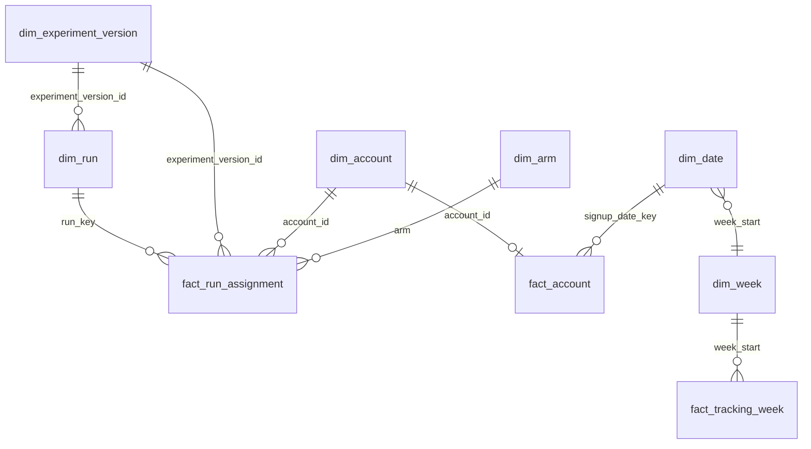

# BI package: reusable metric model for ProductSignal (P06-ART-06)

**Synthetic data only.** The model is a reusable metric layer over the observed synthetic history of `ps-20261026-20261026` (seed 20261026, generator `dataset_hash` `12672f9c39402517083bbbbe9164cbefe3435361dff086eb0d9e16e60f9b66f8`, contract v1, code revision `fdf911a`) as of **2026-10-05T00:00:00Z** and at the five logged analysis cutoffs of one onboarding experiment. Nothing in it is a measured effect on a real product and no benefit is claimed.
Every table is OBSERVED; there is no simulated table (the only simulation is the seeded generator that produced the history; its designed relationships, the injected instrumentation gap (INJ-10), v2's designed sample-ratio mismatch and its four outcome-informed choices are constructed, see `sql-analysis.md` section 10). The published v1 lift sits inside the gap: **published +9.50 pp, drawn +11.50 pp, +9.96 pp excluding the 11 gap accounts**, and it is **conclusive by a hair** (the lower bound is +0.000812); the model reports the published figure and cannot see the gap.
**The sample ratio comes first.** For a read whose sample ratio is a MISMATCH (v2) the outcome measures below return BLANK and `Outcomes Shown` is FALSE; the recomputed expected values emit no v2 outcome. The fact table `fact_run_assignment` still carries the 0/1 flags of every row (they are facts of the log, recomputable by anyone); the withholding is a rule of the measures, as on the site, not a property of the data.

## Verification status (stated plainly)
* **No `.pbix` was produced.** Power BI Desktop is not available here and was not run; no DAX engine evaluated any measure below. The DAX is **pseudocode in DAX syntax** (DAX-like) written to be pasted into a model, and it has not been executed (not executed in any engine).
* **What was checked instead:** the fact and dimension tables are the CSV exports of `data/sql/analysis/bi_dimensions.sql` and `bi_fact_*.sql` under `artifacts/bi/` (produced by `run_all.py --bi-out artifacts/bi`); the **definition of every measure was re-implemented in Python over those CSV files** (`run_all.py` `bi_measures`, no database and no domain code) and the results (`artifacts/bi/measures_recomputed.csv`, section 5) were compared with `data/sql/reference_metrics.sql` and the Python domain at every read (rows E of the reconciliation in `sql-analysis.md`, equal). That proves the definitions and the exports; it does not prove that a DAX engine returns the same figures.
* **Not checked:** DAX syntax and evaluation context (including `CHISQ.DIST.RT`, `T.INV.2T` and the `SELECTEDVALUE` pattern), Power Query typing in Desktop, visual layout, refresh. Anyone with Power BI Desktop can load the CSV files (the M below), paste the measures and compare each one with the expected table in section 5. Power BI Desktop is not available here and was not run.

## 1. How to read or use it without installing anything
Read this file; open any CSV in `artifacts/bi/` in a spreadsheet application (they are plain UTF-8, comma separated, header row, `\n` line ends, an empty cell = absent, never 0). With Power BI Desktop: Get Data > Text/CSV for each file, apply the types of section 3, create the relationships of section 2 and paste the measures of section 4 into a measures table; set `dim_run` to a single-select slicer (every experiment measure reads the selected run) and compare with the expected values of section 5. Nothing needs to be installed to read the definitions.

## 2. Star schema and relationships

All relationships are many-to-one from the fact to the dimension with single-direction filtering (dimension filters fact). `dim_week` (one row per distinct `week_start` of `dim_date`) and `dim_arm` (control, treatment) are built in Power Query. **A read is a run:** `fact_run_assignment` holds one row per assignment per read, only for the assignments that existed by that read's cutoff (the D-08 rule), so selecting `run_key = an-001` shows the 155 accounts assigned by 2026-05-18 and `an-004` the 400 of the final run. The slicer is the cutoff switch of the model.
The dimension `dim_experiment_version` carries the frozen plan's allocation, `z`, SRM threshold and minimum expected cell, so the sample-ratio and interval measures read the plan, not a constant.

## 3. Tables, grain and Power Query

| Table | Grain | Rows | CSV | Key columns |
|---|---|---|---|---|
| `fact_run_assignment` | one assignment per read (run_key) | 1,869 | `artifacts/bi/fact_run_assignment.csv` | `run_key`, `assignment_id`; `account_id`, `experiment_version_id`, `arm`, `assigned_at`, `signup_at`; flags `mature_7d`, `activated_7d` (empty when not mature), `exposed`, `guardrail_eligible`, `errored` (empty when not eligible); `revenue_usd` (empty when not mature) |
| `fact_account` | one account at the as-of | 600 | `artifacts/bi/fact_account.csv` | `account_id`; `is_internal`, `signup_at`, `signup_date_key`, `signup_week_local`; `mature_7d`, `activated_7d`, `mature_day7`, `retained_day7`, `retained_on_or_after_day7`, `mature_week4`, `retained_week4` (empty when the account has no signup or is not mature) |
| `fact_tracking_week` | one UTC week of `event_at` at the as-of | 26 | `artifacts/bi/fact_tracking_week.csv` | `week_start`; `rows_total`, `duplicates_dropped`, `canonical`, `delayed_over_24h`, `unknown_identity`, `bot_excluded`, `internal_excluded`, `analysed` |
| `dim_account` | one account | 600 | `artifacts/bi/dim_account.csv` | `account_id`, `plan`, `segment`, `timezone`, `is_internal`, `created_at` |
| `dim_date` | one UTC day | 183 | `artifacts/bi/dim_date.csv` | `date_key` (yyyymmdd), `date`, `week_start`, `month`, `weekday`, `iso_weekday` |
| `dim_experiment_version` | one experiment version with its frozen plan | 2 | `artifacts/bi/dim_experiment_version.csv` | `experiment_version_id`, `name`, `planned_end`, `allocation_control`, `allocation_treatment`, `z`, `confidence`, `srm_p_threshold`, `srm_min_expected_cell`, `guardrail_window_days`, `plan_frozen_at`, `config_hash` |
| `dim_run` | one logged run, plus the as-of read of each version | 7 | `artifacts/bi/dim_run.csv` | `run_key` (an-001 .. an-005, asof-xv-001, asof-xv-002), `experiment_version_id`, `run_kind`, `cutoff_at`, `is_interim`, `prior_runs` (empty for an as-of read) |
| `dim_event_name` | one event name | 8 | `artifacts/bi/dim_event_name.csv` | `event_name`, `rows_in_log` |
| `measures_recomputed` | one expected value of one measure in one slice (not a model table) | 135 | `artifacts/bi/measures_recomputed.csv` | `measure`, `slice`, `value` |

Power Query (M) for one table; the others differ only in the file name and the type list:
```m
let
    Source = Csv.Document(File.Contents("artifacts/bi/fact_run_assignment.csv"), [Delimiter = ",", Columns = 13, Encoding = 65001, QuoteStyle = QuoteStyle.Csv]),
    Header = Table.PromoteHeaders(Source, [PromoteAllScalars = true]),
    Typed = Table.TransformColumnTypes(Header, {
        {"run_key", type text}, {"assignment_id", type text}, {"account_id", type text}, {"experiment_version_id", type text}, {"arm", type text},
        {"assigned_at", type datetimezone}, {"signup_at", type datetimezone}, {"mature_7d", Int64.Type}, {"activated_7d", Int64.Type}, {"exposed", Int64.Type},
        {"guardrail_eligible", Int64.Type}, {"errored", Int64.Type}, {"revenue_usd", Currency.Type}})
in
    Typed
```
`dim_week = Table.Distinct(Table.SelectColumns(dim_date, {"week_start"}))` and `dim_arm = #table({"arm"}, {{"control"}, {"treatment"}})`. Empty strings in the 0/1 flags must load as null (not 0): a rate over a flag must never count an immature account.

## 4. Measures (DAX-like pseudocode, not executed)
Naming: every experiment measure reads the single selected run (`dim_run[run_key]`); a per-arm figure is evaluated under `dim_arm[arm]`; ratios use `DIVIDE`, so an empty population is BLANK, never 0 (P06-MET-07 and 08 behaviour on a zero denominator; a null relative lift is BLANK, never infinity). Money is USD only, so no currency guard is needed (the contract has no other currency).
```dax
Selected Run          = SELECTEDVALUE ( dim_run[run_key] )
Selected Version      = SELECTEDVALUE ( dim_run[experiment_version_id] )
Is Interim            = SELECTEDVALUE ( dim_run[is_interim] ) = 1

-- counts under the selected run (and, when dim_arm is in context, the arm)
Assigned Accounts     = COUNTROWS ( fact_run_assignment )
Mature Accounts       = CALCULATE ( COUNTROWS ( fact_run_assignment ), fact_run_assignment[mature_7d] = 1 )
Activated Accounts    = CALCULATE ( COUNTROWS ( fact_run_assignment ), fact_run_assignment[activated_7d] = 1 )
Exposed Accounts      = CALCULATE ( COUNTROWS ( fact_run_assignment ), fact_run_assignment[mature_7d] = 1, fact_run_assignment[exposed] = 1 )
Guardrail Eligible    = CALCULATE ( COUNTROWS ( fact_run_assignment ), fact_run_assignment[guardrail_eligible] = 1 )
Guardrail Errors      = CALCULATE ( COUNTROWS ( fact_run_assignment ), fact_run_assignment[errored] = 1 )

-- sample ratio first
Plan Allocation Control   = SELECTEDVALUE ( dim_experiment_version[allocation_control] )
Plan Allocation Treatment = SELECTEDVALUE ( dim_experiment_version[allocation_treatment] )
SRM Statistic =
    VAR n = [Assigned Accounts]
    VAR c = CALCULATE ( [Assigned Accounts], dim_arm[arm] = "control" )
    VAR t = CALCULATE ( [Assigned Accounts], dim_arm[arm] = "treatment" )
    RETURN DIVIDE ( ( c - n * [Plan Allocation Control] ) ^ 2, n * [Plan Allocation Control] ) + DIVIDE ( ( t - n * [Plan Allocation Treatment] ) ^ 2, n * [Plan Allocation Treatment] )
SRM P Value = IF ( NOT ISBLANK ( [SRM Statistic] ), CHISQ.DIST.RT ( [SRM Statistic], 1 ) )
SRM Verdict =
    VAR n = [Assigned Accounts]
    RETURN IF ( n = 0 || MIN ( n * [Plan Allocation Control], n * [Plan Allocation Treatment] ) < SELECTEDVALUE ( dim_experiment_version[srm_min_expected_cell] ), "INSUFFICIENT",
           IF ( [SRM P Value] < SELECTEDVALUE ( dim_experiment_version[srm_p_threshold] ), "MISMATCH", "OK" ) )
Outcomes Shown = [SRM Verdict] <> "MISMATCH"

-- rates and the lift (intention to treat on the mature assigned accounts)
Conversion Rate       = IF ( [Outcomes Shown], DIVIDE ( [Activated Accounts], [Mature Accounts] ) )
Exposure Rate         = DIVIDE ( [Exposed Accounts], [Mature Accounts] )
Guardrail Error Rate  = IF ( [Outcomes Shown], DIVIDE ( [Guardrail Errors], [Guardrail Eligible] ) )
Absolute Lift PP      = IF ( [Outcomes Shown], ( CALCULATE ( [Conversion Rate], dim_arm[arm] = "treatment" ) - CALCULATE ( [Conversion Rate], dim_arm[arm] = "control" ) ) * 100 )
Relative Lift         = IF ( [Outcomes Shown], DIVIDE ( [Absolute Lift PP] / 100, CALCULATE ( [Conversion Rate], dim_arm[arm] = "control" ) ) )   -- BLANK when the control rate is 0

-- Wilson and Newcombe at the plan's z (six decimals in the contract; ROUND ( ..., 6 ) when compared)
Wilson Low Treatment =
    VAR z = SELECTEDVALUE ( dim_experiment_version[z] ) VAR n = CALCULATE ( [Mature Accounts], dim_arm[arm] = "treatment" ) VAR p = CALCULATE ( [Conversion Rate], dim_arm[arm] = "treatment" )
    RETURN DIVIDE ( p + z ^ 2 / ( 2 * n ) - z * SQRT ( p * ( 1 - p ) / n + z ^ 2 / ( 4 * n ^ 2 ) ), 1 + z ^ 2 / n )
Wilson High Control  =    -- the same with the control arm and "+"; Wilson Low Control and Wilson High Treatment follow the same pattern
    VAR z = SELECTEDVALUE ( dim_experiment_version[z] ) VAR n = CALCULATE ( [Mature Accounts], dim_arm[arm] = "control" ) VAR p = CALCULATE ( [Conversion Rate], dim_arm[arm] = "control" )
    RETURN DIVIDE ( p + z ^ 2 / ( 2 * n ) + z * SQRT ( p * ( 1 - p ) / n + z ^ 2 / ( 4 * n ^ 2 ) ), 1 + z ^ 2 / n )
Newcombe Low  = IF ( [Outcomes Shown], [Absolute Lift PP] / 100 - SQRT ( ( CALCULATE ( [Conversion Rate], dim_arm[arm] = "treatment" ) - [Wilson Low Treatment] ) ^ 2 + ( [Wilson High Control] - CALCULATE ( [Conversion Rate], dim_arm[arm] = "control" ) ) ^ 2 ) )
Newcombe High = IF ( [Outcomes Shown], [Absolute Lift PP] / 100 + SQRT ( ( [Wilson High Treatment] - CALCULATE ( [Conversion Rate], dim_arm[arm] = "treatment" ) ) ^ 2 + ( CALCULATE ( [Conversion Rate], dim_arm[arm] = "control" ) - [Wilson Low Control] ) ^ 2 ) )
Interval Includes Zero = IF ( [Outcomes Shown], AND ( [Newcombe Low] <= 0, [Newcombe High] >= 0 ) )
Conclusive = IF ( [Outcomes Shown], AND ( AND ( NOT [Interval Includes Zero], NOT [Is Interim] ), [SRM Verdict] = "OK" ) )   -- plus a valid plan hash and a plan frozen before the first run (typed in the model: dim_experiment_version[config_hash], plan_frozen_at, dim_run[prior_runs])

-- revenue per assigned account (USD, zeros included, mature accounts)
Revenue Per Assigned Account = IF ( [Outcomes Shown], DIVIDE ( CALCULATE ( SUM ( fact_run_assignment[revenue_usd] ), fact_run_assignment[mature_7d] = 1 ), [Mature Accounts] ) )

-- accounts at the as-of (fact_account; mature flags are empty when immature)
Activation Rate All Signups       = DIVIDE ( CALCULATE ( COUNTROWS ( fact_account ), fact_account[activated_7d] = 1, dim_account[is_internal] = 0 ), CALCULATE ( COUNTROWS ( fact_account ), fact_account[mature_7d] = 1, dim_account[is_internal] = 0 ) )
Day 7 Retention                   = DIVIDE ( CALCULATE ( COUNTROWS ( fact_account ), fact_account[retained_day7] = 1 ), CALCULATE ( COUNTROWS ( fact_account ), fact_account[mature_day7] = 1 ) )              -- exact day 7, the account's own calendar
On Or After Day 7 Retention       = DIVIDE ( CALCULATE ( COUNTROWS ( fact_account ), fact_account[retained_on_or_after_day7] = 1 ), CALCULATE ( COUNTROWS ( fact_account ), fact_account[mature_day7] = 1 ) )    -- never mixed with the line above
Week 4 Retention                  = DIVIDE ( CALCULATE ( COUNTROWS ( fact_account ), fact_account[retained_week4] = 1 ), CALCULATE ( COUNTROWS ( fact_account ), fact_account[mature_week4] = 1 ) )

-- tracking quality (fact_tracking_week)
Rows Total              = SUM ( fact_tracking_week[rows_total] )
Duplicates Dropped      = SUM ( fact_tracking_week[duplicates_dropped] )
Delayed Over 24h        = SUM ( fact_tracking_week[delayed_over_24h] )
Delayed Share           = DIVIDE ( [Delayed Over 24h], SUM ( fact_tracking_week[canonical] ) )
Unknown Identity        = SUM ( fact_tracking_week[unknown_identity] )
Bot Events Excluded     = SUM ( fact_tracking_week[bot_excluded] )
Internal Events Excluded = SUM ( fact_tracking_week[internal_excluded] )
Analysed Events         = SUM ( fact_tracking_week[analysed] )
```
`Day 7 Retention` and `On Or After Day 7 Retention` carry a trap the model states instead of hiding: they are different populations of events with the same denominator, and mixing them is the P06-TEST-12 defect. `Activation Rate All Signups` is over every mature signup of the log (not the configured 28-day window of the published metric, 21 of 59 = 0.355932), so it equals investigation 01's ALL row (571 mature, 214 activated, 0.374781). The `fact_account` flags are the as-of; a model that needs a cutoff for the account metrics must add a cutoff-aware fact like `fact_run_assignment` (not built).

## 5. Expected values (recomputed from the CSV facts by `run_all.py`; reconciled to `reference_metrics.sql` and the Python domain)
Slices: `an-001` .. `an-005` are the logged runs, `asof-xv-001` and `asof-xv-002` the as-of read of each version (`slice` = run, or `run|arm`), `asof` the account and tracking facts. Values are the exact decimal strings the contract publishes (six places; percentage points and USD with two). Runs whose sample ratio is a MISMATCH (v2: `an-005` and `asof-xv-002`) carry only the assigned, mature, exposure and sample-ratio rows: no v2 outcome or lift is emitted.

<!-- BEGIN:bi_measures -->
| measure | slice | value |
|---|---|---|
| assigned_accounts | an-001/control | 77 |
| mature_accounts | an-001/control | 65 |
| exposure_rate | an-001/control | 0.892308 |
| activated_accounts | an-001/control | 18 |
| conversion_rate | an-001/control | 0.276923 |
| guardrail_error_rate | an-001/control | 0.184615 |
| revenue_per_assigned_account | an-001/control | 81.88 |
| assigned_accounts | an-001/treatment | 78 |
| mature_accounts | an-001/treatment | 64 |
| exposure_rate | an-001/treatment | 0.812500 |
| activated_accounts | an-001/treatment | 25 |
| conversion_rate | an-001/treatment | 0.390625 |
| guardrail_error_rate | an-001/treatment | 0.187500 |
| revenue_per_assigned_account | an-001/treatment | 85.64 |
| assigned_accounts | an-001 | 155 |
| srm_statistic | an-001 | 0.006452 |
| srm_verdict | an-001 | OK |
| absolute_lift_pp | an-001 | 11.37 |
| relative_lift | an-001 | 0.410590 |
| newcombe_low | an-001 | -0.048312 |
| newcombe_high | an-001 | 0.268068 |
| assigned_accounts | an-002/control | 127 |
| mature_accounts | an-002/control | 114 |
| exposure_rate | an-002/control | 0.877193 |
| activated_accounts | an-002/control | 34 |
| conversion_rate | an-002/control | 0.298246 |
| guardrail_error_rate | an-002/control | 0.166667 |
| revenue_per_assigned_account | an-002/control | 98.87 |
| assigned_accounts | an-002/treatment | 126 |
| mature_accounts | an-002/treatment | 115 |
| exposure_rate | an-002/treatment | 0.860870 |
| activated_accounts | an-002/treatment | 48 |
| conversion_rate | an-002/treatment | 0.417391 |
| guardrail_error_rate | an-002/treatment | 0.165217 |
| revenue_per_assigned_account | an-002/treatment | 98.82 |
| assigned_accounts | an-002 | 253 |
| srm_statistic | an-002 | 0.003953 |
| srm_verdict | an-002 | OK |
| absolute_lift_pp | an-002 | 11.91 |
| relative_lift | an-002 | 0.399488 |
| newcombe_low | an-002 | -0.004952 |
| newcombe_high | an-002 | 0.238174 |
| assigned_accounts | an-003/control | 177 |
| mature_accounts | an-003/control | 164 |
| exposure_rate | an-003/control | 0.890244 |
| activated_accounts | an-003/control | 53 |
| conversion_rate | an-003/control | 0.323171 |
| guardrail_error_rate | an-003/control | 0.164634 |
| revenue_per_assigned_account | an-003/control | 107.07 |
| assigned_accounts | an-003/treatment | 176 |
| mature_accounts | an-003/treatment | 164 |
| exposure_rate | an-003/treatment | 0.871951 |
| activated_accounts | an-003/treatment | 68 |
| conversion_rate | an-003/treatment | 0.414634 |
| guardrail_error_rate | an-003/treatment | 0.158537 |
| revenue_per_assigned_account | an-003/treatment | 123.55 |
| assigned_accounts | an-003 | 353 |
| srm_statistic | an-003 | 0.002833 |
| srm_verdict | an-003 | OK |
| absolute_lift_pp | an-003 | 9.15 |
| relative_lift | an-003 | 0.283019 |
| newcombe_low | an-003 | -0.012863 |
| newcombe_high | an-003 | 0.193048 |
| assigned_accounts | an-004/control | 200 |
| mature_accounts | an-004/control | 200 |
| exposure_rate | an-004/control | 0.875000 |
| activated_accounts | an-004/control | 63 |
| conversion_rate | an-004/control | 0.315000 |
| guardrail_error_rate | an-004/control | 0.155000 |
| revenue_per_assigned_account | an-004/control | 97.83 |
| assigned_accounts | an-004/treatment | 200 |
| mature_accounts | an-004/treatment | 200 |
| exposure_rate | an-004/treatment | 0.870000 |
| activated_accounts | an-004/treatment | 82 |
| conversion_rate | an-004/treatment | 0.410000 |
| guardrail_error_rate | an-004/treatment | 0.150000 |
| revenue_per_assigned_account | an-004/treatment | 130.95 |
| assigned_accounts | an-004 | 400 |
| srm_statistic | an-004 | 0.000000 |
| srm_verdict | an-004 | OK |
| absolute_lift_pp | an-004 | 9.50 |
| relative_lift | an-004 | 0.301587 |
| newcombe_low | an-004 | 0.000812 |
| newcombe_high | an-004 | 0.186863 |
| assigned_accounts | asof-xv-001/control | 200 |
| mature_accounts | asof-xv-001/control | 200 |
| exposure_rate | asof-xv-001/control | 0.875000 |
| activated_accounts | asof-xv-001/control | 63 |
| conversion_rate | asof-xv-001/control | 0.315000 |
| guardrail_error_rate | asof-xv-001/control | 0.155000 |
| revenue_per_assigned_account | asof-xv-001/control | 97.83 |
| assigned_accounts | asof-xv-001/treatment | 200 |
| mature_accounts | asof-xv-001/treatment | 200 |
| exposure_rate | asof-xv-001/treatment | 0.870000 |
| activated_accounts | asof-xv-001/treatment | 82 |
| conversion_rate | asof-xv-001/treatment | 0.410000 |
| guardrail_error_rate | asof-xv-001/treatment | 0.150000 |
| revenue_per_assigned_account | asof-xv-001/treatment | 130.95 |
| assigned_accounts | asof-xv-001 | 400 |
| srm_statistic | asof-xv-001 | 0.000000 |
| srm_verdict | asof-xv-001 | OK |
| absolute_lift_pp | asof-xv-001 | 9.50 |
| relative_lift | asof-xv-001 | 0.301587 |
| newcombe_low | asof-xv-001 | 0.000812 |
| newcombe_high | asof-xv-001 | 0.186863 |
| assigned_accounts | an-005/control | 62 |
| mature_accounts | an-005/control | 56 |
| exposure_rate | an-005/control | 0.928571 |
| assigned_accounts | an-005/treatment | 92 |
| mature_accounts | an-005/treatment | 87 |
| exposure_rate | an-005/treatment | 0.873563 |
| assigned_accounts | an-005 | 154 |
| srm_statistic | an-005 | 25.004329 |
| srm_verdict | an-005 | MISMATCH |
| assigned_accounts | asof-xv-002/control | 62 |
| mature_accounts | asof-xv-002/control | 57 |
| exposure_rate | asof-xv-002/control | 0.929825 |
| assigned_accounts | asof-xv-002/treatment | 92 |
| mature_accounts | asof-xv-002/treatment | 87 |
| exposure_rate | asof-xv-002/treatment | 0.873563 |
| assigned_accounts | asof-xv-002 | 154 |
| srm_statistic | asof-xv-002 | 25.004329 |
| srm_verdict | asof-xv-002 | MISMATCH |
| activation_rate_all_signups | asof | 0.374781 |
| day7_retention | asof | 0.187391 |
| on_or_after_day7_retention | asof | 0.598949 |
| week4_retention | asof | 0.332657 |
| rows_total | asof | 12552 |
| duplicates_dropped | asof | 124 |
| canonical | asof | 12428 |
| delayed_over_24h | asof | 237 |
| unknown_identity | asof | 30 |
| bot_excluded | asof | 305 |
| internal_excluded | asof | 114 |
| analysed | asof | 11979 |
<!-- END:bi_measures -->

Headline figures of the table: for `an-004`, 63 of 200 control and 82 of 200 treatment accounts activated (0.315000 and 0.410000), **absolute lift +9.50 pp, relative lift 0.301587, Newcombe interval +0.000812 to +0.186863**, SRM statistic 0.000000, exposure 0.875000 and 0.870000, guardrail error rate 0.155000 and 0.150000, revenue per assigned account USD 97.83 and USD 130.95; for `an-001` only the 155 accounts assigned by 2026-05-18 (77 and 78). The same figures come from `data/sql/reference_metrics.sql` and the Python domain at those cutoffs (rows E of the reconciliation).

## 6. Limits
* **Not executed in any DAX engine, no `.pbix`, Power BI Desktop not run.** A model built from this file must be validated against section 5 before it is trusted.
* **Withholding is a measure rule.** The facts keep the flags of v2; a user who sums them gets numbers that the sample-ratio mismatch forbids reading as a lift. Row-level restriction of those flags was not built.
* **Plan hash and freeze order are typed, not computed** in the model (`config_hash`, `plan_frozen_at`, `prior_runs` are columns); the DAX `Conclusive` therefore lists them as conditions to be read from the dimension.
* **Account facts are at one instant (the as-of).** There is no cutoff-aware account fact.
* **Segments are exploratory.** `dim_account[plan]`, `[segment]` and `[timezone]` slice every measure, and none of those slices is a decision basis (P06-DOMAIN-06); no multiplicity correction is built into the model.
* **The INJ-10 gap is not modelled.** The model reports the published lift; the drawn figure (+11.50) lives only in the generator's manifest, and the +9.96 sensitivity figure needs the gap accounts excluded, which the fact table does not flag.
* **Synthetic and observed in one draw**; four generator choices were made after looking at earlier drafts (`executive-memo.md`).
