# Entity-relationship diagram (P06-ART-03)

Derived from `data/migrations/0001_schema.sql` and `0002_constraints.sql` (dataset `ps-20261026-20261026`, generator `dataset_hash` `12672f9c39402517083bbbbe9164cbefe3435361dff086eb0d9e16e60f9b66f8`, contract v1, code revision `fdf911a`). **Synthetic data only.** The question the model serves: should an onboarding change ship, stop, or receive more investigation?
How to read it without installing anything: any Markdown viewer that renders Mermaid draws the diagram; otherwise the field lists below are the whole model. Types are those of the migration with the commas of `NUMERIC(p,s)` written `_` and `TEXT[]` written `TEXT_ARRAY` (Mermaid does not allow them). `PK` marks a primary-key column, `FK` a foreign key the database enforces; the logical joins listed at the end are not enforced.

```mermaid
erDiagram
    ps_timezones {
        TEXT name PK
    }
    accounts {
        TEXT account_id PK
        TEXT plan
        TEXT segment
        TIMESTAMPTZ created_at
        BOOLEAN internal
        TEXT timezone
    }
    users {
        TEXT user_id PK
        TEXT account_id FK
        TIMESTAMPTZ created_at
        TEXT timezone
        BOOLEAN bot_flag
    }
    identity_links {
        TEXT identity_link_id PK
        TEXT anonymous_id
        TEXT user_id FK
        TIMESTAMPTZ linked_at
        TEXT rule_version
        TEXT created_by
    }
    sessions {
        TEXT session_id PK
        TEXT user_id FK
        TIMESTAMPTZ started_at
        TIMESTAMPTZ ended_at
        TEXT device_type
    }
    events {
        TEXT event_id PK
        TEXT user_id
        TEXT anonymous_id
        TEXT event_name
        TIMESTAMPTZ event_at
        TIMESTAMPTZ received_at
        TEXT ingested_by
    }
    event_properties {
        TEXT property_id PK
        TEXT event_id FK
        TEXT property_key
        TEXT property_value
        TEXT value_type
    }
    subscriptions {
        TEXT subscription_id PK
        TEXT account_id FK
        TIMESTAMPTZ starts_at
        TIMESTAMPTZ ends_at
        TEXT status
        NUMERIC(14_2) amount_usd
    }
    experiment_versions {
        TEXT experiment_version_id PK
        TEXT name
        TEXT unit_type
        TEXT primary_metric
        TIMESTAMPTZ planned_end
    }
    analysis_plans {
        TEXT experiment_version_id PK
        JSONB plan
        TEXT config_hash
        TIMESTAMPTZ frozen_at
        TEXT frozen_by
    }
    assignments {
        TEXT assignment_id PK
        TEXT experiment_version_id FK
        TEXT unit_id FK
        TEXT variant
        TIMESTAMPTZ assigned_at
        TEXT created_by
    }
    exposures {
        TEXT exposure_id PK
        TEXT assignment_id FK
        TIMESTAMPTZ exposed_at
        TEXT surface
        TEXT event_id
        TEXT created_by
    }
    metric_observations {
        TEXT observation_id PK
        TEXT assignment_id FK
        TEXT metric_name
        TEXT value
        TIMESTAMPTZ window_end
    }
    analysis_runs {
        TEXT analysis_id PK
        TEXT experiment_version_id FK
        TIMESTAMPTZ cutoff_at
        TEXT config_hash
        TIMESTAMPTZ created_at
        TEXT created_by
        BOOLEAN interim
        TEXT srm_verdict
        BOOLEAN conclusive
        INT prior_runs
        JSONB result
    }
    funnel_definitions {
        TEXT definition_id PK
        INT version PK
        TEXT_ARRAY steps
        INT max_gap_hours
        TIMESTAMPTZ window_from
        TIMESTAMPTZ window_to
        TEXT created_by
        TIMESTAMPTZ created_at
    }
    metric_config {
        INT id PK
        JSONB windows
    }
    guardrail_reviews {
        TEXT review_id PK
        TEXT analysis_id FK
        TEXT experiment_version_id FK
        TEXT verdict
        JSONB result
        TEXT reviewed_by
        TIMESTAMPTZ reviewed_at
    }
    decisions {
        TEXT decision_id PK
        TEXT experiment_version_id FK
        TEXT analysis_id FK
        TEXT review_id FK
        TEXT decision
        TEXT basis
        TEXT rationale
        TEXT decided_by
        TEXT decided_role
        TIMESTAMPTZ decided_at
        JSONB evidence
    }
    rejected_records {
        TEXT batch_id PK
        TEXT entity PK
        TEXT id PK
        TEXT reason_code PK
        JSONB raw_row
        INT ordinal PK
        TIMESTAMPTZ created_at
    }
    audit_events {
        TEXT event_id PK
        TEXT entity_type
        TEXT entity_id
        TEXT experiment_version_id
        TEXT action
        TEXT actor_id
        TIMESTAMPTZ occurred_at
        INT before_version
        INT after_version
        TEXT reason
        TEXT request_id
        JSONB details
    }
    command_results {
        TEXT idempotency_key PK
        TEXT payload_hash
        TEXT actor_id
        TEXT actor_role
        TEXT command_id
        TEXT status
        JSONB result
        TIMESTAMPTZ created_at
    }
    dataset_versions {
        TEXT dataset_version PK
        TEXT dataset_hash
        TEXT contract_version
        TIMESTAMPTZ created_at
    }
    t_critical_975 {
        INT df PK
        NUMERIC(30_20) t
    }
    accounts ||--o{ users : "has"
    accounts ||--o{ subscriptions : "pays"
    accounts ||--o{ assignments : "is randomised as"
    users ||--o{ identity_links : "is linked by"
    users ||--o{ sessions : "starts"
    events ||--o{ event_properties : "carries"
    experiment_versions ||--o{ assignments : "assigns"
    assignments ||--o{ exposures : "is exposed by"
    assignments ||--o{ metric_observations : "is observed by"
    experiment_versions ||--o{ analysis_runs : "is analysed by"
    analysis_runs ||--o{ guardrail_reviews : "is reviewed by"
    analysis_runs ||--o{ decisions : "is decided by"
    guardrail_reviews ||--o{ decisions : "is cited by"
    experiment_versions ||--o{ guardrail_reviews : "scopes"
    experiment_versions ||--o{ decisions : "scopes"
```

## Field lists
Every table of `0001_schema.sql`, with the columns of the diagram. Kind, grain and update semantics are in `data-dictionary.md` section 1.

| Table | Columns |
|---|---|
| `ps_timezones` | `name` |
| `accounts` | `account_id`, `plan`, `segment`, `created_at`, `internal`, `timezone` |
| `users` | `user_id`, `account_id`, `created_at`, `timezone`, `bot_flag` |
| `identity_links` | `identity_link_id`, `anonymous_id`, `user_id`, `linked_at`, `rule_version`, `created_by` |
| `sessions` | `session_id`, `user_id`, `started_at`, `ended_at`, `device_type` |
| `events` | `event_id`, `user_id`, `anonymous_id`, `event_name`, `event_at`, `received_at`, `ingested_by` |
| `event_properties` | `property_id`, `event_id`, `property_key`, `property_value`, `value_type` |
| `subscriptions` | `subscription_id`, `account_id`, `starts_at`, `ends_at`, `status`, `amount_usd` |
| `experiment_versions` | `experiment_version_id`, `name`, `unit_type`, `primary_metric`, `planned_end` |
| `analysis_plans` | `experiment_version_id`, `plan`, `config_hash`, `frozen_at`, `frozen_by` |
| `assignments` | `assignment_id`, `experiment_version_id`, `unit_id`, `variant`, `assigned_at`, `created_by` |
| `exposures` | `exposure_id`, `assignment_id`, `exposed_at`, `surface`, `event_id`, `created_by` |
| `metric_observations` | `observation_id`, `assignment_id`, `metric_name`, `value`, `window_end` |
| `analysis_runs` | `analysis_id`, `experiment_version_id`, `cutoff_at`, `config_hash`, `created_at`, `created_by`, `interim`, `srm_verdict`, `conclusive`, `prior_runs`, `result` |
| `funnel_definitions` | `definition_id`, `version`, `steps`, `max_gap_hours`, `window_from`, `window_to`, `created_by`, `created_at` |
| `metric_config` | `id`, `windows` |
| `guardrail_reviews` | `review_id`, `analysis_id`, `experiment_version_id`, `verdict`, `result`, `reviewed_by`, `reviewed_at` |
| `decisions` | `decision_id`, `experiment_version_id`, `analysis_id`, `review_id`, `decision`, `basis`, `rationale`, `decided_by`, `decided_role`, `decided_at`, `evidence` |
| `rejected_records` | `batch_id`, `entity`, `id`, `reason_code`, `raw_row`, `ordinal`, `created_at` |
| `audit_events` | `event_id`, `entity_type`, `entity_id`, `experiment_version_id`, `action`, `actor_id`, `occurred_at`, `before_version`, `after_version`, `reason`, `request_id`, `details` |
| `command_results` | `idempotency_key`, `payload_hash`, `actor_id`, `actor_role`, `command_id`, `status`, `result`, `created_at` |
| `dataset_versions` | `dataset_version`, `dataset_hash`, `contract_version`, `created_at` |
| `t_critical_975` | `df`, `t` |

## Logical joins (not enforced by the database)
* `events.user_id` to `users.user_id` and `events.anonymous_id` to `identity_links.anonymous_id`: an event of an unknown identity is logged and excluded, not rejected.
* `analysis_plans.experiment_version_id` to `experiment_versions.experiment_version_id`: a plan is configuration; C06 checks the version exists.
* `exposures.event_id` to `events.event_id`: optional, NULL on every row.
* `analysis_runs.config_hash` to `analysis_plans.config_hash`: a run cites the plan it used; `config_hash_matches_plan` is reported, not enforced.
* `audit_events.entity_id` to the entity named by `entity_type`.
* Tables without a relationship line (`ps_timezones`, `t_critical_975`, `metric_config`, `funnel_definitions`, `rejected_records`, `command_results`, `dataset_versions`, `analysis_plans`, `audit_events`) are reference, configuration or operational tables joined by value, not by foreign key.

## Reading the diagram for the decision
The path that decides: `accounts` (the unit) -> `assignments` (fixed variant, the cutoff rule reads `assigned_at`) -> `exposures` (reported beside intention to treat) and `metric_observations` -> `analysis_runs` (cites the frozen `analysis_plans.config_hash`) -> `guardrail_reviews` -> `decisions` (ship, stop or inconclusive; writes no product state). Events and sessions feed the outcomes through the canonical log (`events` by `received_at <= cutoff`, `identity_links` forward only).
