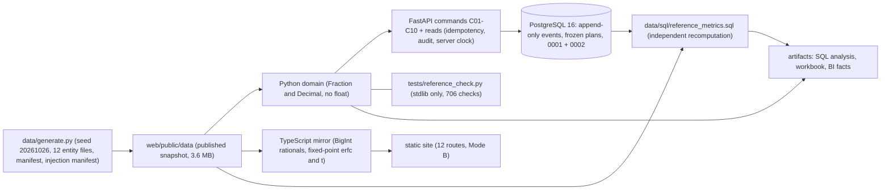

# Technical case study: ProductSignal (P06-ART-09)

**Synthetic data only.** A product-journey laboratory where the experiment read is built before the dashboard, for the decision **should an onboarding change ship, stop, or receive more investigation?** Dataset `ps-20261026-20261026` (seed 20261026, generator hash `12672f9c39402517083bbbbe9164cbefe3435361dff086eb0d9e16e60f9b66f8`), contract v1 (D-01 .. D-10), code revision `fdf911a`; republished on `unified-portfolio` as `e360bf1` (rollback `6e381bf`, first publication of `d7111f1`). Observed, constructed and hypothetical results are kept apart: the measurements below are OBSERVED in one draw of a seeded generator; the designed effect (+8.00 pp), v2's sample-ratio mismatch and the INJ-10 instrumentation gap are constructed (`sql-analysis.md`); no real-world benefit is claimed. The final v1 run is **conclusive by a hair** (Newcombe lower bound +0.000812) and its published lift (+9.50 pp) sits inside the gap (drawn +11.50, +9.96 excluding the 11 gap accounts).
How to read it without installing anything: each section is self-contained; the commands of "Reproducible setup" reproduce every number, and `release-package.md` lists what was run.

## Architecture

* **One contract, four implementations.** The Python domain (`domain/productsignal`: `contract`, `timeutil`, `stats`, `models`, `events`, `ingest`, `metrics`, `pipeline`), the SQL reference (`data/sql/reference_metrics.sql`, facts only, one row, one jsonb column per metric), the TypeScript mirror (`web/src/domain`, BigInt rationals, erfc and the Student t quantile in fixed point) and the standard-library oracle (`tests/reference_check.py`, 706 checks, imports nothing from the app) compute the same metric keys from the same records; they are compared key by key.
* **The account is the unit.** Events roll up to the account before any ratio; the experiment, activation, retention and revenue are account-level; the visitor funnel and signup conversion use the visitor key.
* **The immutable log.** `events`, `event_properties`, `identity_links`, `sessions`, `assignments`, `exposures`, `metric_observations`, `analysis_plans`, `analysis_runs`, `funnel_definitions`, `guardrail_reviews`, `decisions`, `audit_events` and `rejected_records` refuse UPDATE, DELETE and TRUNCATE by trigger. A run at cutoff C canonicalises the log per run: received by C, deduplicated (the earliest received wins), identity forward only, bots, internal accounts and unknown identities excluded and counted.
* **The D-08 cutoff rule.** A run at cutoff C sees only the facts that existed by C: assignments with `assigned_at <= C`, exposures with `exposed_at <= C`, subscriptions with `starts_at <= C`, observations with `window_end <= C`, events received by C. It is applied identically in the domain, the SQL reference and the API (`GET /metrics`, C07, C08), because the generator worker found that an interim run at 2026-05-18 had counted 400 assigned accounts and the SRM counts 200 / 200 although only 155 accounts (77 and 78) existed by then. The frozen plan, runs and decisions are records, not measurements, so they are not cut by instant; a later cutoff includes late rows as a disclosed revision, never a rewrite.
* **Fact-time server stamping (D-10, R6-05).** `assigned_at` (C04), `exposed_at` (C05) and `decided_at` (C10) are stamped with the API clock (`api/clock.py`), `received_at` of an event too; an instant stated by a client needs the role admin **and** `backfill: true` together (403 `BACKFILL_ADMIN_ONLY`, 422 `BACKFILL_FLAG_REQUIRED`, 422 `<FIELD>_IN_FUTURE`) and the audit row records it. Without it a client could date an assignment before a published run and silently change that run; with it, an assignment or exposure at or before a logged run's cutoff is refused (`ASSIGNMENT_BEFORE_PUBLISHED_RUN`, `EXPOSURE_BEFORE_PUBLISHED_RUN`), a cutoff after the clock is `CUTOFF_IN_FUTURE`, and a second C08 at the same cutoff returns the same answer.
* **The decision rule.** `conclusive` = the Newcombe interval excludes 0 AND a final run AND a valid plan hash AND `plan_frozen` (frozen at or before the first logged run) AND an OK sample ratio, the same in Python, SQL, TypeScript and the oracle. C10 refuses `ship` on an interim run, a MISMATCH, a harmful guardrail, a plan deviation or a hash mismatch, refuses `stop` on a MISMATCH, allows `inconclusive` always, writes no product state and audits every refusal.
* **Two modes, disclosed.** Mode A (backend: PostgreSQL 16, FastAPI) is verified on GitHub-hosted runners; Mode B (static site over the snapshot) simulates its registry and decision actions in browser memory and says so (`docs/contracts.md` mode disclosure).

## Trade-offs
| Decision | Chosen | Alternative | Why / cost |
|---|---|---|---|
| Arithmetic | Exact rationals and decimals in Python, BigInt in TypeScript, `numeric` in SQL | floats | A published figure is reproducible to the sixth decimal in four implementations; costs speed and a hand-written erfc, square root and Student t quantile (the SQL reads the t table generated by Python) |
| Unit | The account | the user | Users of one account are not independent; a user-level analysis is refused (`UNIT_MISMATCH`); costs sample size |
| Interval for the lift | Newcombe hybrid score on the difference | Wald, exact | Valid at small counts and near 0 or 1; the golden interval -0.020249 to +0.216734 is pinned; costs an iteration-free but unfamiliar formula |
| Randomisation of v1 | Permuted blocks of four | a fair coin | The first draft gave 223 / 177 (p 0.021); blocks make "v1 passes the sample-ratio check" a property of the design. **Chosen after seeing that draw** (one of four outcome-informed choices, disclosed) |
| Fact instants | Server clock; admin backfill with a flag | client-stated | The cutoff rule is meaningless if a client can date a fact before a published run; costs flexibility for imports (an audited backfill) |
| Cutoff rule | Facts by C | the full data with a plan-window filter | An interim run must not read the future; costs a rule in three implementations and a regression test in each |
| Plan hash | sha256 of key-sorted compact JSON, SQL and Python | a stored flag | A run can cite and re-verify the plan it used; costs a canonical-JSON function in PostgreSQL |
| Sample ratio | Chi-square, df 1, plan names exactly two arms | any number of arms | The lift is treatment minus control; three arms are `VARIANTS_NOT_TWO` (D-10) |
| Segments | Exploratory with a Bonferroni family | confirmatory | Cherry-picking is the failure; costs power; the site corrects k = 9, the API's single split keeps its own k (documented) |
| Public site | Static snapshot, simulated actions | a live API | No server, no secret and no write path on GitHub Pages; costs interactivity (nothing ships from the site) |
| Independence | A standard-library oracle, an SQL reference and a TypeScript mirror | one implementation | A disagreement is a finding; costs 3 more implementations to maintain |

## Recovery behaviour (observed in tests)
| Situation | Behaviour | Test |
|---|---|---|
| The same idempotency key and payload again | the stored response is replayed and nothing is written | `test_idempotent_replay_returns_the_stored_response_and_writes_nothing` |
| The key reused with another payload, actor or role | 409 `IDEMPOTENCY_KEY_REUSED` | `test_the_key_is_bound_to_the_payload_the_actor_and_the_role` |
| A command with a stale dataset version | 409 `STALE_DATASET_VERSION`, nothing written | `test_a_stale_dataset_version_is_409_and_nothing_is_written` |
| A failure between the effect and its audit row | the transaction rolls back: no effect, no audit, no stored result | `test_a_command_and_its_audit_row_commit_together_or_not_at_all` |
| A deadlock | retried three times, then 409 `CONCURRENT_UPDATE` (tested by injection, not a real deadlock) | `test_a_deadlock_is_retried_three_times_then_409_concurrent_update` |
| Two threads assign one account | exactly one assignment; the loser is 409 `ASSIGNMENT_CONFLICT` | `test_two_threads_assigning_one_unit_leave_one_assignment` |
| Two concurrent decisions on one run | exactly one decision | `test_two_concurrent_decisions_on_one_run_leave_one_decision` |
| A re-sent event | the same id and content is idempotent, other content is rejected, a re-send under a new id is dropped as a duplicate per run | `test_a_repeated_event_id_is_idempotent_and_a_changed_one_is_rejected` |
| A late event | changes only a later run, with a disclosed revision; the earlier result is never rewritten | `test_06_a_late_event_changes_only_a_later_run_and_the_revision_is_disclosed` |
| A row dated after the cutoff | not in the run (domain, SQL and API) | `test_domain_ignores_rows_dated_after_the_cutoff`, `test_sql_reference_ignores_rows_dated_after_the_cutoff` |
| A future cutoff | 422 `CUTOFF_IN_FUTURE`, no run, observation or audit row | `test_R6_04_a_cutoff_after_the_api_clock_is_refused` |
| An interim run presented as final | the run is labelled interim with its prior-run count; ship is refused | `test_03_an_interim_result_presented_as_final_cannot_support_ship` |
| A sample-ratio mismatch | shown before any lift; ship and stop refused | `test_c10_a_sample_ratio_mismatch_blocks_ship_and_stop` |
| A refused decision | one `record-decision-refused` audit row in its own transaction | `test_R6_07_every_refused_decision_leaves_an_audit_row` |
| Per-arm outcomes read before the freeze | 409 `PLAN_NOT_FROZEN`, no per-arm figure | `test_R6_06_per_arm_outcomes_are_withheld_until_the_plan_is_frozen_and_a_freeze_cannot_be_backdated` |
| Any write to an append-only table | the database refuses (UPDATE, DELETE, TRUNCATE) | `test_the_database_refuses`, `test_decisions_and_reviews_are_constrained_and_append_only` |
| The SQL reference under another session TimeZone | the same answer (hour-based intervals) | `test_R6_03_the_sql_reference_gives_the_same_answer_in_every_session_time_zone` |
| A migration file changed after it was applied | refused | `test_changed_migration_is_detected` |

## Reproducible setup
```
cd apps/productsignal
pip install -r requirements.txt                                                       # fastapi 0.162, pydantic 2.14, psycopg 3.3, pytest 9.1, openpyxl 3.1.5
../../.venv/bin/python -I tests/reference_check.py                                    # ALL OK (706 checks)
DATABASE_URL=postgresql://<user>:<password>@<host>:5432/<database> ../../.venv/bin/python -m pytest -q -p no:cacheprovider
../../.venv/bin/python data/generate.py                                               # byte-identical entity files (dataset_hash unchanged)
cd web && npm ci && npm run check && npm run build:pages && npm run e2e               # 2,519 golden + 36 review checks; 77 browser tests
# artifacts
../../.venv/bin/python data/sql/analysis/run_all.py --json artifacts/analysis-results.json --bi-out artifacts/bi    # creates and drops artifacts06_* databases
../../.venv/bin/python artifacts/render_sql_analysis.py && ../../.venv/bin/python artifacts/build_workbook.py --recalc
../../.venv/bin/python artifacts/checksums.py --table && sha256sum -c artifacts/CHECKSUMS.txt
```
The database URL placeholders are the caller's; the CI workflow's throwaway `postgres:16` service is created per run. The analysis scripts create and drop scratch databases named `artifacts06_*` (a schema cannot stand in for a database: `0002_constraints.sql` looks constraint names up globally) and refuse any other name.

## Measured evidence
| What | Result | Where |
|---|---|---|
| Independent oracle (stdlib only) | ALL OK (706 checks) | `tests/reference_check.py`; this pass: exit 0 |
| Python suite | 357 passed (the DB suite takes about three and a half minutes) | `uat-evidence.md` at `fdf911a`; hosted CI `40435203915` (Mode A, success, per the ledger) |
| TypeScript golden and snapshot checks | 2,519 checks plus 36 review checks | `npm run check` at `fdf911a`; hosted CI `40435203915` (Mode B) |
| Browser tests | 77 passed (12 journeys and 65 screens at 360, 768, 1280, 1920 and 200% zoom) | `web/evidence/playwright-report.json`; hosted CI `40435203915` |
| Hosted CI of the site commit | both jobs success | `d7111f1`, run `40426536267` |
| Live check | all jobs success for the first publication and the republish | runs `40426869172` (portfolio `6e381bf`) and `40435315836` (portfolio `e360bf1`) |
| Reviewer harness | 13 hand-built worlds agree across hand, Python, SQL and TypeScript; a three-variant plan is a rejection everywhere | `uat-evidence.md` |
| SQL analysis (this package) | 8 numbered investigations, the golden known answer and **296 reconciliation rows, all equal** | `data/sql/analysis/run_all.py` -> `artifacts/analysis-results.json` |
| Workbook | `Metrics!E3` TRUE for all five runs after LibreOffice recalculation | `tests/test_artifacts.py` |
| Result of the experiment (OBSERVED) | v1 final: 63 / 200 against 82 / 200, +9.50 pp, +0.000812 to +0.186863, conclusive by a hair; v2: chi-square 25.004329, MISMATCH, no lift | `sql-analysis.md` sections 5 and 6 |

The hosted run ids are copied from the committed ledgers (`docs/program/verification-ledger.json`) and were not fetched by this package; no hosted run of `tests/test_artifacts.py` is recorded yet.

## Open gaps
* **Excel and Power BI Desktop were not run.** The workbook was recalculated by LibreOffice only; the BI package has no `.pbix` and its DAX was not executed (`bi-package.md`).
* **The INJ-10 gap is disclosed, not corrected**: the domain cannot see it, and the published lift is below the drawn one.
* **Four outcome-informed generator choices** (v1 randomisation, the error model, two count tunings, the INJ-06 window) mean the world is not a neutral draw; the realised results are one draw.
* **The mismatch of v2 and the pass of v1 are constructed**, not findings about a randomiser.
* **Daylight-saving edges are not pinned by the fixture**; three-variant experiments are refused; the API's single-split segment read keeps its own Bonferroni k; refusals before the C10 handler leave no audit row; the deadlock retry is tested by injection.
* **The public site simulates its registry and decision actions** in browser memory; the transactional behaviour is not served by GitHub Pages.
* **Hosted evidence for the artifact tests is not recorded** and `tests/test_artifacts.py` skips its LibreOffice and database parts when those are unavailable.
