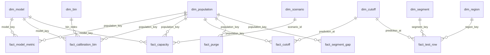

# BI package: reusable metric model for RetentionLab (P10-ART-06)

**Synthetic data; economics are hypothetical and labelled by population; no retention improvement is claimed.** Dataset `rl-20261026-20261026`, `dataset_hash` `9ebaaadab8a2f70e5f25820616391ee0aec55fbf0b121dee25460de469821b1c`, code revision `ce96e65`, as-of 2026-10-05T00:00:00Z. Files: `artifacts/bi/*.csv` (7 dimensions, 8 facts, `measures_recomputed.csv`), produced by `data/sql/analysis/run_all.py --bi-out artifacts/bi` from the queries `bi_dimensions.sql` and `bi_fact_*.sql`.

## Verification status (stated plainly)
* **Verified:** the CSV files equal the output of the SQL queries on the scratch database (`tests/test_artifacts.py` re-runs them when the scratch URLs are set); every measure in section 5 was recomputed from the CSV facts in plain Python (exact fractions, no database, no domain) and reconciled to the analysis, `reference_metrics.sql` and the domain (reconciliation group E, 52 rows).
* **NOT verified, not run:** Power BI Desktop and the Power BI service were not run; no `.pbix` exists and none is claimed. The DAX in section 4 is pseudocode, never executed; the Power Query in section 3 is a template, never executed. Excel was not run either.

## 1. How to read or use it without installing anything
Open the CSV files in any text editor or spreadsheet; `measures_recomputed.csv` is the answer sheet (one row per measure x population x slice). To build a model in Power BI, load the dimensions and facts as below, relate them as in section 2 and write the measures of section 4; compare each against section 5. Nothing needs installing to read this file.

## 2. Star schema and relationships



All relationships are many-to-one from fact to dimension, single direction. Text list of the same relationships: every `population_key` in a fact is in `dim_population` (`test_world`, `cohort_200`, `world_2400`); every `model_key` in `dim_model`; every `scenario_id` in `dim_scenario` (`sc-001`..`sc-003`); every `prediction_at` of `fact_cutoff` in `dim_cutoff` (21 monthly cutoffs). `fact_segment_gap` carries its own group key (`dimension`, `group_key`) and a `population_key`; `fact_drift` carries `source` (which says whether the row is the published 2,400-account series or a recomputation from the 442-account test table), `grp` and `prediction_at`, and relates to `dim_cutoff` by `prediction_at`. The population key is part of every economics row: **an economics value is meaningless without its population.**

## 3. Tables, grain and Power Query

| Table | Grain | Rows | Notes |
|---|---|---|---|
| `dim_population` | population | 3 | `test_world` (1,513 rows, outcomes known), `cohort_200`, `world_2400` |
| `dim_model` | model | 5 | four models plus the logistic regression before Platt |
| `dim_cutoff` | monthly cutoff | 21 | split range, label-window close, whether it matures by the as-of |
| `dim_scenario` | scenario | 3 | capacity, contact cost, assumed effect, margin; label `hypothetical` |
| `dim_segment`, `dim_region`, `dim_bin` | group / bin | 4, 5, 10 | |
| `fact_test_row` | account x test cutoff | 1,513 | features, outcome and the five probability columns |
| `fact_model_metric` | model | 5 | AP, Brier, mean probability; interpretation column says "met by construction (D-G02)" |
| `fact_calibration_bin` | model x bin | 20 | empty bins are rows with null measures |
| `fact_capacity` | population x model x scenario | 18 | ranking metrics where outcomes are known; economics only for the censored queue, labelled HYPOTHETICAL |
| `fact_cutoff` | population x cutoff | 42 | eligible, mature, censored, churned, shares |
| `fact_drift` | source x group x cutoff | 91 | `published full world` and `recomputed from the test table`; floored bins flagged |
| `fact_purge` | population x range | 8 | retained and dropped by reason |
| `fact_segment_gap` | dimension x group | 9 | calibration gap in percentage points |

Power Query template (not executed):

```
let
    Source   = Csv.Document(File.Contents("fact_test_row.csv"), [Delimiter = ",", Encoding = 65001, QuoteStyle = QuoteStyle.Csv]),
    Promoted = Table.PromoteHeaders(Source, [PromoteAllScalars = true]),
    Typed    = Table.TransformColumnTypes(Promoted, {{"row_no", Int64.Type}, {"account_id", Int64.Type}, {"churned", Int64.Type},
                 {"p_logistic_regression", type number}, {"p_random_baseline", type number}, {"p_business_rule", type number},
                 {"p_prevalence_baseline", type number}, {"p_logistic_uncalibrated", type number}}, "en-US")
in  Typed
```
Empty strings in the CSV mean null (a missing feature, an empty bin); keep them null, never zero.

## 4. Measures (DAX-like pseudocode, not executed)

```
Evaluated Rows        = COUNTROWS(fact_test_row)
Churning Rows         = SUM(fact_test_row[churned])
Prevalence            = DIVIDE([Churning Rows], [Evaluated Rows])
Brier Score (selected)= AVERAGEX(fact_test_row, ([Selected P] - fact_test_row[churned]) ^ 2)     -- Selected P = SWITCH(model slicer, ...)
Average Precision     = AVERAGEX(FILTER(fact_test_row, fact_test_row[churned] = 1),
                           DIVIDE(COUNTROWS(FILTER(fact_test_row, [P] >= EARLIER([P]) && fact_test_row[churned] = 1)),
                                  COUNTROWS(FILTER(fact_test_row, [P] >= EARLIER([P])))))       -- tied probabilities are one threshold
Precision at K        = DIVIDE(SUMX(TOPN([K], fact_test_row, [P], DESC, fact_test_row[account_id], ASC, fact_test_row[prediction_at], ASC), fact_test_row[churned]), [K])
Recall at K           = DIVIDE(SUMX(TOPN(...same...), fact_test_row[churned]), [Churning Rows])
Risk Lift at K        = DIVIDE([Precision at K], [Prevalence])                                   -- a ranking statistic, NOT uplift
Calibration Gap (pp)  = IF(COUNTROWS(bin rows) = 0, BLANK(), (AVERAGEX(bin rows, [P]) - DIVIDE(SUM(bin churned), COUNTROWS(bin rows))) * 100)
Censored Share        = DIVIDE(SUM(fact_cutoff[censored]), SUM(fact_cutoff[eligible]))
Mature Churn Rate     = DIVIDE(SUM(fact_cutoff[churned]), SUM(fact_cutoff[mature]))               -- BLANK for a cutoff with no mature row
Contact Budget        = SUM(fact_capacity[contact_budget])                                        -- HYPOTHETICAL; slice by population_key
Expected Value (HYP.) = SUM(fact_capacity[expected_value])                                        -- HYPOTHETICAL; always shown with population_key and scenario_id
Treatment Effect      = BLANK()   -- withheld: no randomised experiment exists; the measure exists so that its absence is visible
```
Rules for the report: show the population next to any economics figure; never sum economics across populations; show `Evaluated Rows` and the distinct-account count beside any rate; label every margin of the logistic model "met by construction"; show empty calibration bins as empty, not zero; show `tie_split_at_k` beside precision at K for the rule and the prevalence constant.

## 5. Expected values (recomputed from the CSV facts by `run_all.py`; reconciled to the analysis, the reference SQL and the domain)
Every cell of the measure grid has a row. A null has a stated status (`null: outcomes censored`, `null: empty bin`, `null: no mature row`, `withheld: no randomised experiment`); nothing is dropped. `result_kind` is `simulated` (one draw of the synthetic world) or `hypothetical` (assumption-based).

<!-- BEGIN:bi_measures -->
| measure | population | slice | value | numerator | denominator | status | result_kind | note |
|---|---|---|---|---|---|---|---|---|
| evaluated_rows | test_world | all | 1513 |  |  | value | simulated |  |
| distinct_accounts | test_world | all | 442 |  |  | value | simulated | rows are not accounts: overlapping cutoffs of one account are correlated, so no interval is given |
| prevalence | test_world | all | 0.124917 | 189 | 1513 | value | simulated |  |
| average_precision | test_world | random_baseline | 0.126793 |  |  | value | simulated | scikit-learn step form over distinct probabilities |
| brier_score | test_world | random_baseline | 0.326543 |  |  | value | simulated | mean((p - y)^2) on one population |
| average_precision | test_world | business_rule | 0.136653 |  |  | value | simulated | scikit-learn step form over distinct probabilities |
| brier_score | test_world | business_rule | 0.109255 |  |  | value | simulated | mean((p - y)^2) on one population |
| average_precision | test_world | logistic_regression | 0.238552 |  |  | value | simulated | scikit-learn step form over distinct probabilities |
| brier_score | test_world | logistic_regression | 0.105019 |  |  | value | simulated | mean((p - y)^2) on one population |
| average_precision | test_world | prevalence_baseline | 0.124917 |  |  | value | simulated | scikit-learn step form over distinct probabilities |
| brier_score | test_world | prevalence_baseline | 0.109664 |  |  | value | simulated | mean((p - y)^2) on one population |
| average_precision | test_world | logistic_uncalibrated | 0.238552 |  |  | value | simulated | scikit-learn step form over distinct probabilities |
| brier_score | test_world | logistic_uncalibrated | 0.104515 |  |  | value | simulated | mean((p - y)^2) on one population |
| ap_margin_over_rule | test_world | declared 0.030000 | 0.101899 |  |  | met, by construction (D-G02) | simulated | a property of the synthetic world, not evidence about real accounts |
| ap_margin_over_random | test_world | declared 0.050000 | 0.111759 |  |  | met, by construction (D-G02) | simulated | a property of the synthetic world, not evidence about real accounts |
| brier_margin_under_rule | test_world | declared 0.002000 | 0.004236 |  |  | met, by construction (D-G02) | simulated | a property of the synthetic world, not evidence about real accounts |
| brier_margin_under_random | test_world | declared 0.050000 | 0.221524 |  |  | met, by construction (D-G02) | simulated | a property of the synthetic world, not evidence about real accounts; uninformative: a uniform random score cannot beat about 0.33 |
| ap_margin_over_prevalence_constant | test_world | reference | 0.113635 |  |  | reference, not a target | simulated | a property of the synthetic world, not evidence about real accounts |
| brier_margin_under_prevalence_constant | test_world | reference | 0.004645 |  |  | reference, not a target | simulated | a property of the synthetic world, not evidence about real accounts |
| precision_at_k | test_world | random_baseline/K=5 | 0.000000 | 0 | 5 | value | simulated |  |
| recall_at_k | test_world | random_baseline/K=5 | 0.000000 | 0 | 189 | value | simulated |  |
| risk_lift_at_k | test_world | random_baseline/K=5 | 0.000000 | 0 | 5 | value | simulated | a ranking statistic, not treatment uplift |
| precision_at_k | test_world | random_baseline/K=10 | 0.100000 | 1 | 10 | value | simulated |  |
| recall_at_k | test_world | random_baseline/K=10 | 0.005291 | 1 | 189 | value | simulated |  |
| risk_lift_at_k | test_world | random_baseline/K=10 | 0.800529 | 1 | 10 | value | simulated | a ranking statistic, not treatment uplift |
| precision_at_k | test_world | random_baseline/K=20 | 0.050000 | 1 | 20 | value | simulated |  |
| recall_at_k | test_world | random_baseline/K=20 | 0.005291 | 1 | 189 | value | simulated |  |
| risk_lift_at_k | test_world | random_baseline/K=20 | 0.400265 | 1 | 20 | value | simulated | a ranking statistic, not treatment uplift |
| precision_at_k | test_world | business_rule/K=5 | 0.400000 | 2 | 5 | value | simulated | tie across the cut: the order inside the tie group is by account id |
| recall_at_k | test_world | business_rule/K=5 | 0.010582 | 2 | 189 | value | simulated | tie across the cut: the order inside the tie group is by account id |
| risk_lift_at_k | test_world | business_rule/K=5 | 3.202116 | 2 | 5 | value | simulated | a ranking statistic, not treatment uplift; tie across the cut: the order inside the tie group is by account id |
| precision_at_k | test_world | business_rule/K=10 | 0.300000 | 3 | 10 | value | simulated | tie across the cut: the order inside the tie group is by account id |
| recall_at_k | test_world | business_rule/K=10 | 0.015873 | 3 | 189 | value | simulated | tie across the cut: the order inside the tie group is by account id |
| risk_lift_at_k | test_world | business_rule/K=10 | 2.401587 | 3 | 10 | value | simulated | a ranking statistic, not treatment uplift; tie across the cut: the order inside the tie group is by account id |
| precision_at_k | test_world | business_rule/K=20 | 0.150000 | 3 | 20 | value | simulated | tie across the cut: the order inside the tie group is by account id |
| recall_at_k | test_world | business_rule/K=20 | 0.015873 | 3 | 189 | value | simulated | tie across the cut: the order inside the tie group is by account id |
| risk_lift_at_k | test_world | business_rule/K=20 | 1.200794 | 3 | 20 | value | simulated | a ranking statistic, not treatment uplift; tie across the cut: the order inside the tie group is by account id |
| precision_at_k | test_world | logistic_regression/K=5 | 0.000000 | 0 | 5 | value | simulated |  |
| recall_at_k | test_world | logistic_regression/K=5 | 0.000000 | 0 | 189 | value | simulated |  |
| risk_lift_at_k | test_world | logistic_regression/K=5 | 0.000000 | 0 | 5 | value | simulated | a ranking statistic, not treatment uplift |
| precision_at_k | test_world | logistic_regression/K=10 | 0.200000 | 2 | 10 | value | simulated |  |
| recall_at_k | test_world | logistic_regression/K=10 | 0.010582 | 2 | 189 | value | simulated |  |
| risk_lift_at_k | test_world | logistic_regression/K=10 | 1.601058 | 2 | 10 | value | simulated | a ranking statistic, not treatment uplift |
| precision_at_k | test_world | logistic_regression/K=20 | 0.250000 | 5 | 20 | value | simulated |  |
| recall_at_k | test_world | logistic_regression/K=20 | 0.026455 | 5 | 189 | value | simulated |  |
| risk_lift_at_k | test_world | logistic_regression/K=20 | 2.001323 | 5 | 20 | value | simulated | a ranking statistic, not treatment uplift |
| precision_at_k | test_world | prevalence_baseline/K=5 | 0.000000 | 0 | 5 | value | simulated | tie across the cut: the order inside the tie group is by account id |
| recall_at_k | test_world | prevalence_baseline/K=5 | 0.000000 | 0 | 189 | value | simulated | tie across the cut: the order inside the tie group is by account id |
| risk_lift_at_k | test_world | prevalence_baseline/K=5 | 0.000000 | 0 | 5 | value | simulated | a ranking statistic, not treatment uplift; tie across the cut: the order inside the tie group is by account id |
| precision_at_k | test_world | prevalence_baseline/K=10 | 0.000000 | 0 | 10 | value | simulated | tie across the cut: the order inside the tie group is by account id |
| recall_at_k | test_world | prevalence_baseline/K=10 | 0.000000 | 0 | 189 | value | simulated | tie across the cut: the order inside the tie group is by account id |
| risk_lift_at_k | test_world | prevalence_baseline/K=10 | 0.000000 | 0 | 10 | value | simulated | a ranking statistic, not treatment uplift; tie across the cut: the order inside the tie group is by account id |
| precision_at_k | test_world | prevalence_baseline/K=20 | 0.000000 | 0 | 20 | value | simulated | tie across the cut: the order inside the tie group is by account id |
| recall_at_k | test_world | prevalence_baseline/K=20 | 0.000000 | 0 | 189 | value | simulated | tie across the cut: the order inside the tie group is by account id |
| risk_lift_at_k | test_world | prevalence_baseline/K=20 | 0.000000 | 0 | 20 | value | simulated | a ranking statistic, not treatment uplift; tie across the cut: the order inside the tie group is by account id |
| calibration_gap_pp | test_world | logistic_regression/bin 0 | -1.21 | 815 | 815 | value | simulated | mean predicted minus observed churn rate, percentage points |
| calibration_gap_pp | test_world | logistic_regression/bin 1 | -4.96 | 640 | 640 | value | simulated | mean predicted minus observed churn rate, percentage points |
| calibration_gap_pp | test_world | logistic_regression/bin 2 | -6.99 | 50 | 50 | value | simulated | mean predicted minus observed churn rate, percentage points |
| calibration_gap_pp | test_world | logistic_regression/bin 3 | 22.10 | 8 | 8 | value | simulated | mean predicted minus observed churn rate, percentage points |
| calibration_gap_pp | test_world | logistic_regression/bin 4 |  | 0 | 0 | null: empty bin | simulated | no rows fall in this bin; the gap is unknown, never 0 |
| calibration_gap_pp | test_world | logistic_regression/bin 5 |  | 0 | 0 | null: empty bin | simulated | no rows fall in this bin; the gap is unknown, never 0 |
| calibration_gap_pp | test_world | logistic_regression/bin 6 |  | 0 | 0 | null: empty bin | simulated | no rows fall in this bin; the gap is unknown, never 0 |
| calibration_gap_pp | test_world | logistic_regression/bin 7 |  | 0 | 0 | null: empty bin | simulated | no rows fall in this bin; the gap is unknown, never 0 |
| calibration_gap_pp | test_world | logistic_regression/bin 8 |  | 0 | 0 | null: empty bin | simulated | no rows fall in this bin; the gap is unknown, never 0 |
| calibration_gap_pp | test_world | logistic_regression/bin 9 |  | 0 | 0 | null: empty bin | simulated | no rows fall in this bin; the gap is unknown, never 0 |
| calibration_gap_pp | test_world | logistic_uncalibrated/bin 0 | -0.88 | 778 | 778 | value | simulated | mean predicted minus observed churn rate, percentage points |
| calibration_gap_pp | test_world | logistic_uncalibrated/bin 1 | -3.50 | 653 | 653 | value | simulated | mean predicted minus observed churn rate, percentage points |
| calibration_gap_pp | test_world | logistic_uncalibrated/bin 2 | -8.37 | 72 | 72 | value | simulated | mean predicted minus observed churn rate, percentage points |
| calibration_gap_pp | test_world | logistic_uncalibrated/bin 3 | 5.50 | 7 | 7 | value | simulated | mean predicted minus observed churn rate, percentage points |
| calibration_gap_pp | test_world | logistic_uncalibrated/bin 4 | 41.88 | 3 | 3 | value | simulated | mean predicted minus observed churn rate, percentage points |
| calibration_gap_pp | test_world | logistic_uncalibrated/bin 5 |  | 0 | 0 | null: empty bin | simulated | no rows fall in this bin; the gap is unknown, never 0 |
| calibration_gap_pp | test_world | logistic_uncalibrated/bin 6 |  | 0 | 0 | null: empty bin | simulated | no rows fall in this bin; the gap is unknown, never 0 |
| calibration_gap_pp | test_world | logistic_uncalibrated/bin 7 |  | 0 | 0 | null: empty bin | simulated | no rows fall in this bin; the gap is unknown, never 0 |
| calibration_gap_pp | test_world | logistic_uncalibrated/bin 8 |  | 0 | 0 | null: empty bin | simulated | no rows fall in this bin; the gap is unknown, never 0 |
| calibration_gap_pp | test_world | logistic_uncalibrated/bin 9 |  | 0 | 0 | null: empty bin | simulated | no rows fall in this bin; the gap is unknown, never 0 |
| calibration_gap_pp | test_world | logistic_regression/overall | -2.86 |  |  | value | simulated | Platt scaling made the overall gap and the Brier score worse on test |
| calibration_gap_pp | test_world | logistic_uncalibrated/overall | -2.26 |  |  | value | simulated |  |
| calibration_gap_pp | test_world | region/amer | -0.59 | 58 | 597 | value | simulated |  |
| calibration_gap_pp | test_world | region/anz | -3.33 | 17 | 135 | value | simulated |  |
| calibration_gap_pp | test_world | region/apac | -10.68 | 49 | 233 | value | simulated | not a designed relationship |
| calibration_gap_pp | test_world | region/emea | -1.05 | 42 | 373 | value | simulated |  |
| calibration_gap_pp | test_world | region/latam | -3.68 | 23 | 175 | value | simulated |  |
| calibration_gap_pp | test_world | segment/enterprise | -1.28 | 11 | 213 | value | simulated |  |
| calibration_gap_pp | test_world | segment/mid | -1.99 | 34 | 380 | value | simulated |  |
| calibration_gap_pp | test_world | segment/smb | 0.22 | 52 | 498 | value | simulated |  |
| calibration_gap_pp | test_world | segment/starter | -8.07 | 92 | 422 | value | simulated | designed (DR-02): an unobserved repricing |
| contact_budget | cohort_200 | sc-001 | 40.00 | 5 | 8.000000 | value | hypothetical | 5 contacts x 8.000000 per contact |
| expected_intervention_value | cohort_200 | sc-001 | 21.38 |  |  | value | hypothetical | assumption-based: assumed effect 0.300000, margin 200.000000; no randomised experiment supports the effect; a ranking by risk is not a treatment effect; 97 scored accounts |
| precision_at_k | cohort_200 | sc-001 |  |  |  | null: outcomes censored | simulated | every row of the 2026-09-01 cutoff has a label window that closes after the as-of |
| recall_at_k | cohort_200 | sc-001 |  |  |  | null: outcomes censored | simulated | as precision_at_k |
| contact_budget | cohort_200 | sc-002 | 80.00 | 10 | 8.000000 | value | hypothetical | 10 contacts x 8.000000 per contact |
| expected_intervention_value | cohort_200 | sc-002 | -6.87 |  |  | value | hypothetical | assumption-based: assumed effect 0.200000, margin 200.000000; no randomised experiment supports the effect; a ranking by risk is not a treatment effect; 97 scored accounts |
| precision_at_k | cohort_200 | sc-002 |  |  |  | null: outcomes censored | simulated | every row of the 2026-09-01 cutoff has a label window that closes after the as-of |
| recall_at_k | cohort_200 | sc-002 |  |  |  | null: outcomes censored | simulated | as precision_at_k |
| contact_budget | cohort_200 | sc-003 | 160.00 | 20 | 8.000000 | value | hypothetical | 20 contacts x 8.000000 per contact |
| expected_intervention_value | cohort_200 | sc-003 | -95.46 |  |  | value | hypothetical | assumption-based: assumed effect 0.100000, margin 200.000000; no randomised experiment supports the effect; a ranking by risk is not a treatment effect; 97 scored accounts |
| precision_at_k | cohort_200 | sc-003 |  |  |  | null: outcomes censored | simulated | every row of the 2026-09-01 cutoff has a label window that closes after the as-of |
| recall_at_k | cohort_200 | sc-003 |  |  |  | null: outcomes censored | simulated | as precision_at_k |
| contact_budget | world_2400 | sc-001 | 40.00 | 5 | 8.000000 | value | hypothetical | 5 contacts x 8.000000 per contact |
| expected_intervention_value | world_2400 | sc-001 | 81.13 |  |  | value | hypothetical | assumption-based: assumed effect 0.300000, margin 200.000000; no randomised experiment supports the effect; a ranking by risk is not a treatment effect; 1241 scored accounts |
| precision_at_k | world_2400 | sc-001 |  |  |  | null: outcomes censored | simulated | every row of the 2026-09-01 cutoff has a label window that closes after the as-of |
| recall_at_k | world_2400 | sc-001 |  |  |  | null: outcomes censored | simulated | as precision_at_k |
| contact_budget | world_2400 | sc-002 | 80.00 | 10 | 8.000000 | value | hypothetical | 10 contacts x 8.000000 per contact |
| expected_intervention_value | world_2400 | sc-002 | 71.04 |  |  | value | hypothetical | assumption-based: assumed effect 0.200000, margin 200.000000; no randomised experiment supports the effect; a ranking by risk is not a treatment effect; 1241 scored accounts |
| precision_at_k | world_2400 | sc-002 |  |  |  | null: outcomes censored | simulated | every row of the 2026-09-01 cutoff has a label window that closes after the as-of |
| recall_at_k | world_2400 | sc-002 |  |  |  | null: outcomes censored | simulated | as precision_at_k |
| contact_budget | world_2400 | sc-003 | 160.00 | 20 | 8.000000 | value | hypothetical | 20 contacts x 8.000000 per contact |
| expected_intervention_value | world_2400 | sc-003 | -29.12 |  |  | value | hypothetical | assumption-based: assumed effect 0.100000, margin 200.000000; no randomised experiment supports the effect; a ranking by risk is not a treatment effect; 1241 scored accounts |
| precision_at_k | world_2400 | sc-003 |  |  |  | null: outcomes censored | simulated | every row of the 2026-09-01 cutoff has a label window that closes after the as-of |
| recall_at_k | world_2400 | sc-003 |  |  |  | null: outcomes censored | simulated | as precision_at_k |
| treatment_effect_estimate | all | all |  |  |  | withheld: no randomised experiment | hypothetical | the product never estimates a treatment effect from a risk ranking (P10-DOMAIN-06, P10-TEST-09) |
| censored_share | cohort_200 | all cutoffs | 0.373856 | 286 | 765 | value | simulated | eligible rows whose label window has not closed at the as-of |
| mature_churn_rate | cohort_200 | all cutoffs | 0.112735 | 54 | 479 | value | simulated | mature eligible churned / mature eligible |
| censored_share | cohort_200 | 2026-07-01T00:00:00+00:00 | 1.000000 | 94 | 94 | value | simulated |  |
| mature_churn_rate | cohort_200 | 2026-07-01T00:00:00+00:00 |  | 0 | 0 | null: no mature row | simulated | censored rows are never counted as retained |
| censored_share | cohort_200 | 2026-08-01T00:00:00+00:00 | 1.000000 | 95 | 95 | value | simulated |  |
| mature_churn_rate | cohort_200 | 2026-08-01T00:00:00+00:00 |  | 0 | 0 | null: no mature row | simulated | censored rows are never counted as retained |
| censored_share | cohort_200 | 2026-09-01T00:00:00+00:00 | 1.000000 | 97 | 97 | value | simulated |  |
| mature_churn_rate | cohort_200 | 2026-09-01T00:00:00+00:00 |  | 0 | 0 | null: no mature row | simulated | censored rows are never counted as retained |
| censored_share | world_2400 | all cutoffs | 0.397610 | 3594 | 9039 | value | simulated | eligible rows whose label window has not closed at the as-of |
| mature_churn_rate | world_2400 | all cutoffs | 0.104500 | 569 | 5445 | value | simulated | mature eligible churned / mature eligible |
| censored_share | world_2400 | 2026-07-01T00:00:00+00:00 | 1.000000 | 1154 | 1154 | value | simulated |  |
| mature_churn_rate | world_2400 | 2026-07-01T00:00:00+00:00 |  | 0 | 0 | null: no mature row | simulated | censored rows are never counted as retained |
| censored_share | world_2400 | 2026-08-01T00:00:00+00:00 | 1.000000 | 1199 | 1199 | value | simulated |  |
| mature_churn_rate | world_2400 | 2026-08-01T00:00:00+00:00 |  | 0 | 0 | null: no mature row | simulated | censored rows are never counted as retained |
| censored_share | world_2400 | 2026-09-01T00:00:00+00:00 | 1.000000 | 1241 | 1241 | value | simulated |  |
| mature_churn_rate | world_2400 | 2026-09-01T00:00:00+00:00 |  | 0 | 0 | null: no mature row | simulated | censored rows are never counted as retained |
| rows_dropped_by_the_purge | cohort_200 | train | 134 | 134 | 220 | value | simulated | LABEL_WINDOW 97, GROUP_TEST 32, GROUP_VALIDATION 5 |
| rows_dropped_by_the_purge | cohort_200 | validation | 110 | 110 | 141 | value | simulated | LABEL_WINDOW 107, GROUP_TEST 3, GROUP_VALIDATION 0 |
| rows_dropped_by_the_purge | cohort_200 | test | 0 | 0 | 161 | value | simulated | LABEL_WINDOW 0, GROUP_TEST 0, GROUP_VALIDATION 0 |
| rows_dropped_by_the_purge | cohort_200 | outside | 0 | 0 | 448 | value | simulated | LABEL_WINDOW 0, GROUP_TEST 0, GROUP_VALIDATION 0 |
| rows_dropped_by_the_purge | world_2400 | train | 1055 | 1055 | 2143 | value | simulated | LABEL_WINDOW 879, GROUP_TEST 124, GROUP_VALIDATION 52 |
| rows_dropped_by_the_purge | world_2400 | validation | 1304 | 1304 | 1688 | value | simulated | LABEL_WINDOW 1291, GROUP_TEST 13, GROUP_VALIDATION 0 |
| rows_dropped_by_the_purge | world_2400 | test | 0 | 0 | 1862 | value | simulated | LABEL_WINDOW 0, GROUP_TEST 0, GROUP_VALIDATION 0 |
| rows_dropped_by_the_purge | world_2400 | outside | 0 | 0 | 5550 | value | simulated | LABEL_WINDOW 0, GROUP_TEST 0, GROUP_VALIDATION 0 |
| drift_exceedances_before_the_change | world_2400 | apac | 5 | 5 | 14 | value | simulated | 4 of them carry a floored bin: false positives of a diagnostic |
| drift_exceedances_from_2026_05 | world_2400 | apac | 5 | 5 | 5 | value | simulated | the shift: 60 percent of logins unrecorded from 2026-03-31 |
<!-- END:bi_measures -->

## 6. Limits
* The BI model has not been opened in Power BI; relationship cardinality, DAX syntax and Power Query typing are unverified there.
* `fact_drift` PSI values come from the SQL (`ln()` of PostgreSQL) and the published series; DAX can compute PSI with `LN` but this package does not claim it was tried.
* `fact_capacity` for `cohort_200` and `world_2400` has no precision or recall, because the outcomes of the 2026-09-01 queue are censored; those cells are explicit nulls in `measures_recomputed.csv`.
* The world figures are published aggregates, not row-level data: there is no `fact_test_row` for the other 1,958 accounts.
* The data are synthetic and carry no personal information.
