# Entity-relationship diagram (P10-ART-03)

**Synthetic data throughout.** Dataset `rl-20261026-20261026`, `dataset_hash` `9ebaaadab8a2f70e5f25820616391ee0aec55fbf0b121dee25460de469821b1c`, contract v1, code revision `ce96e65`. The diagram is generated from the foreign keys of the migrated database (22 foreign keys over 25 tables, `0001`..`0003`).

**Read the text lists below the diagram** if the diagram does not render; they carry the same information (tables, keys and joins).

```mermaid
erDiagram
    accounts ||--o{ billing_events : "account_id"
    training_runs ||--o{ calibration_maps : "training_run_id"
    feature_versions ||--o{ feature_registry : "feature_version"
    prediction_cutoffs ||--o{ feature_rows : "cutoff_id"
    feature_versions ||--o{ feature_rows : "feature_version"
    prediction_cutoffs ||--o{ labels : "cutoff_id"
    training_runs ||--o{ model_coefficients : "training_run_id"
    training_runs ||--o{ model_preprocessing : "training_run_id"
    accounts ||--o{ outreach_events : "account_id"
    intervention_scenarios ||--o{ outreach_events : "scenario_id"
    training_runs ||--o{ outreach_events : "training_run_id"
    accounts ||--o{ prediction_cutoffs : "account_id"
    prediction_cutoffs ||--o{ predictions : "cutoff_id"
    feature_versions ||--o{ predictions : "feature_version"
    label_versions ||--o{ predictions : "label_version"
    training_runs ||--o{ predictions : "training_run_id"
    training_runs ||--o{ scoring_publications : "training_run_id"
    prediction_cutoffs ||--o{ split_assignments : "cutoff_id"
    training_runs ||--o{ split_assignments : "training_run_id"
    accounts ||--o{ subscription_events : "account_id"
    accounts ||--o{ support_events : "account_id"
    accounts ||--o{ usage_events : "account_id"
```

## Field lists

* `label_versions` (reference): `label_version_id` (PK), `horizon_days`, `grace_days`
* `feature_versions` (reference): `feature_version` (PK), `observation_days`
* `feature_registry` (reference): `feature_name` (PK), `feature_version` (PK), `source_entity`, `window_days`, `post_outcome`, `latent`, `id_derived`, `lineage`
* `accounts` (entity): `account_id` (PK), `created_at`, `segment`, `region`, `synthetic`
* `subscription_events` (event, append-only): `subscription_event_id` (PK), `account_id`, `event_type`, `event_at`, `available_at`
* `billing_events` (event, append-only): `billing_event_id` (PK), `account_id`, `amount`, `event_at`, `available_at`
* `usage_events` (event, append-only): `usage_event_id` (PK), `account_id`, `event_name`, `event_at`, `available_at`
* `support_events` (event, append-only): `support_event_id` (PK), `account_id`, `severity`, `event_at`, `available_at`
* `prediction_cutoffs` (entity, append-only): `cutoff_id` (PK), `account_id`, `prediction_at`, `horizon_end`, `observation_start`
* `feature_rows` (derived, append-only): `feature_row_id` (PK), `cutoff_id`, `feature_version`, `features_json`, `max_available_at`
* `labels` (derived): `label_id` (PK), `cutoff_id`, `churned`, `label_end`, `mature`
* `training_runs` (entity): `training_run_id` (PK), `train_end`, `validation_end`, `test_end`, `config`, `config_hash`, `created_at`, `created_by`
* `model_preprocessing` (artefact): `training_run_id` (PK), `feature_name` (PK), `median`, `mean`, `std`, `missing_in_fit`, `missing_indicator`
* `model_coefficients` (artefact): `training_run_id` (PK), `model_name` (PK), `term` (PK), `value`
* `calibration_maps` (artefact): `training_run_id` (PK), `method`, `a`, `b`, `fit_rows`
* `split_assignments` (derived, append-only): `assignment_id` (PK), `training_run_id`, `cutoff_id`, `split`, `status`, `drop_reason`
* `predictions` (fact, append-only): `prediction_id` (PK), `training_run_id`, `cutoff_id`, `model_name`, `probability`, `scored_at`, `config_hash`, `feature_version`, `label_version`
* `scoring_publications` (fact, append-only): `publication_id` (PK), `training_run_id`, `model_name`, `prediction_at`, `published_at`, `status`
* `intervention_scenarios` (assumption, append-only): `scenario_id` (PK), `capacity`, `contact_cost`, `assumed_effect`, `margin_value`, `selected_on`, `created_at`, `created_by`
* `outreach_events` (fact, append-only): `outreach_event_id` (PK), `account_id`, `scenario_id`, `action`, `status`, `training_run_id`, `prediction_at`, `queue_rank`, `created_at`
* `rejected_records` (audit, append-only): `batch_id` (PK), `entity` (PK), `id` (PK), `reason_code` (PK), `raw_row`, `ordinal` (PK), `created_at`
* `audit_events` (audit, append-only): `event_id` (PK), `entity_type`, `entity_id`, `action`, `actor_id`, `actor_role`, `occurred_at`, `before_version`, `after_version`, `reason`, `request_id`, `details`
* `command_results` (audit, append-only): `idempotency_key` (PK), `payload_hash`, `actor_id`, `actor_role`, `command_id`, `status`, `result`, `created_at`
* `dataset_versions` (reference): `dataset_version` (PK), `dataset_hash`, `contract_version`, `as_of`, `created_at`
* `schema_migrations` (system): `version` (PK), `checksum`, `applied_at`

## Foreign keys (enforced)

* `billing_events.account_id` -> `accounts.account_id`
* `calibration_maps.training_run_id` -> `training_runs.training_run_id`
* `feature_registry.feature_version` -> `feature_versions.feature_version`
* `feature_rows.cutoff_id` -> `prediction_cutoffs.cutoff_id`
* `feature_rows.feature_version` -> `feature_versions.feature_version`
* `labels.cutoff_id` -> `prediction_cutoffs.cutoff_id`
* `model_coefficients.training_run_id` -> `training_runs.training_run_id`
* `model_preprocessing.training_run_id` -> `training_runs.training_run_id`
* `outreach_events.account_id` -> `accounts.account_id`
* `outreach_events.scenario_id` -> `intervention_scenarios.scenario_id`
* `outreach_events.training_run_id` -> `training_runs.training_run_id`
* `prediction_cutoffs.account_id` -> `accounts.account_id`
* `predictions.cutoff_id` -> `prediction_cutoffs.cutoff_id`
* `predictions.feature_version` -> `feature_versions.feature_version`
* `predictions.label_version` -> `label_versions.label_version_id`
* `predictions.training_run_id` -> `training_runs.training_run_id`
* `scoring_publications.training_run_id` -> `training_runs.training_run_id`
* `split_assignments.cutoff_id` -> `prediction_cutoffs.cutoff_id`
* `split_assignments.training_run_id` -> `training_runs.training_run_id`
* `subscription_events.account_id` -> `accounts.account_id`
* `support_events.account_id` -> `accounts.account_id`
* `usage_events.account_id` -> `accounts.account_id`

## Logical joins (not enforced by the database)

* `predictions.cutoff_id` and `labels.cutoff_id` join to `prediction_cutoffs.cutoff_id`; the evaluation joins a prediction to its label only through the cutoff.
* The four event tables join to a cutoff through `account_id` and the window `observation_start <= event_at < prediction_at` AND `available_at < prediction_at`; no foreign key can express the window.
* `training_runs.config` (JSONB) names the models, the preprocessing and the calibration that `model_preprocessing`, `model_coefficients` and `calibration_maps` project into NUMERIC columns.
* The verification layer (`art_*`) joins to nothing by key: `art_test_table.account_id` is an account of the 2,400-account world, only 200 of which are in `accounts`.

## Reading the diagram for the decision

The decision (which accounts deserve limited retention attention under uncertain intervention value) runs along one path: an `accounts` row gets a `prediction_cutoffs` row each month; the four event tables, read through `available_at`, give its `feature_rows`; `labels` say what happened only once `label_end` has passed; `split_assignments` decide whether the row may train, calibrate or be tested; `predictions` cite `training_runs`; `intervention_scenarios` and `outreach_events` turn the top K into a DRAFT queue. Nothing in the model reads treatment: there is no table of interventions delivered, because none is delivered.

