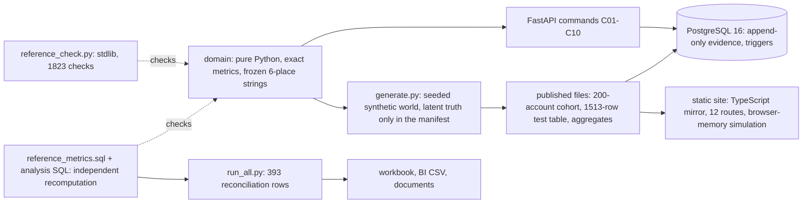

# Technical case study: RetentionLab (P10-ART-09)

**Synthetic data; the economics are hypothetical; no retention improvement is claimed.** Dataset `rl-20261026-20261026` (`dataset_hash` `9ebaaadab8a2f70e5f25820616391ee0aec55fbf0b121dee25460de469821b1c`), contract v1, code revision `ce96e65` (app content of the lab branch after the review R10 fixes; the lab HEAD when the republish was recorded is `c17fa32`, the published `code_sha` per the release manifest). **How to read it without installing anything:** the sections below follow the usual order; a reader who wants to reproduce it uses "Reproducible setup".

## Architecture
One contract, three implementations and an independent check:



* **Domain** (`domain/retentionlab/`, standard library only): `ingest` (D-P10-15 validation), `world` (eligibility, point-in-time features, arrived-late counts, labels with censoring), `split` (chronological split, label-window then group purge), `rules` (refusal codes), `fitting` (preprocessing, random baseline, prevalence constant, rule, logistic regression by deterministic gradient descent, Platt; floats only inside the loops, frozen to 6-place decimal strings; `det_exp` built from basic arithmetic so results do not depend on libm), `metrics` (every D-03 metric exact on the frozen strings), `pipeline` (the whole fixture to `expected.json`).
* **Database and API.** PostgreSQL 16 with 25 tables, 22 foreign keys, 18 append-only tables enforced by trigger, availability, citation, frozen-run and label-maturity triggers (`0001`..`0003`); FastAPI with ten commands (C01..C10) with idempotency keys bound to actor, role and dataset version, lock ordering, deadlock retry and 401/403/404/409/422 contracts; every queue row is a draft.
* **Site.** A TypeScript mirror evaluates the frozen predictions with rational arithmetic only (a BigInt fixed-point natural logarithm at 10^90; a static guard keeps `Math` functions out of every figure); 12 routes; every browser-memory action is labelled simulated.
* **Independent checks.** A standard-library reference script recomputes the golden fixture (1,823 checks, 7 fixture hashes); `data/sql/reference_metrics.sql` recomputes the metrics of a cutoff set from the facts in SQL; **this package** adds ten SQL investigations over the loaded cohort and the 1,513-row test table, with average precision (window functions) and the stability index (numeric `ln()`) in SQL for the first time, a plain-Python side that shares no code with the SQL or the domain, and a 393-row reconciliation that includes a rebuild of the whole 2,400-account world.
* **Artifact package** (`data/sql/analysis/`, `artifacts/`, `tests/test_artifacts.py`): scratch databases `artifacts10_*` only; a verification layer (`data/sql/verification_layer.sql`) for the full-world files; the formula-driven workbook with 70 checks, recalculated by LibreOffice; the BI CSVs with a measures file; 12 documents with their tables rendered from the stored results.

## Trade-offs
* **Exact numbers over floating point.** Every published figure is a `Fraction` or `Decimal` rounded once; fitting is floating-point but frozen. Cost: a pure-Python fit is slow (the 2,400-account world takes about 25 s to build in memory). Benefit: SQL, Python and TypeScript agree to the last digit.
* **Account-level split roles by hash of the id (D-G03).** Without it the group purge would remove almost every earlier row. Cost: the test population is the test-role accounts only (1,513 rows, 442 accounts), shaped by a design choice that is disclosed.
* **Latent truth only in the manifest.** No feature, prediction or entity carries it; the cost is that the site cannot show the ceiling except on the evidence page.
* **Sample versus world.** The files publish the complete records of 200 accounts plus a row-level test table and per-cutoff aggregates (4,614,525 bytes under a 5,000,000 cap). Cost: world figures cannot be recomputed from the cohort; the package reconciles them by re-running the generator (group F) instead.
* **AP and PSI in SQL.** `ln()` of PostgreSQL's numeric differs from `Decimal.ln` at 60 digits in the 17th place and beyond; rounded to six places they agree on every compared value (12 PSI values in the test range, 2 golden PSI values, all APs).
* **A met margin by construction.** The generator was tuned until the declared margins were met (D-G02). Cost: the headline comparison proves nothing about real data. Benefit: it is disclosed on every route and in this package, and a prevalence-constant baseline gives an honest reference.
* **Rank evaluated inside the top 25 in the workbook.** A spreadsheet with 1,513 x 4 tie-broken ranks would be slow; ranks are computed only for rows within the 25 highest probabilities of a model (exact for K <= 25).

## The review (R10) and what it found
An independent disproof review (A-075) recomputed the golden and test-population figures, attacked leakage and point-in-time correctness through the API and domain, mutated the snapshot (249 of 250 mutations caught) and `expected.json` (all 180 caught), and checked the case-study claims. It found one code defect, two accessibility defects and twelve documentation findings; the fix worker (A-077) closed all of R10-01..R10-15 in commit `ce96e65`:

| Id | Defect | Fix |
|---|---|---|
| R10-01 | a future `as_of` labelled censored rows | `AS_OF_IN_FUTURE` refusal; stored labels authoritative |
| R10-02 | contrast on cream panels | darker inks, measured on every route |
| R10-03 | model card broke words at 360 px | stacked pairs, safe breaks |
| R10-04 | cohort economics quoted as full-world | population named; world values published beside |
| R10-05 | stale test count | one count source |
| R10-06 | rows presented as accounts | rows and accounts both stated |
| R10-07 | drift series without false positives | whole series, `floored_bins` |
| R10-08 | Platt worsened the model silently | stated and published |
| R10-09 | apac gap unexplained | labelled not designed |
| R10-10 | P10-TEST-12 without a decision | reinterpreted; permutation refit |
| R10-11 | incomplete choice list | all eleven items listed |
| R10-12 | wrong D-07 figures | corrected |
| R10-13 | training rows ambiguous | 1,088 retained, 744 fitted |
| R10-14 | no honest Brier reference | prevalence constant, migration 0003 |
| R10-15 | smaller defects | `DUPLICATE_FIELD` and others |

This pass found no defect in those paths; its own findings are in `uat-evidence.md` (F1..F6).

## Recovery behaviour (observed in tests)
* An interrupted command leaves nothing or an explicit noncommit (`tests/test_adversarial.py`, interruption cases); a repeated request with the same idempotency key returns the stored result, bound to actor, role and dataset version (`tests/test_api_commands.py`).
* A scored run is frozen (`RUN_FROZEN`, 409 `INVALID_STATE`); a label may mature once (`LABEL_IMMUTABLE`); a prediction must cite its run's config hash, feature version and label version (`CITATION_MISMATCH`); the append-only tables refuse UPDATE, DELETE and TRUNCATE (`tests/test_migrations.py`).
* A deadlock is retried, then reported 409 `CONCURRENT_UPDATE`; concurrent identical requests run once.
* Each of the twelve adversarial cases is detected and recovered from its smallest fixture (`tests/fixtures/adversarial/p10-test-NN.json`).
* A failed data load on the site shows an honest error and no figure; retry recovers (`web/e2e/journey.spec.ts`).
* In this package: a scratch database name outside `artifacts10_*` is refused before anything is touched (`prepare_snapshot.py`, tested); a failed run drops its scratch databases (`run_all.py` `finally`); a stale reference column makes the workbook's check cell FALSE.

## Reproducible setup
```bash
# from apps/retentionlab (Python 3.11; PostgreSQL 16 reachable; LibreOffice for the workbook); pip install -r requirements.txt -r requirements-artifacts.txt
../../.venv/bin/python -I tests/reference_check.py                     # ALL OK (1823 checks), 7 fixture hashes
export DATABASE_URL=postgresql://<user>:<password>@127.0.0.1:5432/artifacts10_pytest   # a SCRATCH database: the test suite resets the project's tables
# artifacts (scratch databases are created and dropped by run_all.py; names start with artifacts10_)
../../.venv/bin/python data/sql/analysis/run_all.py --json artifacts/analysis-results.json --bi-out artifacts/bi
../../.venv/bin/python artifacts/build_workbook.py --recalc
../../.venv/bin/python artifacts/render_sql_analysis.py
../../.venv/bin/python artifacts/checksums.py --table
sha256sum -c artifacts/CHECKSUMS.txt
# the package's own tests: both scratch URLs let the database tests run; without them they skip with a printed reason
export ARTIFACTS_DATABASE_URL=postgresql://<user>:<password>@127.0.0.1:5432/artifacts10_snapshot
export ARTIFACTS_GOLDEN_DATABASE_URL=postgresql://<user>:<password>@127.0.0.1:5432/artifacts10_golden
../../.venv/bin/python -m pytest -q -ra
```
The published data are regenerated byte-for-byte by `data/generate.py` (same seed, same bytes, checked under three `PYTHONHASHSEED` values by `tests/test_generator.py`).

## Measured evidence
* **Reference check.** `tests/reference_check.py`: `ALL OK (1823 checks)`, 7 fixture hashes `OK`.
* **Suite.** baseline (before this package) `342 passed, 1 warning in 318.78s (0:05:18)` against a scratch database, no skips; this package adds 39 test functions (41 test cases) in `tests/test_artifacts.py`; the whole suite: `383 passed` (342 existing + 41 of this package), no skips with the three URLs set.
* **Reconciliation.** `run_all.py`: 393 reconciliation rows, all equal (A 46, B 117, C 44, D 107, E 52, F 27), 43 result sets, 229 rows; about 50 s with the whole-world rebuild, about 20 s without it (`--skip-world`).
* **Workbook.** 70 checks, `Checks!B2` TRUE after LibreOffice recalculation as delivered and with three other models / what-ifs selected.
* **Negative control.** Changing one outcome of the test table in a scratch copy makes 11 of the 43 result sets differ from the Python side.
* **Recorded elsewhere, not fetched.** CI run `40464123151` (green in both modes on `c17fa32`, release manifest), live-check run `40464668157` (success after the R10 republish `cf04a0e`, recorded in the ledgers after this pass was dispatched: pending at dispatch), CI run `40464667982` on the workflow-provisioning commit `7a748ac` (success in both modes, no artifact tests yet), live-check run `40456970303` (earlier release `b5168a2`), the ledger's counts for the final R10 run: 342 Python tests, 3,197 TypeScript golden checks, 95 review checks over 31 worlds, 90 browser tests; and the earlier hosted runs `40447567631` (299 tests on `4b957ca`) and `40451829378` (323 tests on `e81c2b4`).
* **Not measured.** Excel and Power BI Desktop were not run. This package's tests have no hosted run recorded yet: `tests/test_artifacts.py` runs in CI once the branch is pushed, with LibreOffice, two `artifacts10_*` databases, full history and the portfolio case study provisioned (pending at dispatch).

## Open gaps
* No randomised experiment; the by-construction margin; four features; Platt fitted on one cutoff (made the test result worse); cursors not bound to a dataset version; no monitoring history; no non-UTC zones; not benchmarked at 10,000 accounts.
* World-level figures are published aggregates; the package reconciles them by regenerating the world, not by SQL over 2,400 accounts.
* Excel and Power BI Desktop were not run; the workbook and CSVs were built in a sandbox, not on a GitHub-hosted runner, and are not attached to a GitHub release (`release-package.md`).
* The README, D-06 and the public case study still describe the SQL recomputation of AP and PSI as not built.
