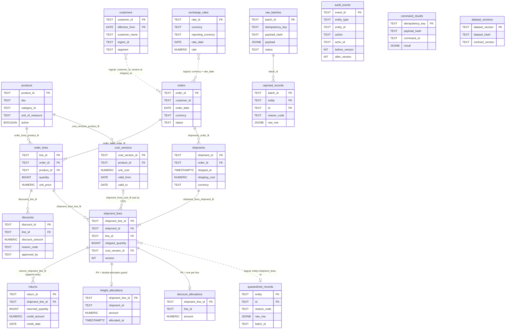

# Entity-relationship diagram (P01-ART-03)

Derived from `data/migrations/0001_schema.sql` and `0002_constraints.sql`. Solid lines are enforced foreign keys; dotted lines are logical joins the contract
relies on (D-02, D-06) that the database does not enforce. Field detail is in `data-dictionary.md`. Synthetic data only.

Reading notes
* `customers` is type-2, so `orders.customer_id` cannot be a foreign key; the region is chosen per shipment by the version whose `effective_from` is the greatest one on or before the shipped UTC date (D-06).
* `returns` and `audit_events` carry `BEFORE UPDATE OR DELETE` triggers that raise `integrity_constraint_violation`.
* `command_results`, `audit_events`, `dataset_versions`, `quarantined_records` are not referenced by foreign keys; `quarantined_records.id` points at `shipment_lines.shipment_line_id` by convention.
