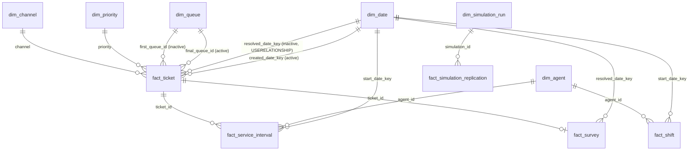

# BI package: reusable metric model for ServiceFlow (P04-ART-06)

**Synthetic data only.** The model is a reusable metric layer over the observed synthetic history of `sf-20261026-20261026` (seed 20261026, generator `dataset_hash`
`944ef91b3dc17c04c6bb601e0faac94f956d121877de2b9864988cf7c5d5cba4`, contract v1, code revision `43de7f8`). Nothing in it is a measured effect on a real support team, and no staffing benefit is claimed.
Observed tables and SIMULATED tables are separate: the four `fact_*` tables of tickets, intervals, shifts and surveys are observed; `fact_simulation_replication` and `dim_simulation_run` hold simulated estimates and every measure
that reads them starts with the word *Simulated*.

## Verification status (stated plainly)
* **No `.pbix` was produced.** Power BI Desktop is not available here and was not run; no DAX engine evaluated any measure below. The DAX is **pseudocode in DAX syntax** (DAX-like) written to be pasted into a model, and it has not been executed.
* **What was checked instead:** the fact and dimension tables are the CSV exports of `data/sql/analysis/bi_fact_*.sql` and `bi_dimensions.sql` under `artifacts/bi/` (produced by `run_all.py --bi-out artifacts/bi`); the **definition of every measure was re-implemented in Python over those CSV files**
  (`run_all.py` `bi_measures`, not the domain) and the results reconciled with `data/sql/reference_metrics.sql` and the Python domain: all 17 contract measures equal on the whole window, and 15 measures equal on the training dates and on the holdout dates
  (the `E BI measure...` rows of the reconciliation in `sql-analysis.md` section 10); the simulated means and intervals equal `web/public/reference/simulation-runs.json`.
  That proves the definitions and the exports; it does not prove that a DAX engine returns the same figures.
* **Not checked:** DAX syntax and evaluation context, Power Query typing in Desktop, visual layout, refresh. Anyone with Power BI Desktop can load the CSV files (the M below), paste the measures and compare each one with the expected table in section 5.

## 1. How to read or use it without installing anything
Read this file; open any CSV in `artifacts/bi/` in a spreadsheet application (they are plain UTF-8, comma separated, header row, `\n` line ends, empty cell = absent, never 0). With Power BI Desktop: Get Data > Text/CSV for each file, apply the types of section 3, create the relationships of section 2 and paste the measures of section 4 into a measures table.

## 2. Star schema and relationships

All relationships are many-to-one from the fact to the dimension with single-direction filtering (dimension filters fact). `fact_service_interval` and `fact_survey` reach `dim_queue`, `dim_priority` and `dim_channel` through `fact_ticket`
(cross-filter fact_ticket to its children: one-to-many, single direction, so a queue slicer filters the intervals and surveys of its tickets). The two date relationships on `fact_ticket` are **role-playing**: arrivals use the active created-date relationship, completions use `USERELATIONSHIP` on the resolved date.
`dim_date` is a day grain table of 84 UTC calendar days (2026-07-06 to 2026-09-27); the training and holdout weeks are `dim_date[period]`.

## 3. Tables, grain and Power Query

| Table | Grain | Rows | CSV | Key columns |
|---|---|---|---|---|
| `fact_ticket` | one accepted ticket (a rejected ticket is not here) | 3,817 | `artifacts/bi/fact_ticket.csv` | `ticket_id`; `created_date_key`, `resolved_date_key`; `final_queue_id`, `first_queue_id`, `priority`, `channel`; durations in integer seconds; flags 1 / 0 or empty |
| `fact_service_interval` | one service interval | 4,976 | `artifacts/bi/fact_service_interval.csv` | `interval_id`; `ticket_id`, `agent_id`, `start_date_key`, `started_at`, `ended_at`, `handling_seconds` |
| `fact_shift` | one shift of one agent | 1,020 | `artifacts/bi/fact_shift.csv` | `shift_id`; `agent_id`, `start_date_key`, `starts_at`, `ends_at`, `shift_minutes`, `declared_break_minutes`, `recorded_break_minutes`, `staffed_available_minutes`, `crosses_clock_change` |
| `fact_survey` | one survey row (one per invited ticket) | 2,147 | `artifacts/bi/fact_survey.csv` | `survey_id`; `ticket_id`, `resolved_date_key`, `is_invited`, `is_valid_response`, `score`, `is_positive` |
| `fact_simulation_replication` | one replication of one simulated run (SIMULATED) | 150 | `artifacts/bi/fact_simulation_replication.csv` | `simulation_id`, `replication` (0..49), `seed`, `mean_wait_minutes` |
| `dim_date` | one UTC day | 84 | `artifacts/bi/dim_date.csv` | `date_key` (yyyymmdd), `date`, `iso_weekday`, `weekday_name`, `week_number` (1..12), `period` (training / holdout), `is_weekend` |
| `dim_queue` | one queue | 3 | `artifacts/bi/dim_queue.csv` | `queue_id`, `queue_name`, `priority_policy`, `calendar_id`, `active` |
| `dim_agent` | one agent (synthetic names) | 18 | `artifacts/bi/dim_agent.csv` | `agent_id`, `agent_name`, `timezone`, `employment_type`, `active`, `max_concurrent` |
| `dim_priority` | one priority with its SLA targets | 3 | `artifacts/bi/dim_priority.csv` | `priority`, `sla_first_response_minutes`, `sla_resolution_minutes`, `calendar_id` |
| `dim_channel` | one channel | 4 | `artifacts/bi/dim_channel.csv` | `channel`, `can_abandon` |
| `dim_simulation_run` | one declared simulation run (SIMULATED) | 3 | `artifacts/bi/dim_simulation_run.csv` | `simulation_id`, `policy_version`, `agents`, `arrival_rate_per_hour`, `service_minutes`, `discipline`, `warmup_minutes`, `horizon_minutes`, `seed`, `label` |

Lineage: `fact_ticket` is `sf_ticket` joined to `sla_policies` (first human reply, first service, final resolution, abandonment, reopen / transfer / pause counts, targets and met-flags); `fact_service_interval` is `sf_interval`; `fact_shift` is `shifts` with the sum of its `shift_breaks`;
`fact_survey` is `surveys` joined to `sf_ticket` for the resolved date (`data-dictionary.md` section 5 gives the rules; D-01..D-09 in `contracts.md`). Timestamps are UTC ISO text with a `Z`; durations are integer seconds so a minute is exact to the second; money does not occur.

Power Query (M), one query per CSV; the same pattern for each file, shown for `fact_ticket`:

```m
let
    Source = Csv.Document(File.Contents("artifacts\bi\fact_ticket.csv"), [Delimiter = ",", Encoding = 65001, QuoteStyle = QuoteStyle.Csv]),
    Promoted = Table.PromoteHeaders(Source, [PromoteAllScalars = true]),
    Typed = Table.TransformColumnTypes(Promoted, {
        {"created_date_key", Int64.Type}, {"resolved_date_key", Int64.Type}, {"created_hour_utc", Int64.Type},
        {"first_response_seconds", Int64.Type}, {"wait_seconds", Int64.Type}, {"resolution_seconds", Int64.Type}, {"handling_seconds", Int64.Type},
        {"reopen_count", Int64.Type}, {"transfer_count", Int64.Type}, {"pause_count", Int64.Type},
        {"met_first_response", Int64.Type}, {"met_resolution", Int64.Type}, {"is_completed", Int64.Type}, {"is_abandoned", Int64.Type}, {"can_abandon", Int64.Type}
    }, "en-US"),
    Dated = Table.TransformColumns(Typed, {
        {"created_at", each DateTimeZone.FromText(_), type datetimezone}, {"first_human_reply_at", each if _ = "" or _ = null then null else DateTimeZone.FromText(_), type nullable datetimezone},
        {"first_service_at", each if _ = "" or _ = null then null else DateTimeZone.FromText(_), type nullable datetimezone},
        {"final_resolved_at", each if _ = "" or _ = null then null else DateTimeZone.FromText(_), type nullable datetimezone},
        {"abandoned_at", each if _ = "" or _ = null then null else DateTimeZone.FromText(_), type nullable datetimezone}
    })
in
    Dated
```
Empty cells must load as null (an empty string would turn a blank duration into 0 in a sum, which the contract forbids: "do not replace unknown values with zero"). `fact_shift` and `fact_service_interval` need their `starts_at`, `ends_at`, `started_at`, `ended_at` columns typed the same way
(UTC date-time; the measures below compare them with the selected dates at midnight UTC). Power Query has not been run on these files (see the verification status).

## 4. Measures (DAX-like pseudocode, not executed)
Conventions: the date slicer is `dim_date[date]`; the selected period is `[p0, p1)` with `p0` the first selected day at 00:00 UTC and `p1` the day after the last selected day. Durations are stored in seconds and divided by 60 once. Every division is `DIVIDE(numerator, denominator, BLANK())`
so an empty population is blank, never 0 (P04-MET-01..11, R13-R15). Observed measures never read a simulated table.

```dax
-- ===== observed: volume =====
Arrivals = COUNTROWS ( fact_ticket )
Completions = CALCULATE ( COUNTROWS ( fact_ticket ), fact_ticket[is_completed] = 1, USERELATIONSHIP ( fact_ticket[resolved_date_key], dim_date[date_key] ) )
Arrival Rate per Hour = DIVIDE ( [Arrivals], DISTINCTCOUNT ( dim_date[date_key] ) * 24, BLANK () )
Completion Rate per Hour = DIVIDE ( [Completions], DISTINCTCOUNT ( dim_date[date_key] ) * 24, BLANK () )

-- ===== observed: first response, wait, resolution (mean beside P90, P04-TEST-10) =====
Mean First Response (min) = DIVIDE ( AVERAGE ( fact_ticket[first_response_seconds] ), 60, BLANK () )
P90 First Response (min) =
    VAR t = FILTER ( fact_ticket, NOT ISBLANK ( fact_ticket[first_response_seconds] ) )
    VAR k = INT ( ( 9 * COUNTROWS ( t ) + 9 ) / 10 )                                   -- nearest rank, index ceil(0.9 n)
    RETURN IF ( COUNTROWS ( t ) = 0, BLANK (), DIVIDE ( MAXX ( TOPN ( k, t, fact_ticket[first_response_seconds], ASC ), fact_ticket[first_response_seconds] ), 60 ) )
Mean Wait to First Service (min) = DIVIDE ( AVERAGE ( fact_ticket[wait_seconds] ), 60, BLANK () )
Mean Resolution (min) =
    CALCULATE ( DIVIDE ( AVERAGE ( fact_ticket[resolution_seconds] ), 60, BLANK () ), fact_ticket[is_completed] = 1, USERELATIONSHIP ( fact_ticket[resolved_date_key], dim_date[date_key] ) )
P90 Resolution (min) =
    VAR t = CALCULATETABLE ( FILTER ( fact_ticket, fact_ticket[is_completed] = 1 ), USERELATIONSHIP ( fact_ticket[resolved_date_key], dim_date[date_key] ) )
    VAR k = INT ( ( 9 * COUNTROWS ( t ) + 9 ) / 10 )
    RETURN IF ( COUNTROWS ( t ) = 0, BLANK (), DIVIDE ( MAXX ( TOPN ( k, t, fact_ticket[resolution_seconds], ASC ), fact_ticket[resolution_seconds] ), 60 ) )

-- ===== observed: SLA (open overdue is never in a denominator) =====
SLA First Response Compliance =
    DIVIDE ( CALCULATE ( COUNTROWS ( fact_ticket ), fact_ticket[met_first_response] = 1 ), CALCULATE ( COUNTROWS ( fact_ticket ), NOT ISBLANK ( fact_ticket[met_first_response] ) ), BLANK () )
SLA Resolution Compliance =
    DIVIDE ( CALCULATE ( COUNTROWS ( fact_ticket ), fact_ticket[met_resolution] = 1, USERELATIONSHIP ( fact_ticket[resolved_date_key], dim_date[date_key] ) ),
             CALCULATE ( COUNTROWS ( fact_ticket ), fact_ticket[is_completed] = 1, USERELATIONSHIP ( fact_ticket[resolved_date_key], dim_date[date_key] ) ), BLANK () )
Open at End of Data = CALCULATE ( COUNTROWS ( fact_ticket ), fact_ticket[is_completed] = 0, fact_ticket[is_abandoned] = 0 )   -- open tickets; their overdue subset is shown by a visual filter on age, never dropped

-- ===== observed: capacity (D-05) =====
Handling Minutes =
    VAR p0 = MIN ( dim_date[date] )  VAR p1 = MAX ( dim_date[date] ) + 1
    RETURN SUMX ( fact_service_interval,
                  VAR s = MAX ( fact_service_interval[started_at], p0 )  VAR e = MIN ( fact_service_interval[ended_at], p1 )
                  RETURN IF ( e > s, DATEDIFF ( s, e, SECOND ) / 60, 0 ) )          -- clipped to the dates, as the domain clips to the window
Staffed Available Minutes =
    VAR p0 = MIN ( dim_date[date] )  VAR p1 = MAX ( dim_date[date] ) + 1
    RETURN SUMX ( ALL ( fact_shift ),
                  VAR s = MAX ( fact_shift[starts_at], p0 )  VAR e = MIN ( fact_shift[ends_at], p1 )
                  RETURN IF ( e > s, DATEDIFF ( s, e, SECOND ) / 60 - IF ( fact_shift[starts_at] >= p0 && fact_shift[ends_at] <= p1, fact_shift[declared_break_minutes], 0 ), 0 ) )
Staffed Shift Minutes (whole shifts) = SUMX ( fact_shift, fact_shift[shift_minutes] - fact_shift[declared_break_minutes] )
Agent Occupancy = DIVIDE ( [Handling Minutes], [Staffed Available Minutes], BLANK () )

-- ===== observed: customers =====
Abandonment Rate =
    DIVIDE ( CALCULATE ( COUNTROWS ( fact_ticket ), fact_ticket[can_abandon] = 1, fact_ticket[is_abandoned] = 1 ), CALCULATE ( COUNTROWS ( fact_ticket ), fact_ticket[can_abandon] = 1 ), BLANK () )
Survey Invitation Rate = DIVIDE ( SUM ( fact_survey[is_invited] ), [Completions], BLANK () )      -- fact_survey is filtered by its resolved date: use the same date slicer
Survey Response Rate = DIVIDE ( SUM ( fact_survey[is_valid_response] ), SUM ( fact_survey[is_invited] ), BLANK () )
CSAT = DIVIDE ( SUM ( fact_survey[is_positive] ), SUM ( fact_survey[is_valid_response] ), BLANK () )   -- positive = score >= 4; always show it beside the response rate (P04-TEST-11)

-- ===== observed: additions beyond the 28 published keys =====
Reopen Rate of Completions = DIVIDE ( CALCULATE ( COUNTROWS ( fact_ticket ), fact_ticket[is_completed] = 1, fact_ticket[reopen_count] > 0, USERELATIONSHIP ( fact_ticket[resolved_date_key], dim_date[date_key] ) ), [Completions], BLANK () )
Transfer Share of Arrivals = DIVIDE ( CALCULATE ( COUNTROWS ( fact_ticket ), fact_ticket[transfer_count] > 0 ), [Arrivals], BLANK () )

-- ===== SIMULATED estimates (never mixed with the observed measures above) =====
Simulated Mean Wait (min) = AVERAGE ( fact_simulation_replication[mean_wait_minutes] )
Simulated 95 % Half-width (min) =
    VAR n = COUNTROWS ( fact_simulation_replication )
    RETURN IF ( n < 2, BLANK (), T.INV.2T ( 0.05, n - 1 ) * DIVIDE ( STDEV.S ( fact_simulation_replication[mean_wait_minutes] ), SQRT ( n ), BLANK () ) )   -- the domain's table gives 2.010 at 49 degrees of freedom
Simulated Paired Difference sim-002 minus sim-001 (min) =
    AVERAGEX ( VALUES ( fact_simulation_replication[replication] ),
               CALCULATE ( AVERAGE ( fact_simulation_replication[mean_wait_minutes] ), dim_simulation_run[simulation_id] = "sim-002" )
             - CALCULATE ( AVERAGE ( fact_simulation_replication[mean_wait_minutes] ), dim_simulation_run[simulation_id] = "sim-001" ) )   -- same seeds, same demand path
```

Notes on the definitions. (a) `Arrivals`, the first-response and wait measures, `Abandonment Rate` and `Transfer Share of Arrivals` are arrival-based (created date); `Completions`, the resolution measures, the survey measures and `Reopen Rate of Completions` are completion-based (resolved date) (D-05). (b) `Mean First Response` ignores tickets with no human reply
(201 abandoned arrivals): they are outside the denominator and are counted in the SQL investigation 03, not dropped. (c) `Handling Minutes` and `Staffed Available Minutes` clip at the selected dates because the contract clips at the window: with day-aligned dates the figures equal the domain's for the whole, training and holdout windows
(an earlier draft that counted an interval on its start date differed by 81.03 minutes between the training and holdout windows, which is why the clipped form is used). (d) `Staffed Available Minutes` keeps D-05's rule: the declared break is deducted only for a shift inside the dates, so adjacent periods do not add up to the whole.
(e) `Open at End of Data` is 0 here; the open-overdue exposure over time needs the event grain (a `fact_ticket_event` table was not exported) and is in SQL investigation 03. (f) The P90 measures use nearest rank on purpose: `PERCENTILE.INC` interpolates and would not equal the contract's value.

## 5. Expected values (whole twelve weeks, recomputed from the CSV exports)
Computed by `run_all.py` from `artifacts/bi/*.csv` (Python, not DAX) and reconciled with `data/sql/reference_metrics.sql` and the Python domain; `analysis-results.json` key `bi_expected_measures`. Paste the measures into a model, select all 84 days and compare.

<!-- BEGIN:bi_expected_measures -->
| measure | expected | source |
|---|---|---|
| Arrivals | 3817 | COUNTROWS(fact_ticket) on the created date |
| Completions | 3608 | tickets with a final resolution (resolved date) |
| Arrival Rate per Hour | 1.893353 | Arrivals / (days x 24) |
| Completion Rate per Hour | 1.789683 | Completions / (days x 24) |
| Mean First Response (min) | 28.0046 | tickets with a human reply |
| P90 First Response (min) | 44.1500 | nearest rank, index ceil(0.9 n) |
| Mean Wait to First Service (min) | 25.5073 | tickets that were served |
| Mean Resolution (min) | 164.5909 | completed tickets, from the original arrival |
| P90 Resolution (min) | 294.5833 | nearest rank |
| SLA First Response Compliance | 0.950498 | 3437 / 3616 |
| SLA Resolution Compliance | 0.978104 | 3529 / 3608 |
| Open at End of Data | 0 | not completed and not abandoned (open overdue = 0 of them) |
| Handling Minutes | 189836.2667 | service intervals clipped to the selected dates |
| Staffed Available Minutes | 447450.0000 | overlap of each shift with the selected dates, minus the declared break only for a shift inside them (D-05) |
| Staffed Shift Minutes (whole shifts) | 447990.0000 | every shift net of its declared break, clipped by nothing |
| Agent Occupancy | 0.424263 | Handling Minutes / Staffed Available Minutes |
| Abandonment Rate | 0.118213 | 209 / 1768 (chat and phone) |
| Survey Invitation Rate | 0.595067 | 2147 invited / 3608 completed |
| Survey Response Rate | 0.349325 | 750 valid / 2147 invited |
| CSAT | 0.864000 | 648 positive / 750 valid |
| Reopen Rate of Completions | 0.066796 | 241 / 3608 (an addition beyond the 28 published keys) |
| Transfer Share of Arrivals | 0.078334 | 299 / 3817 (an addition beyond the 28 published keys) |
| Simulated Mean Wait sim-001 (min, mean of 50 replications) | 18.8435 | SIMULATED estimate |
| Simulated 95 % Half-width sim-001 (min) | 8.2004 | SIMULATED estimate, Student-t |
| Simulated Mean Wait sim-002 (min, mean of 50 replications) | 7.9502 | SIMULATED estimate |
| Simulated 95 % Half-width sim-002 (min) | 5.2231 | SIMULATED estimate, Student-t |
| Simulated Mean Wait sim-003 (min, mean of 50 replications) | 30.6253 | SIMULATED estimate |
| Simulated 95 % Half-width sim-003 (min) | 8.3091 | SIMULATED estimate, Student-t |
| Simulated Paired Difference sim-002 minus sim-001 (min) | -10.8932 | SIMULATED estimate, same seeds |
| Simulated Paired 95 % Half-width (min) | 3.4329 | SIMULATED estimate, Student-t |
<!-- END:bi_expected_measures -->

The same measures over the training dates (2026-07-06 to 2026-08-30) and the holdout dates (2026-08-31 to 2026-09-27) equal the domain's figures for 15 measures (arrivals 2,386 and 1,431; mean first response 23.4036 and 35.7365; handling 118,965.3833 and 70,870.8833; occupancy 0.399387 and 0.473609; reconciliation rows `E BI measures over the training dates` and `...holdout dates`).

## 6. Modelling and governance notes
* **Grain discipline.** A measure that needs the event grain (backlog at an arbitrary instant, open overdue over time) is not defined on these facts. The event log is in `ticket_events` and is reproduced by SQL investigation 03; adding a `fact_ticket_event` table (21,893 rows) would allow it.
* **Late data.** Late arrivals keep their own `occurred_at` (P04-FLOW-01), so a ticket's figures can move when late events load; the exports are a snapshot of the published dataset `sf-20261026-20261026` and carry no refresh.
* **Observed against simulated.** The simulated measures read replication means that came from `data/simulation_reference.py`; they are estimates of a seeded queue model and are not comparable with the observed waits (the model is a dedicated-server picture of the technical queue; `executive-memo.md`).
* **Security.** Synthetic data, no row-level security, no credentials, no gateway; agent names are generated.
* **Export contract (P04-MET-xx R23).** Each CSV is a full-population export of the published dataset; the dataset hash and code revision are in this file and in `artifacts/CHECKSUMS.txt`.
