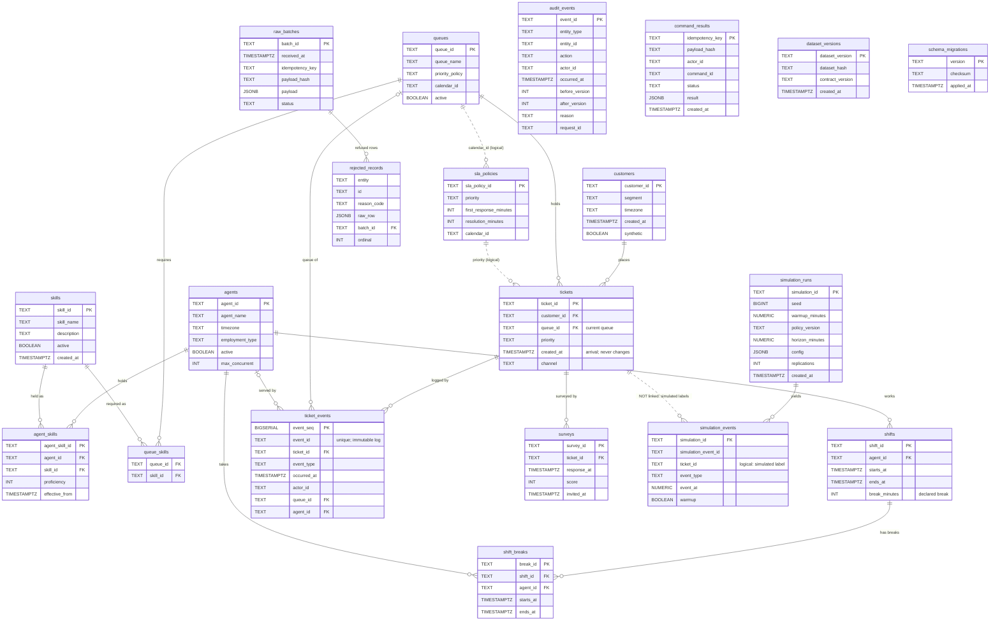

# Entity-relationship diagram (P04-ART-03)

Derived from `data/migrations/0001_schema.sql` and `0002_constraints.sql`. Solid lines are enforced foreign keys; dotted lines are logical joins the contract relies on (D-01, D-02, D-06) that the database does not enforce. Field detail, grain, update semantics and the deletion policy are in `data-dictionary.md`. Synthetic data only (dataset `sf-20261026-20261026`, hash `944ef91b3dc17c04c6bb601e0faac94f956d121877de2b9864988cf7c5d5cba4`, code revision `43de7f8`).

## Reading notes

* **Immutable:** `ticket_events` (a state change is an event: no UPDATE, DELETE or TRUNCATE; a replayed `event_id` is refused). **Append-only:** `audit_events` and `simulation_events`. **Fixed:** `tickets.created_at`, the arrival, which a transfer or a reopen never moves (P04-FLOW-04). The only mutable business column is `tickets.queue_id` (the current queue).
* **A reopen is not a new ticket** and there is no table for a cycle: cycles are replayed from the event log (`resolved` then `reopened`), so a reopened ticket is one customer contact (P04-TEST-02).
* **Logical joins (dotted):** `sla_policies.priority` to `tickets.priority` (the SLA of a ticket is read by priority, `SLA_POLICY_MISSING` is 422 when absent); `calendar_id` on queues and policies (carried, ignored, D-09 R4-18); `simulation_events.ticket_id` carries the simulation's own labels (`t-001`...) and must NOT be joined to `tickets`. `audit_events.entity_id`, `rejected_records.id` and `command_results.idempotency_key` point at any entity.
* **The source queue of a transfer** is not a column: it is the queue of the previous `created`/`queued`/`transferred` event of the same ticket (analysis query 05 derives it).
* **Not drawn:** the analysis views `sf_window`, `sf_ev`, `sf_ticket`, `sf_interval` (`data/sql/analysis/00_event_views.sql`) and the BI star schema (`bi-package.md`).
* **Analysis grains:** the ticket (`fact_ticket`), the service interval (`fact_service_interval`), the shift (`fact_shift`) and the survey (`fact_survey`) are the grains of `bi_fact_*.sql`.
* `schema_migrations` (created by `data/migrate.py`) is drawn for completeness; it has no relationship.
