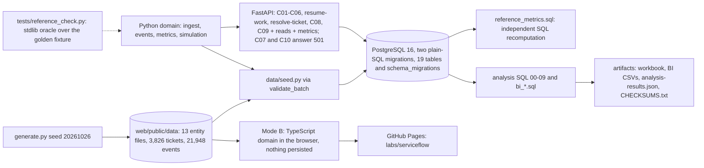

# Technical case study: ServiceFlow (P04-ART-09)

A synthetic support-operations analytics product built around one question: **which staffing or routing change meets support targets under uncertain workload?** (P04-GOAL-01). It is a **business-data lab** project, not a customer system: all data is generated, nothing is persisted from the public site, and no result describes a real support team (P04-DOMAIN-06, P04-GOAL-12).
Dataset `sf-20261026-20261026` (generator hash `944ef91b3dc17c04c6bb601e0faac94f956d121877de2b9864988cf7c5d5cba4`, seed 20261026), contract v1, code revision `43de7f8`.
Observed results, simulated outcomes and hypothetical benefits are kept apart: observed = the synthetic history; simulated = seeded queue-model estimates with intervals; hypothetical = nothing is claimed.
How to read it without installing anything: the sections are Architecture, Tradeoffs, Recovery behaviour, Reproducible setup, Measured evidence and Open gaps; commands are listed so anyone can reproduce a number, but none is needed to read the text.

## Architecture

* **Mode A (verified on hosted runners):** the standard-library Python domain (`domain/serviceflow`), PostgreSQL migrations (`data/migrations`), FastAPI commands and reads (`api/`), prefix `/api/v1/serviceflow`. Not served by GitHub Pages.
* **Mode B (public):** the same contract in TypeScript (`web/src/domain`) over the published snapshot; the simulation studio re-simulates in the browser on a copy with the published seed and nothing is persisted; a refresh restores the snapshot.
* **One contract** (`docs/contracts.md`, v1, D-01..D-09) with a **golden fixture** whose answers are hand-derived (`tests/fixtures/golden/CALCULATION.md`: starts 0 / 10 / 20, waits 0 / 10 / 20, mean wait 10, last completion 30; SLA first response 0.666667).
* **Independent implementations of the same numbers:** the Python domain, the TypeScript domain, `data/sql/reference_metrics.sql` (window functions over the event log), the analysis SQL (`data/sql/analysis`), the stdlib oracle `tests/reference_check.py`, `data/sql/analysis/python_side.py` (exact rationals over the domain's replay) and the workbook's spreadsheet formulas. They check each other: `run_all.py` prints 185 reconciliation rows, all equal (`sql-analysis.md` section 10).
* **The seeded simulator** (`domain/serviceflow/simulation.py`): three independent random streams (arrivals, priorities, service) are drawn before dispatch so two policies share a demand path (common random numbers); replication r uses seed + r; warm-up observations are excluded; tickets waiting at the horizon are censored and counted apart; a paired comparison reports a 95 % Student-t interval.

## Tradeoffs
* **Events are the truth; state is replayed (D-01).** A ticket's state, first response, resolution, handling and reopen cycles are derived from an immutable ordered log (`(occurred_at, event_id)`), so late arrivals land where they happened and a correction is a new event. Cost: every metric needs a replay (the SQL does it with window functions, the domain with a per-ticket fold). Benefit: the same history gives the same numbers in every implementation.
* **Overlap is an application rule, not a trigger (D-06).** "No two overlapping service intervals for one agent beyond `max_concurrent`" is checked by ingest and C03 under a row lock, because a row trigger would refuse valid out-of-order loads. Cost: the database alone does not enforce it. Benefit: late arrivals load; `test_two_simultaneous_starts_for_one_agent_exactly_one_wins` shows the race is closed.
* **Original arrival, always (P04-FLOW-04).** Waits, first response and resolution are measured from `tickets.created_at`, which a trigger makes immutable; a transfer restarts only the per-queue wait. Cost: a reopened ticket is charged its dormant gap (mean 932.8268 minutes among reopened-only completions, `sql-analysis.md` 05). Benefit: no clock reset can hide a long wait; the cost is disclosed on the SLA and overview pages.
* **Mean beside P90, nearest rank (D-02).** P90 is the value at index `ceil(0.9 n)` (`(9n+9)/10` in integers), never interpolated, so the SQL, the domain and the browser agree to the digit. Cost: it differs from `PERCENTILE_CONT`. Benefit: technical P1 resolution shows a P90 of 619.4167 against a mean of 247.1852.
* **Open overdue is counted, never dropped (P04-TEST-06).** SLA compliance excludes open tickets from both denominators and reports them separately; the analysis also samples hourly because a point-in-time zero hides 62 tickets that were overdue at some hour.
* **Breaks are not capacity (D-03, D-05).** Staffed time = shift minus the declared break, deducted only when the window covers the whole shift. Cost: adjacent windows do not add up (297,870 + 149,640 = 447,510 against 447,450). Benefit: no pro-rata choice is hidden; the INJ-05 shifts (declared break 0) are visible as a 90-minute overstatement.
* **Exact arithmetic, one rounding.** Minutes are rationals rendered at 4 dp and rates at 6 dp, half up, once; TypeScript uses integer seconds and rationals; the SQL divides exact sums. Cost: the TypeScript Student-t square root is exact at 1e-8 where Python uses a float (D-08). Benefit: 28 keys equal over three windows.
* **Different methods for independent checks.** The analysis SQL uses window sums and lateral subqueries where the reference uses CTEs; `python_side.py` uses rationals over the domain replay; the workbook uses `COUNTIFS` and clipped per-row formulas over typed epoch instants. One wrong idea is unlikely to be shared.
* **A single-queue simulator with dedicated servers.** Cost: 28.9 % of the technical-skilled agents' handling in the Monday bind went to other queues, which the model cannot represent. Benefit: a seeded, replicable, paired comparison that the browser reproduces event for event. The limit is stated in the memo.
* **Static public mode.** Cost: no backend authorization is claimed on Pages (the roles are shown only as a mode disclosure). Benefit: nothing can be persisted or leaked; the backend is exercised in hosted CI against a transient PostgreSQL.

## Recovery behaviour (observed in tests)
| Situation | Behaviour | Test |
|---|---|---|
| A bot reply typed as a human reply | rejected alone (`BOT_AS_HUMAN_REPLY`), the ticket stays; the database constraint refuses the same row | `test_ingest_bot_as_human_reply_is_rejected`, `test_a_bot_cannot_author_a_human_reply_even_directly` |
| A replayed `event_id` | the first is kept, the replay rejected; `ticket_events_event_id_key` refuses it too | `test_ingest_duplicate_event_id_is_rejected_not_overwritten`, `test_event_id_is_unique` |
| A late-arriving event | preserved with its own `occurred_at`; replay order, not insertion order, decides | `test_ingest_preserves_late_arrivals_with_their_own_time` |
| An unqualified agent or two simultaneous services | the whole ticket is rejected with its events and surveys (`TICKET_REJECTED`); a rejected ticket occupies nobody; a ticket rejected only because of a rejected neighbour is accepted again (fixed point, R4-02) | `test_ingest_agent_not_qualified_rejects_the_whole_ticket`, `test_R4_02_*` |
| A start outside a shift or inside a break | 422 `AGENT_NOT_IN_SHIFT` / `AGENT_ON_BREAK`; ingest rejects `SERVICE_OUTSIDE_SHIFT`; `resume-work` applies the same checks | `test_start_service_agent_must_be_in_shift`, `test_start_service_agent_on_break_is_refused_break_is_not_capacity`, `test_R4_03_*` |
| A transfer that resets the arrival | rejected at ingest (`TRANSFER_RESETS_ARRIVAL`); a correct transfer changes only `queue_id`; the trigger refuses an UPDATE of `created_at` | `test_transfer_preserves_the_original_arrival`, `test_a_ticket_keeps_its_arrival_but_may_change_queue` |
| The same idempotency key and payload | the stored result is returned and nothing is written; another payload, another actor or another dataset version is 409 `IDEMPOTENCY_KEY_REUSED` | `test_replay_returns_the_stored_response_and_writes_nothing`, `test_same_key_different_payload_is_409`, `test_same_key_from_another_actor_is_409` |
| A stale dataset version | 409 `STALE_DATASET_VERSION` before the handler runs, nothing written (R4-05) | `test_R4_05_*` |
| A state change by an analyst on an existing ticket | 403 `ROLE_FORBIDDEN`, nothing written (R4-04) | `test_R4_04_*`, `test_an_analyst_cannot_change_ticket_state_but_may_ingest_and_simulate` |
| Missing identity / forbidden role | 401 / 403, never a fake public auth | `test_missing_actor_is_401_and_bad_role_is_403` |
| A deadlock between commands | rolled back and retried up to three times, then 409 `CONCURRENT_UPDATE`, never 500; locks are taken key, tickets, agents | `test_a_deadlock_is_retried_then_409_never_500`, `test_d08_every_command_locks_the_ticket_before_the_agent` |
| Any failed command | no partial write and no audit row: the handler, the `audit_events` row and the `command_results` row are one transaction | `test_a_failed_command_leaves_no_trace` |
| Malformed input | 422 with field path and rule id, never 500; instants need seconds, integer fields take integral numbers (R4-17) | `test_malformed_input_is_422_with_path_and_rule`, `test_R4_17_*` |
| Unbuilt commands | 501 `NOT_IMPLEMENTED` for C07 and C10; an unknown command is 404 | `test_extension_commands_are_501`, `test_unknown_command_is_404` |
| A simulation with the warm-up left in | accepted (0 is legal) but `warmup_excluded` is 0 and the mean wait is lower; labelled an estimate | `test_p04_test_09_warmup_is_excluded_from_every_statistic`, `test_warm_up_is_excluded_from_every_statistic` |
| An empty population | rates 0, means and compliance null (never 0), `empty_population` true | `test_empty_variant_is_honest_not_zero_filled`, `test_metrics_on_an_empty_database_are_honest` |

Error envelope: `{error: {code, message, details[]}, request_id}`; `details[].rule_id` carries the domain reason code. Commands need `X-Actor-Id` and `X-Actor-Role` (`analyst`, `supervisor`, `admin`).
The analysis scripts add their own recovery rules: `prepare_snapshot.py` refuses any database whose name does not start with `artifacts04_`, and `run_all.py` drops the scratch databases it created even when a check fails.

## Reproducible setup
```sh
python -m venv .venv && .venv/bin/pip install -r requirements.txt            # Mode A; add -r requirements-artifacts.txt for the workbook
export DATABASE_URL=postgresql://<user>:<password>@127.0.0.1:5432/<scratch db>
python data/migrate.py && python data/seed.py tests/fixtures/golden/inputs.json
python data/generate.py --out <dir> --data-dir <dir>                         # deterministic: dataset_hash 944ef91b...cba4 (the committed files are byte-identical)
python -I tests/reference_check.py                                           # stdlib oracle, ALL OK
python -m pytest -q                                                          # database tests skip cleanly without DATABASE_URL
(cd web && npm ci && npm run check && npm run build:pages && npm run e2e)    # Mode B: typecheck + 303 golden + 54 review checks; 70 Playwright tests
# artifacts
../../.venv/bin/python data/sql/analysis/run_all.py --json artifacts/analysis-results.json --bi-out artifacts/bi    # creates and drops its scratch databases
../../.venv/bin/python artifacts/render_sql_analysis.py && ../../.venv/bin/python artifacts/build_workbook.py --recalc
../../.venv/bin/python artifacts/checksums.py --table && sha256sum -c artifacts/CHECKSUMS.txt
../../.venv/bin/python -m pytest -q tests/test_artifacts.py
```
Tests that reset the schema must run against a scratch database, never one that holds work in progress (`tests/support_db.py` drops the project's tables). The artifact pass used databases named `artifacts04_*` and never the shared `serviceflow` database for its own work.

## Measured evidence
Hosted runs and ledger entries (`docs/program/verification-ledger.json`):

| Evidence | Result | Code | Run |
|---|---|---|---|
| Mode A (reference check, domain, PostgreSQL, API) | Mode A success on the hosted runner; 301 local at that commit | `99e219b` | https://github.com/mrrishit909/projects-site/actions/runs/40354858820 |
| Mode A with the generator tests (333 tests, `postgres:16` service) | success | `dd40fdf` | https://github.com/mrrishit909/projects-site/actions/runs/40360702938 |
| Mode A and Mode B (296 TypeScript golden checks, 65 Playwright tests at 360 / 768 / 1280 / 1920 and 200 % zoom; the entry-journey screenshots) | both jobs success; evidence artifact uploaded | `6a753e8` | https://github.com/mrrishit909/projects-site/actions/runs/40364940392 |
| Live site: 11 routes 200, manifest served, case study links to the site and the site links back, 360 / 1280 browser journey with no console errors | all jobs success (deploy-wait matched code `6a753e8` on attempt 2) | `6a753e8`, portfolio `e3bd4a4` | https://github.com/mrrishit909/projects-site/actions/runs/40367109366 |
| Reviewer findings R4-01..R4-18 fixed (T-04-07): `reference_check.py` ALL OK; 377 passed; 303 golden + 54 review checks; 70 e2e | local, recorded in the ledger at `2026-10-26T18:12:13Z` | `43de7f8` | `docs/uat-evidence.md` (local commands); **no hosted run recorded yet** |

Measured in this artifact pass (local, 2026-10-26, scratch PostgreSQL 16 databases `artifacts04_*`): `run_all.py` exit 0 with 185 reconciliation rows all equal (28 metric keys equal in `reference_metrics.sql` and the domain over the whole, training and holdout windows; golden fixture equal in three sources); the workbook recalculated by LibreOffice headless with its switch on all three scenarios; `tests/test_artifacts.py`
(the count is in `release-package.md`). Excel and Power BI Desktop were not run; no `.pbix` exists.

## Open gaps
* **Hosted evidence for the republished release.** The release `e44d15d` (code `43de7f8`) has local evidence only; the manifest records "CI and live check pending". The hosted artifact tests are not part of `serviceflow-ci.yml`.
* **C07 `build-shift-scenario` and C10 `export-recommendation` return 501**; the queues, compare and surveys screens are stubs. The memo is a document, not an application export.
* **The simulation is a single-queue dedicated-server model**; 28.9 % of the technical-skilled agents' handling in the bind went to other queues (query 04). A multi-queue model with skills and breaks is the next piece of work and the only way to evaluate cross-skilling.
* **Calendars are ignored** (`SLA_CALENDAR_IGNORED`); the **break rule** for a window that cuts a shift keeps the full overlap (D-05); `shift_breaks` has no loader in `seed.py`; the metrics default window and the full-population reload of C01 are lab-scale (D-06).
* **The +20 % holdout is a chosen realisation** of a seeded series (attempt index 7; D-09 R4-13); a different draw would give a different holdout.
* **INJ-02 (a reopen recorded as a new customer) is not detectable by the domain**; the analysis finds it with an analyst check (4 customers).
* **Artifacts:** the workbook replays no events (the per-ticket instants are typed from the domain's replay); its `Domain reference` and `SQL results` sheets are pastes; no Excel run; the BI model is a design with DAX pseudocode, no `.pbix`; the analysis is one seed, and the simulation intervals are over 50 replications of one seeded model.
