# Entity-relationship diagram (P03-ART-03)

Derived from `data/migrations/0001_schema.sql` and `0002_constraints.sql`. Solid lines are enforced foreign keys; dotted lines are logical joins the contract relies on (D-01, D-02, D-04) that the database does not enforce. Field detail, grain and update semantics are in `data-dictionary.md`. Synthetic data only. Types are shown without precision (money is `NUMERIC(14,2)`).

```mermaid
erDiagram
    suppliers {
        TEXT supplier_id PK
        TEXT supplier_name
        TEXT calendar_id "logical"
        INT quoted_lead_days
        BOOLEAN active
    }
    products {
        TEXT product_id PK
        TEXT sku
        NUMERIC unit_cost "cost before any cost_versions row"
        INT pack_size
        INT minimum_order_quantity
        TEXT abc_class
        TEXT supplier_id FK "NULL in the snapshot (S-02)"
    }
    locations {
        TEXT location_id PK
        TEXT location_name
        TEXT timezone
        INT storage_capacity
        BOOLEAN active
    }
    calendar_closures {
        TEXT closure_id PK
        TEXT calendar_id "logical"
        DATE closed_from
        DATE closed_to
    }
    cost_versions {
        TEXT cost_version_id PK
        TEXT product_id FK
        NUMERIC unit_cost
        TIMESTAMPTZ effective_from
    }
    policy_scenarios {
        TEXT scenario_id PK
        TEXT scenario_name
        NUMERIC service_target
        TEXT unmet_policy
        BIGINT seed
        INT warmup_days
        INT replications
    }
    purchase_orders {
        TEXT purchase_order_id PK
        TEXT supplier_id FK
        TIMESTAMPTZ ordered_at
        TEXT status "current status, not as-of"
        TEXT currency
    }
    purchase_order_lines {
        TEXT po_line_id PK
        TEXT purchase_order_id FK
        TEXT product_id FK
        INT ordered_quantity
        NUMERIC unit_cost
    }
    receipts {
        TEXT receipt_id PK
        TEXT po_line_id FK
        TEXT location_id FK
        INT received_quantity
        TIMESTAMPTZ received_at
    }
    inventory_movements {
        TEXT movement_id PK "immutable; also UNIQUE"
        TEXT product_id FK
        TEXT location_id FK
        INT quantity_delta
        TIMESTAMPTZ event_at
        TEXT movement_type
    }
    sales {
        TEXT sale_id PK
        TEXT product_id FK
        TEXT location_id FK
        TIMESTAMPTZ sold_at
        INT quantity
    }
    promotions {
        TEXT promotion_id PK
        TEXT product_id FK
        TEXT location_id FK
        TIMESTAMPTZ starts_at
        TIMESTAMPTZ ends_at
        NUMERIC planned_uplift
        TIMESTAMPTZ announced_at
        NUMERIC realised_uplift "outcome, never a feature"
    }
    latent_demand {
        TEXT product_id PK, FK
        TEXT location_id PK, FK
        DATE demand_date PK
        INT latent_quantity "positive days only"
    }
    forecast_runs {
        TEXT forecast_run_id PK
        TEXT product_id FK
        TEXT location_id FK
        TIMESTAMPTZ cutoff "information cutoff"
        INT horizon_days
        TEXT selected_model
        TEXT information_hash
        JSONB model_report
        JSONB notes
        TIMESTAMPTZ created_at
    }
    forecast_points {
        TEXT forecast_point_id PK
        TEXT forecast_run_id FK
        TEXT model
        DATE target_date
        NUMERIC forecast_value
    }
    backorders {
        TEXT backorder_id PK
        TEXT product_id FK
        TEXT location_id FK
        INT quantity
        TIMESTAMPTZ opened_at
        TIMESTAMPTZ closed_at
        TEXT scenario_id FK
        TEXT demand_ref "unique, XOR with lost_sales"
    }
    lost_sales {
        TEXT lost_sale_id PK
        TEXT product_id FK
        TEXT location_id FK
        INT quantity
        TIMESTAMPTZ occurred_at
        TEXT scenario_id FK
        TEXT demand_ref "unique, XOR with backorders"
    }
    reservations {
        TEXT reservation_id PK
        TEXT product_id FK
        TEXT location_id FK
        INT quantity
        TIMESTAMPTZ reserved_at
        TIMESTAMPTZ released_at
    }
    replenishment_params {
        TEXT product_id PK, FK
        TEXT location_id PK, FK
        INT reorder_point
        INT target_position
        TEXT supplier_id FK
    }
    stock_snapshots {
        TIMESTAMPTZ as_of PK
        TEXT product_id PK, FK
        TEXT location_id PK, FK
        INT on_hand_raw
        INT on_hand
        INT reserved
        INT available
        INT running_stock_min
        BOOLEAN negative_stock
        JSONB flags
    }
    draft_orders {
        TEXT draft_order_id PK
        TIMESTAMPTZ as_of
        TEXT scenario_id FK
        TEXT product_id FK
        TEXT location_id FK
        TEXT supplier_id
        INT inventory_position
        INT reorder_point
        INT target_position
        INT raw_order
        INT minimum_order_quantity
        INT order_after_moq
        INT pack_size
        INT order_quantity "whole packs"
        TEXT parameter_source
        TEXT status "always draft"
        TEXT dataset_version
        TIMESTAMPTZ created_at
    }
    fixture_states {
        TEXT state_name PK
        JSONB payload
    }
    raw_batches {
        TEXT batch_id PK
        TIMESTAMPTZ received_at
        TEXT idempotency_key
        TEXT payload_hash
        JSONB payload
        TEXT status
    }
    rejected_records {
        TEXT entity PK
        TEXT id PK
        TEXT reason_code PK
        JSONB raw_row
        TEXT batch_id PK, FK
        INT ordinal PK
    }
    quarantined_records {
        TEXT entity PK
        TEXT id PK
        TEXT reason_code
        JSONB raw_row
        TEXT batch_id
    }
    audit_events {
        TEXT event_id PK
        TEXT entity_type
        TEXT entity_id
        TEXT action
        TEXT actor_id
        TIMESTAMPTZ occurred_at "append-only table"
        INT before_version
        INT after_version
        TEXT reason
        TEXT request_id
    }
    command_results {
        TEXT idempotency_key PK
        TEXT payload_hash
        TEXT actor_id
        TEXT command_id
        TEXT status
        JSONB result
        TIMESTAMPTZ created_at
    }
    dataset_versions {
        TEXT dataset_version PK
        TEXT dataset_hash
        TEXT contract_version
        TIMESTAMPTZ created_at
    }

    suppliers ||--o{ products : "optionally supplies (S-02: NULL)"
    suppliers ||--o{ purchase_orders : "receives"
    suppliers |o--o{ replenishment_params : "supplies"
    products ||--o{ cost_versions : "costed by"
    products ||--o{ purchase_order_lines : "ordered as"
    products ||--o{ inventory_movements : "moves"
    products ||--o{ sales : "sold as"
    products ||--o{ promotions : "promoted by"
    products ||--o{ latent_demand : "wanted as"
    products ||--o{ forecast_runs : "forecast by"
    products ||--o{ backorders : "owed as"
    products ||--o{ lost_sales : "lost as"
    products ||--o{ reservations : "reserved as"
    products ||--o{ replenishment_params : "parameterised by"
    products ||--o{ stock_snapshots : "reconstructed as"
    products ||--o{ draft_orders : "recommended as"
    locations ||--o{ receipts : "arrives at"
    locations ||--o{ inventory_movements : "holds"
    locations ||--o{ sales : "sells from"
    locations |o--o{ promotions : "scopes"
    locations ||--o{ latent_demand : "wanted at"
    locations ||--o{ forecast_runs : "forecast for"
    locations ||--o{ backorders : "owes at"
    locations ||--o{ lost_sales : "loses at"
    locations ||--o{ reservations : "reserves at"
    locations ||--o{ replenishment_params : "parameterised at"
    locations ||--o{ stock_snapshots : "snapshot of"
    locations ||--o{ draft_orders : "drafted for"
    purchase_orders ||--|{ purchase_order_lines : "has lines"
    purchase_order_lines ||--o{ receipts : "received by"
    forecast_runs ||--|{ forecast_points : "yields"
    policy_scenarios |o--o{ backorders : "policy of"
    policy_scenarios |o--o{ lost_sales : "policy of"
    policy_scenarios |o--o{ draft_orders : "scenario of"
    raw_batches ||--o{ rejected_records : "refused rows"
    suppliers ||..o{ calendar_closures : "calendar_id (logical)"
    suppliers ||..o{ draft_orders : "supplier_id (logical)"
```

## Reading notes

* **Immutable:** `inventory_movements` (a posted movement is an event: no UPDATE, DELETE or TRUNCATE; a duplicate `movement_id` is rejected). **Append-only:** `audit_events`. Triggers guard receipts (`RECEIPT_BEFORE_ORDER`, `RECEIPT_EXCEEDS_ORDERED`) and the backorder / lost-sale exclusion.
* **Draft orders:** `draft_orders` rows are recommendations (`status = 'draft'`, whole packs); `stock_snapshots` and `draft_orders` are derived and empty in the seeded snapshot.
* **Logical joins (dotted):** `suppliers.calendar_id` to `calendar_closures.calendar_id` (no FK; query 04 relies on it for the promised date); `draft_orders.supplier_id` to `suppliers`. `audit_events.entity_id`, `rejected_records.id`, `command_results.idempotency_key` and `quarantined_records` point at rows by value.
* **A purchase order line has no location:** its open quantity counts at the product's home location (`replenishment_params`), as in `data/sql/reference_metrics.sql`.
* **Not drawn:** `schema_migrations` (created by `data/migrate.py`: `version` PK, `checksum`, `applied_at`); the analysis views `ss_ledger` and `ss_home` (`data/sql/analysis/00_ledger_views.sql`).
* **Analysis grains:** the movement-day (SKU x location x date) is the grain of `bi_fact_movement_day.sql`; the draft order (SKU x location x as-of) of `bi_fact_draft_order.sql` (see `bi-package.md`).
