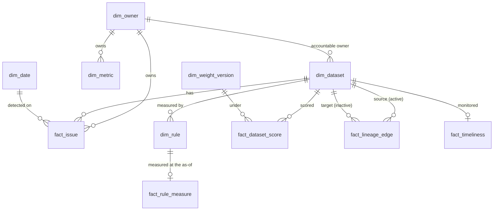

# BI package: reusable metric model for TrustLedger (P07-ART-06)

Dataset `tl-20261026-20261026` (generator `dataset_hash` `a9f7a3321b102752dd7aa95b76df14c1d9372103e685e10222959fd6438f27ff`), contract v1, code revision `0b5d686`, as-of 2026-10-05T00:00:00Z. **Synthetic data only**: nothing is a claim about a real organisation. Observed (what this one draw of a generated ledger shows), constructed (the designed relationships DR-01..DR-06 and the injected defects) and hypothetical (benefits of acting on it: not claimed) are kept apart; every figure in section 5 is observed.
The decision the model serves: **which data issues should be fixed first, and who is accountable?** (P07-GOAL-01).

## Verification status (stated plainly)
* **No `.pbix` was produced.** Power BI Desktop is not available here and was not run; no DAX engine, Power Query engine or Excel was run. The measures in section 4 are **pseudocode** (DAX-like), **not executed** in any engine.
* What was verified: the dimension and fact CSV files were written by SQL (`data/sql/analysis/bi_*.sql`) from the scratch database; every measure of section 5 was **recomputed in Python from the CSV files alone** (`run_all.py`, `bi_measures`: exact `Fraction` arithmetic, no database, no domain code) and compared with `data/sql/reference_metrics.sql`, the Python domain and the analysis (rows E of the reconciliation in `sql-analysis.md`: all equal). The 80 dataset-by-version weighted scores are recomputed from the exact rule fractions (`score_numerator` / `score_denominator`) and the weight table, not read from the SQL fact.
* A reader can import the CSV files into Power BI, Excel Power Query or any tool and compare with section 5; whether the DAX below evaluates as written is **unverified**.

## 1. How to read or use it without installing anything
Read this file and the CSV files in `artifacts/bi/` (plain UTF-8, comma-separated, a header row, `\n` line ends). Section 5 lists the value of each measure; `artifacts/bi/measures_recomputed.csv` carries the same rows with numerator, denominator, a **status** and a note. Nothing is withheld silently: a measure with a zero denominator is `null: zero denominator`; a dataset that no rule measures has an **empty** weighted score with the status `not_measured: no rule measures a value`, never 0.

## 2. Star schema and relationships

Relationships are many-to-one from fact to dimension, single direction, filtering the fact. `fact_lineage_edge` has two relationships to `dim_dataset` (source active, target inactive; use `USERELATIONSHIP` for the target). `fact_candidate` stands alone (record ids and the verification flag; it joins to no dimension).

## 3. Tables, grain and Power Query
| Table | Grain | Key | Source query | File | Rows |
|---|---|---|---|---|---|
| `dim_owner` | one owner | `owner_id` | `bi_dimensions.sql` `dim_owner` | `artifacts/bi/dim_owner.csv` | 18 |
| `dim_dataset` | one dataset registered by the as-of | `dataset_id` | `bi_dimensions.sql` `dim_dataset` | `artifacts/bi/dim_dataset.csv` | 40 |
| `dim_rule` | one rule (active or disabled) | `rule_id` | `bi_dimensions.sql` `dim_rule` | `artifacts/bi/dim_rule.csv` | 60 |
| `dim_weight_version` | one weight version | `weight_version` | `bi_dimensions.sql` `dim_weight_version` | `artifacts/bi/dim_weight_version.csv` | 2 |
| `dim_date` | one calendar day, 2026-07-13 to 2026-10-05 | `date` | `bi_dimensions.sql` `dim_date` | `artifacts/bi/dim_date.csv` | 85 |
| `dim_metric` | one published metric (effective version at the as-of) | `metric_id` | `bi_dimensions.sql` `dim_metric` | `artifacts/bi/dim_metric.csv` | 30 |
| `fact_rule_measure` | one rule active at the as-of (55 of 60) | `rule_id` | `bi_fact_rule_measure.sql` | `artifacts/bi/fact_rule_measure.csv` | 55 |
| `fact_dataset_score` | one dataset x weight version | (`dataset_id`, `weight_version`) | `bi_fact_dataset_score.sql` | `artifacts/bi/fact_dataset_score.csv` | 80 |
| `fact_issue` | one issue | `issue_id` | `bi_fact_issue.sql` | `artifacts/bi/fact_issue.csv` | 574 |
| `fact_lineage_edge` | one lineage edge | `edge_id` | `bi_fact_lineage_edge.sql` | `artifacts/bi/fact_lineage_edge.csv` | 160 |
| `fact_candidate` | one match candidate | `candidate_id` | `bi_fact_candidate.sql` | `artifacts/bi/fact_candidate.csv` | 400 |
| `fact_timeliness` | one monitored dataset at the as-of read | `dataset_id` | `bi_fact_timeliness.sql` | `artifacts/bi/fact_timeliness.csv` | 15 |
| `measures_recomputed` | one measure x slice, recomputed from the files above | (`measure`, `slice`) | `run_all.py` `bi_measures` | `artifacts/bi/measures_recomputed.csv` | 121 |

Notes on columns that carry meaning: `fact_rule_measure.score_numerator` / `score_denominator` are the exact fraction behind `score` (passing over eligible, over populated for validity), empty when the rule measures nothing (`score_status` says why); `fact_dataset_score.critical_override` is 1 when the dataset has a failing active critical rule or a critical issue not resolved; `fact_issue.class` is `resolved` only after a successful rerun of the same rule version, `hours` is resolution hours (resolved), hours to the close (claimed) or age at the as-of (open); `fact_issue.owner_accountable` is 0 when the issue's owner is inactive at the as-of; `fact_lineage_edge.pair_declared` / `pair_observed` look the (source, target) pair up across evidence kinds; `fact_candidate.truth_same_entity` is the verification layer's synthetic truth (precision only).

**Power Query (M), pseudocode, not executed.** One query per file, with the folder path as a parameter:
```
let
    Source   = Csv.Document(File.Contents(DataFolder & "fact_issue.csv"), [Delimiter = ",", Encoding = 65001, QuoteStyle = QuoteStyle.Csv]),
    Promoted = Table.PromoteHeaders(Source, [PromoteAllScalars = true]),
    Typed    = Table.TransformColumnTypes(Promoted, {{"hours", type number}, {"reopen_cycles", Int64.Type}, {"owner_accountable", Int64.Type}, {"detected_date", type date}}),
    Kept     = Table.SelectRows(Typed, each [issue_id] <> null)
in
    Kept
```
Types: counts `Int64.Type`; proportions and scores `type number` (the files carry six places, so a consumer that needs exactness should use `score_numerator` / `score_denominator` or Decimal); `date` columns `type date`; instants are UTC ISO text. Never convert an empty `weighted_score` to 0.

## 4. Measures (DAX-like pseudocode, not executed)
`Selected Weight Version = SELECTEDVALUE(dim_weight_version[weight_version], "w2")`
`Dataset Count = COUNTROWS(dim_dataset)`
`Covered Datasets = SUM(dim_dataset[owner_covered])`
`Ownership Coverage = DIVIDE([Covered Datasets], [Dataset Count])`
`Uncovered Datasets = [Dataset Count] - [Covered Datasets]`
`Published Metrics = COUNTROWS(dim_metric)`
`Complete Metrics = SUM(dim_metric[checklist_complete])`
`Definition Coverage = DIVIDE([Complete Metrics], [Published Metrics])`
`Declared Pairs = CALCULATE(COUNTROWS(fact_lineage_edge), fact_lineage_edge[evidence_type] = "declared")`
`Observed Matching Declared = CALCULATE(COUNTROWS(fact_lineage_edge), fact_lineage_edge[evidence_type] = "observed", fact_lineage_edge[pair_declared] = 1)`
`Lineage Coverage = DIVIDE([Observed Matching Declared], [Declared Pairs])`
`Undeclared Observed = CALCULATE(COUNTROWS(fact_lineage_edge), fact_lineage_edge[evidence_type] = "observed", fact_lineage_edge[pair_declared] = 0)`
`Issue Count = COUNTROWS(fact_issue)`
`Issues Resolved = CALCULATE([Issue Count], fact_issue[class] = "resolved")`
`Issues Claimed = CALCULATE([Issue Count], fact_issue[class] = "claimed")`
`Issues Open = CALCULATE([Issue Count], fact_issue[class] = "open")`
`Resolved Share = DIVIDE([Issues Resolved], [Issue Count])`
`Claimed Share = DIVIDE([Issues Claimed], [Issue Count])`
`Unresolved Issues = [Issues Claimed] + [Issues Open]`
`Mean Resolution Hours = AVERAGEX(FILTER(fact_issue, fact_issue[class] = "resolved"), fact_issue[hours])` (BLANK when no issue is resolved; claimed and open issues are never in it)
`Unresolved With Inactive Owner = CALCULATE([Unresolved Issues], fact_issue[owner_accountable] = 0)`
`Monitored Datasets = COUNTROWS(fact_timeliness)`
`On Time Datasets = CALCULATE([Monitored Datasets], fact_timeliness[state] = "on_time")`
`Pending Datasets = CALCULATE([Monitored Datasets], fact_timeliness[state] = "pending")`
`Late Datasets = CALCULATE([Monitored Datasets], fact_timeliness[state] = "late")`
`Timeliness = DIVIDE([On Time Datasets], [Monitored Datasets] - [Pending Datasets])`
`Approved Decisions = CALCULATE(COUNTROWS(fact_candidate), fact_candidate[decision] = "approve")`
`Approved Correct = CALCULATE(COUNTROWS(fact_candidate), fact_candidate[decision] = "approve", fact_candidate[truth_same_entity] = 1)`
`Match Precision = DIVIDE([Approved Correct], [Approved Decisions])`
`Reviewed Candidates = CALCULATE(COUNTROWS(fact_candidate), fact_candidate[decision] <> "none")`
`Reviewed Correct Share = DIVIDE(CALCULATE(COUNTROWS(fact_candidate), fact_candidate[decision] <> "none", fact_candidate[truth_same_entity] = 1), [Reviewed Candidates])`
`Decision Agreement Share = DIVIDE(CALCULATE(COUNTROWS(fact_candidate), fact_candidate[decision] = "approve", fact_candidate[truth_same_entity] = 1) + CALCULATE(COUNTROWS(fact_candidate), fact_candidate[decision] = "reject", fact_candidate[truth_same_entity] = 0), [Reviewed Candidates])`
`Weighted Score = VAR s = SELECTEDVALUE(fact_dataset_score[weighted_score]) RETURN IF(SELECTEDVALUE(fact_dataset_score[score_status]) = "measured", s, BLANK())` (a dataset that no rule measures is BLANK with its status shown in a tooltip, never 0; averaging the blank rows away is the intended behaviour for a mean)
`Mean Weighted Score = AVERAGEX(FILTER(fact_dataset_score, fact_dataset_score[score_status] = "measured"), fact_dataset_score[weighted_score])`
`Score Shift = VAR a = CALCULATE([Weighted Score], dim_weight_version[weight_version] = "w1") VAR b = CALCULATE([Weighted Score], dim_weight_version[weight_version] = "w2") RETURN IF(ISBLANK(a) || ISBLANK(b), BLANK(), b - a)` (the files carry six places; exact fractions are in `fact_rule_measure`)
`Critical Failures = CALCULATE(SUM(fact_rule_measure[failing]), dim_rule[severity] = "critical")`
`Critical Override Datasets = CALCULATE(DISTINCTCOUNT(fact_dataset_score[dataset_id]), fact_dataset_score[critical_override] = 1)` (counted apart from any score: the override is never averaged away)
`Open Critical Issues = CALCULATE([Unresolved Issues], fact_issue[severity] = "critical")`

## 5. Expected values (recomputed from the CSV facts by `run_all.py`; reconciled to `reference_metrics.sql` and the Python domain)
Portfolio measures (value, numerator and denominator, status and note):

<!-- BEGIN:bi_measures_portfolio -->
| measure | slice | value | numerator | denominator | status | note |
|---|---|---|---|---|---|---|
| ownership_coverage | portfolio | 0.875000 | 35 | 40 | value | datasets whose accountable owner is active / datasets |
| datasets_without_an_accountable_owner | portfolio | 5 | 5 |  | value |  |
| definition_coverage | portfolio | 0.766667 | 23 | 30 | value | published metrics with a complete checklist cl-1 / published metrics |
| lineage_coverage | portfolio | 0.725000 | 58 | 80 | value | distinct observed pairs that match a declared pair / declared pairs; inferred pairs never count |
| undeclared_observed_pairs | portfolio | 12 | 12 |  | value |  |
| declared_not_observed_pairs | portfolio | 22 | 22 |  | value |  |
| inferred_pairs | portfolio | 10 | 10 |  | value | never counted as observed |
| issues | resolved | 0.548780 | 315 | 574 | value | share of all issues |
| issues | claimed | 0.172474 | 99 | 574 | value | share of all issues |
| issues | open | 0.278746 | 160 | 574 | value | share of all issues |
| issues | all | 574 | 574 |  | value |  |
| mean_resolution_hours | all resolved | 68.2716 | 315 |  | value | mean of (verifying rerun - first detected_at), 4 places, resolved issues only; claimed and open issues are not in it |
| mean_resolution_hours | Data Platform | 34.4202 | 109 |  | value | mean of (verifying rerun - first detected_at), 4 places, resolved issues only; claimed and open issues are not in it |
| mean_resolution_hours | all other teams | 86.1833 | 206 |  | value | mean of (verifying rerun - first detected_at), 4 places, resolved issues only; claimed and open issues are not in it |
| mean_resolution_hours | team: Customer Data | 77.5452 | 28 |  | value |  |
| mean_resolution_hours | team: Data Governance | 83.4130 | 9 |  | value |  |
| mean_resolution_hours | team: Data Platform | 34.4202 | 109 |  | value |  |
| mean_resolution_hours | team: Finance Systems | 91.9537 | 68 |  | value |  |
| mean_resolution_hours | team: Supply Chain | 82.8748 | 55 |  | value |  |
| mean_resolution_hours | team: Support Operations | 87.4087 | 46 |  | value |  |
| unresolved_issues | severity: critical | 1 | 1 |  | value |  |
| unresolved_issues | severity: high | 171 | 171 |  | value |  |
| unresolved_issues | severity: medium | 70 | 70 |  | value |  |
| unresolved_issues | severity: low | 17 | 17 |  | value |  |
| unresolved_issues | all | 259 | 259 |  | value | open + claimed |
| unresolved_issues_with_an_inactive_owner | all | 66 | 66 |  | value |  |
| timeliness | portfolio | 0.666667 | 10 | 15 | value | on time / (monitored - pending); pending is outside the denominator |
| timeliness_pending | portfolio | 0 | 0 |  | value |  |
| timeliness_late | portfolio | 5 | 5 |  | value |  |
| match_precision | portfolio | 0.988506 | 172 | 174 | value | approved decisions the truth confirms / approved decisions |
| reviewed_correct_share | portfolio | 0.840909 | 185 | 220 | value | reviewed candidates that are the same entity / reviewed candidates (the contract's share) |
| decision_agreement_share | portfolio | 0.931818 | 205 | 220 | value | reviews that agree with the truth / reviews |
| approvals_reversed | portfolio | 15 | 15 |  | value |  |
| mean_weighted_score | w1 | 0.950980 | 29 |  | value | mean over the 29 datasets that measure something |
| mean_weighted_score | w2 | 0.943118 | 29 |  | value | mean over the 29 datasets that measure something |
| datasets_with_a_different_score | w1 vs w2 | 0.448276 | 13 | 29 | value |  |
| datasets_moved_at_least_0_005 | w1 vs w2 | 0.241379 | 7 | 29 | value |  |
| largest_move | w1 vs w2 | -0.167477 |  |  | value |  |
| critical_failures | portfolio | 2 | 2 |  | value | failing rows of active critical rules, counted apart from any score |
| datasets_with_the_critical_override | portfolio | 1 | 1 |  | value |  |
| open_critical_issues | portfolio | 1 | 1 |  | value |  |
<!-- END:bi_measures_portfolio -->

The weighted score of every dataset under both weight versions (80 rows; the empty values are datasets that no rule measures, with their status, never 0):

<!-- BEGIN:bi_measures_dataset_scores -->
| measure | slice | value | numerator | denominator | status | note |
|---|---|---|---|---|---|---|
| weighted_score | ds-accounts/w1 | 0.990000 |  |  | value |  |
| weighted_score | ds-accounts/w2 | 0.981250 |  |  | value |  |
| weighted_score | ds-billing-accounts/w1 |  |  |  | not_measured: no rule measures a value | withheld, never 0 |
| weighted_score | ds-billing-accounts/w2 |  |  |  | not_measured: no rule measures a value | withheld, never 0 |
| weighted_score | ds-campaigns/w1 |  |  |  | not_measured: no rule measures a value | withheld, never 0 |
| weighted_score | ds-campaigns/w2 |  |  |  | not_measured: no rule measures a value | withheld, never 0 |
| weighted_score | ds-carriers/w1 | 0.966387 |  |  | value |  |
| weighted_score | ds-carriers/w2 | 0.966387 |  |  | value |  |
| weighted_score | ds-consent-records/w1 | 0.916340 |  |  | value |  |
| weighted_score | ds-consent-records/w2 | 0.932773 |  |  | value |  |
| weighted_score | ds-contacts/w1 | 0.984127 |  |  | value |  |
| weighted_score | ds-contacts/w2 | 0.988839 |  |  | value |  |
| weighted_score | ds-cost-centres/w1 | 0.974359 |  |  | value |  |
| weighted_score | ds-cost-centres/w2 | 0.974359 |  |  | value |  |
| weighted_score | ds-credit-notes/w1 |  |  |  | not_measured: no rule measures a value | withheld, never 0 |
| weighted_score | ds-credit-notes/w2 |  |  |  | not_measured: no rule measures a value | withheld, never 0 |
| weighted_score | ds-crm-activities/w1 |  |  |  | not_measured: no rule measures a value | withheld, never 0 |
| weighted_score | ds-crm-activities/w2 |  |  |  | not_measured: no rule measures a value | withheld, never 0 |
| weighted_score | ds-csat-surveys/w1 | 0.935484 |  |  | value |  |
| weighted_score | ds-csat-surveys/w2 | 0.935484 |  |  | value |  |
| weighted_score | ds-customers/w1 | 0.990329 |  |  | value |  |
| weighted_score | ds-customers/w2 | 0.990175 |  |  | value |  |
| weighted_score | ds-delivery-events/w1 | 0.955882 |  |  | value |  |
| weighted_score | ds-delivery-events/w2 | 0.955882 |  |  | value |  |
| weighted_score | ds-employees/w1 | 1.000000 |  |  | value |  |
| weighted_score | ds-employees/w2 | 1.000000 |  |  | value |  |
| weighted_score | ds-experiments/w1 |  |  |  | not_measured: no rule measures a value | withheld, never 0 |
| weighted_score | ds-experiments/w2 |  |  |  | not_measured: no rule measures a value | withheld, never 0 |
| weighted_score | ds-inventory/w1 | 1.000000 |  |  | value |  |
| weighted_score | ds-inventory/w2 | 1.000000 |  |  | value |  |
| weighted_score | ds-invoices/w1 | 0.987767 |  |  | value |  |
| weighted_score | ds-invoices/w2 | 0.986495 |  |  | value |  |
| weighted_score | ds-kb-articles/w1 | 0.984848 |  |  | value |  |
| weighted_score | ds-kb-articles/w2 | 0.984848 |  |  | value |  |
| weighted_score | ds-leads/w1 |  |  |  | not_measured: no rule measures a value | withheld, never 0 |
| weighted_score | ds-leads/w2 |  |  |  | not_measured: no rule measures a value | withheld, never 0 |
| weighted_score | ds-ledger-entries/w1 | 0.942387 |  |  | value |  |
| weighted_score | ds-ledger-entries/w2 | 0.950617 |  |  | value |  |
| weighted_score | ds-opportunities/w1 | 0.886076 |  |  | value |  |
| weighted_score | ds-opportunities/w2 | 0.886076 |  |  | value |  |
| weighted_score | ds-order-lines/w1 | 0.966981 |  |  | value |  |
| weighted_score | ds-order-lines/w2 | 0.966981 |  |  | value |  |
| weighted_score | ds-orders/w1 | 0.936207 |  |  | value |  |
| weighted_score | ds-orders/w2 | 0.891379 |  |  | value |  |
| weighted_score | ds-page-events/w1 |  |  |  | not_measured: no rule measures a value | withheld, never 0 |
| weighted_score | ds-page-events/w2 |  |  |  | not_measured: no rule measures a value | withheld, never 0 |
| weighted_score | ds-payments/w1 | 0.831301 |  |  | value |  |
| weighted_score | ds-payments/w2 | 0.796341 |  |  | value |  |
| weighted_score | ds-price-books/w1 |  |  |  | not_measured: no rule measures a value | withheld, never 0 |
| weighted_score | ds-price-books/w2 |  |  |  | not_measured: no rule measures a value | withheld, never 0 |
| weighted_score | ds-products/w1 | 0.982759 |  |  | value |  |
| weighted_score | ds-products/w2 | 0.982759 |  |  | value |  |
| weighted_score | ds-purchase-orders/w1 | 0.977778 |  |  | value |  |
| weighted_score | ds-purchase-orders/w2 | 0.977778 |  |  | value |  |
| weighted_score | ds-refunds/w1 | 0.938776 |  |  | value |  |
| weighted_score | ds-refunds/w2 | 0.938776 |  |  | value |  |
| weighted_score | ds-returns/w1 | 0.930000 |  |  | value |  |
| weighted_score | ds-returns/w2 | 0.930000 |  |  | value |  |
| weighted_score | ds-segments/w1 |  |  |  | not_measured: no rule measures a value | withheld, never 0 |
| weighted_score | ds-segments/w2 |  |  |  | not_measured: no rule measures a value | withheld, never 0 |
| weighted_score | ds-shipments/w1 | 0.848394 |  |  | value |  |
| weighted_score | ds-shipments/w2 | 0.850297 |  |  | value |  |
| weighted_score | ds-sla-policies/w1 |  |  |  | not_measured: no rule measures a value | withheld, never 0 |
| weighted_score | ds-sla-policies/w2 |  |  |  | not_measured: no rule measures a value | withheld, never 0 |
| weighted_score | ds-subscriptions/w1 | 0.961988 |  |  | value |  |
| weighted_score | ds-subscriptions/w2 | 0.955044 |  |  | value |  |
| weighted_score | ds-suppliers/w1 | 0.961149 |  |  | value |  |
| weighted_score | ds-suppliers/w2 | 0.964894 |  |  | value |  |
| weighted_score | ds-support-agents/w1 |  |  |  | not_measured: no rule measures a value | withheld, never 0 |
| weighted_score | ds-support-agents/w2 |  |  |  | not_measured: no rule measures a value | withheld, never 0 |
| weighted_score | ds-ticket-events/w1 | 0.971429 |  |  | value |  |
| weighted_score | ds-ticket-events/w2 | 0.971429 |  |  | value |  |
| weighted_score | ds-tickets/w1 | 0.852608 |  |  | value |  |
| weighted_score | ds-tickets/w2 | 0.685131 |  |  | value |  |
| weighted_score | ds-warehouses/w1 | 0.933333 |  |  | value |  |
| weighted_score | ds-warehouses/w2 | 0.933333 |  |  | value |  |
| weighted_score | ds-web-sessions/w1 | 0.985714 |  |  | value |  |
| weighted_score | ds-web-sessions/w2 | 0.985714 |  |  | value |  |
| weighted_score | ds-web-users/w1 | 0.986014 |  |  | value |  |
| weighted_score | ds-web-users/w2 | 0.987374 |  |  | value |  |
<!-- END:bi_measures_dataset_scores -->

Headline reading: ownership coverage **0.875000** (35 of 40), definition coverage **0.766667** (23 of 30), lineage coverage **0.725000** (58 of 80), timeliness **0.666667** (10 of 15, none pending), match precision **0.988506** (172 of 174), review-correct share **0.840909** (185 of 220), decision-agreement share **0.931818** (205 of 220), 315 issues resolved, 99 claimed and 160 open with a mean resolution of **68.2716** hours (Data Platform **34.4202** against **86.1833**), 259 unresolved of which 66 have an inactive owner, 2 critical failing rows and 1 dataset with the critical override beside a score of 0.990175 (w2) and 0.990329 (w1).

## 6. Limits
* **Not run in Power BI, Excel Power Query or any DAX engine.** The DAX is pseudocode and unverified; the verification is the Python recomputation from the CSV files.
* **Six decimals in the files.** Scores and shares are rounded once to six places; the per-rule exact fractions are carried so a consumer can average exactly. A difference of 0.000001 between an exact result and a rounded file is not a defect (D-10 R7-18).
* **One draw of a synthetic world.** The designed relationships were chosen; none of this is a measurement of an organisation.
* **The truth column is a verification device.** `fact_candidate.truth_same_entity` exists so precision can be reproduced; a production model would not hold it beside the matcher's output (P07-DOMAIN-03).
* **No row-level security, refresh schedule or gateway is modelled.** The files are a snapshot at the as-of.
