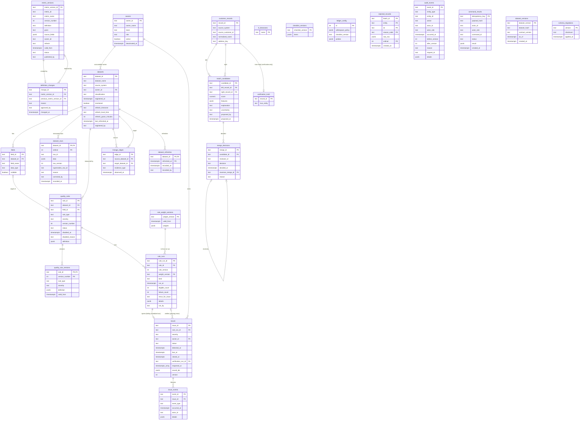

# Entity-relationship diagram (P07-ART-03)

Dataset `tl-20261026-20261026` (generator hash `a9f7a3321b102752dd7aa95b76df14c1d9372103e685e10222959fd6438f27ff`), contract v1, code revision `0b5d686`. **Synthetic data only.** The diagram is the physical model of `data/migrations/0001_schema.sql`, `0002_constraints.sql` and `0003_review_r7.sql` plus `verification_truth` (`data/sql/verification_truth.sql`, loaded only by a test or reviewer) and `schema_migrations` (created by `data/migrate.py`): 26 tables. Cardinalities are the foreign keys of `data-dictionary.md` section 3. Read the text lists below the diagram if your viewer does not render Mermaid.

## Field lists
Each table's columns are in `data-dictionary.md` section 2 with type, nullability and meaning. The grouping below is the reading order for the decision (P07-GOAL-01: which data issues should be fixed first and who is accountable?):

* **Who is accountable:** `owners` -> `datasets` (the accountable owner), `issues.owner_id`.
* **What is measured:** `datasets` -> `fields`, `dataset_rows`, `quality_rules` (+ `quality_rule_versions`), `rule_weight_versions`, `checklist_versions`, `ledger_config`.
* **What failed and what happened next:** `rule_runs` -> `issues` -> `issue_events`; the verification of an issue is a second link from `issues` to `rule_runs`.
* **Where data comes from:** `lineage_edges` (declared, observed, inferred), `metric_versions` -> `definition_changes`.
* **Who is the same person:** `customer_records` -> `match_candidates` -> `merge_decisions` (approve, reject, reverse); `verification_truth` stands outside it.
* **What the system did:** `rejected_records`, `audit_events`, `command_results`, `dataset_versions`, `dataset_refreshes`, `schema_migrations`.

## Logical joins (not enforced by the database)
* `rule_runs.rerun_for_issue` -> `issues.issue_id`: a rerun re-checks one issue; `issues_guard` accepts a verification only if that rerun is of the same rule and version, passes, and is not before the detection or the latest reopen.
* `quality_rules.definition.parent_dataset_id` -> `datasets`: the parent of a relationship rule.
* `match_candidates.proposed_by` and `merge_decisions.reviewer_id` -> `owners.owner_id`: separation of duties.
* `metric_versions.owner_id` and `definition_changes.approved_by` -> `owners.owner_id`: not a foreign key, so a definition can name an owner that does not exist (the checklist then fails on `owner`; investigation 06 finds one).
* `verification_truth.record_id` -> `customer_records.record_id`: the synthetic truth for match precision.

## Reading the diagram for the decision
An issue is a row of `issues` joined to the failing run (`rule_runs`), its rule (`quality_rules`), the dataset and its accountable owner; "resolved" additionally needs the verification run, so a claim (a closed issue with no passing rerun of the same rule version) is visible as an issue whose `verification_run_id` does not satisfy the guard. Ownership coverage is `datasets` joined to `owners` on the active flag at the as-of; lineage coverage is `lineage_edges` self-joined on (source, target) across evidence kinds; definition coverage is the effective published `metric_versions` row tested against the checklist; match precision joins `merge_decisions` to `match_candidates` to `verification_truth` twice (left and right record). See `sql-analysis.md` for each as a numbered investigation.
