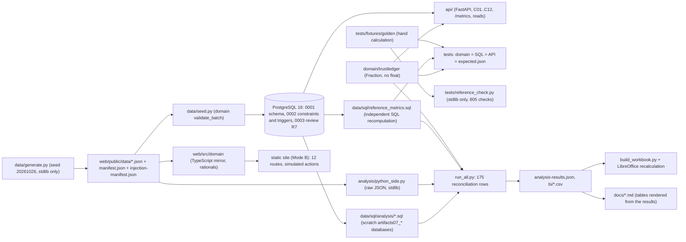

# Technical case study: TrustLedger (P07-ART-09)

Dataset `tl-20261026-20261026` (generator hash `a9f7a3321b102752dd7aa95b76df14c1d9372103e685e10222959fd6438f27ff`), contract v1, code revision `0b5d686` (published as `e205202` on `unified-portfolio`). **Synthetic data only**; nothing here is a claim about a real organisation. The decision it serves: **which data issues should be fixed first, and who is accountable?**

**How to read it without installing anything:** the architecture and trade-offs describe the system, the review table what was found and fixed, the recovery list names the tests that show the behaviour, and the last two sections give the commands and the measured results.

## Architecture

Two implementations of one contract (`docs/contracts.md` D-01..D-10) check each other: the Python domain with `fractions.Fraction` for every ratio, and a SQL reference that reads only facts. A third, standard-library-only oracle (`tests/reference_check.py`) reproduces the golden fixture from its records, and the TypeScript mirror of the site is held to the same golden figures plus the snapshot at three as-of instants under both weight versions. This package adds a fourth and fifth reading of the snapshot: analysis SQL with its own formulation of the rules, and a plain-Python recomputation from the raw JSON (`data/sql/analysis/python_side.py`).
The API (prefix `/api/v1/trustledger`) takes commands C01..C12 with idempotency keys bound to the actor, the role, the payload and the dataset version; each command runs in one transaction with its audit row and stored result; the actor is resolved against the owners register and the role is the register's (D-10 R7-03). Rows, rule runs, decisions, edges, events, weights and definitions are append-only (triggers); the verification truth is a separate table that the matcher, the API and the seeder never read.

## Trade-offs
| Choice | Why | Cost |
|---|---|---|
| Exact rationals in Python, TypeScript and SQL; ratios rounded once to six places, hours to four | a published figure can be reproduced by hand and compared string for string across three engines | slower than floats; reads load the whole population per request (D-07 known) |
| One current row per rule plus an append-only `quality_rule_versions` | a rule's identity never changes in place and an earlier version's denominator stays readable (R7-12) | no command creates or versions a rule; the generator states the earlier versions |
| Row-level measurement is authoritative; stored run counts are compared with it, not trusted | the measurement can be recomputed anywhere; `RULE_VERSION_DIFFERS` marks the one rule whose stored run is not comparable (INJ-12) | the analysis re-measures 55 rules over 2,554 rows (milliseconds, but not free) |
| Patterns may not use `\s \d \w \b` (refused at ingest and by a database check) | three engines (PostgreSQL, Python `re`, JavaScript) disagree on those escapes; explicit classes are shown to agree (R7-04) | rule authors write `[0-9]` and `[ \t\r\n\f\v]`; beyond the patterns in the data no assurance is given |
| Match truth in a verification table that only a test or reviewer loads | the matcher cannot cheat, and precision without it is null, never 0 (P07-DOMAIN-03) | the analysis has to load the table itself (`prepare_snapshot.py`) |
| A pending timeliness state outside the denominator (R7-01) | a dataset whose window is still open is neither on time nor late | one more state to explain; a read taken mid-window gives a different rate |
| Corrections as new row versions (C11) and refreshes as appended rows (C12), not UPDATEs (R7-07) | history stays readable and earlier as-of reads keep their answers | every read picks the latest version recorded by its as-of |
| Mode B simulates actions in browser memory | a public demo with no write path and no secrets | the issue workbench and duplicate review change nothing published; the transactional behaviour is verified on hosted runners |
| The workbook types per-rule counts and timeliness instants (W-02) | a spreadsheet cannot run patterns, duplicate keys or time-zone arithmetic | every result is compared with the domain after recalculation; it is not a rule engine |
| LibreOffice, not Excel, recalculates the workbook; no `.pbix` | the container has one and not the other | Excel and Power BI are unverified; the BI measures are recomputed in Python from the CSV files |
| Scratch databases named `artifacts07_*` for every analysis | `0002_constraints.sql` looks constraint names up globally, so a schema is not an isolation boundary, and the shared database must never be reset | `prepare_snapshot.py` refuses any other name; the suite's database tests reset their own database as before |

## The review (R7) and what it found
An independent reviewer, briefed to disprove the site and its case study, confirmed **eight defects** (R7-01..R7-08) and raised **twelve documentation and nit findings** (R7-09..R7-20) (ledger assignments A-060, fixed by A-063 at `1e0283f`, decisions D-10, CI `40448066870` green on `0b5d686`, republished as `e205202`). Every figure the reviewer recomputed reproduced, and mutation tests showed that both checks (the Python/SQL oracle and the TypeScript golden check) can fail.
| Defect | Before | After (D-10) | Regression test |
|---|---|---|---|
| R7-01 timeliness | a refresh made on time for today counted late until the day's deadline passed | latest occurrence started by the as-of; on time / pending / late; pending outside the denominator; pinned in the fixture (`probes.timeliness`) | `test_r7_01_timeliness_states_domain_and_sql_agree`, `test_r7_01_pending_is_outside_the_denominator_and_counted` |
| R7-02 disabled critical rule | disabling a failing critical rule before an issue was opened made the override disappear | a disabled critical rule's live failure is carried until a verified rerun passes; C10 reruns a disabled rule | `test_r7_02_a_disabled_critical_rule_keeps_its_live_failure_and_the_override`, `test_r7_02_only_a_verified_rerun_clears_it_and_disabling_never_does` |
| R7-03 identity | the backend trusted the actor headers: a proposer could approve their own merge | actors resolved against the owners register, the role is the register's, `SELF_REVIEW` for a proposer or drafter | `test_identity_roles_and_envelope_errors`, `test_c07_a_proposer_cannot_decide_their_own_candidate_and_the_refusal_is_kept` |
| R7-04 patterns | the three engines disagreed on non-ASCII whitespace in e-mail patterns | non-portable escapes refused (`PATTERN_NOT_PORTABLE`, database check); the data uses explicit classes; five disputed characters pinned | `test_r7_04_a_pattern_with_s_d_w_or_b_is_refused_at_ingest`, `test_r7_04_whitespace_probes_python_and_sql_agree` |
| R7-05 uniqueness | the score ignored null keys | score = (eligible - null-key rows - duplicate rows) / eligible, null keys listed | `test_r7_05_null_keys_fail_are_listed_and_lower_the_score` |
| R7-06 self-edge | a self-loop edge passed the domain and failed the database | `MALFORMED_RECORD` in the domain, the TypeScript ingest and the reference; the seeder never aborts | `test_r7_06_an_edge_from_a_dataset_to_itself_is_rejected_and_the_seeder_does_not_abort` |
| R7-07 no correction path | only timeliness issues could be resolved without SQL | C11 `correct-dataset-rows` and C12 `record-refresh`, append-only | `test_r7_07_a_completeness_issue_is_resolved_through_c11_then_c10_with_no_sql_outside_the_application` |
| R7-08 case study | it named commands that did not exist | corrected on the portfolio (`031705d`) | n/a (wording) |
The documentation findings: R7-11 (empty and whitespace foreign keys are missing: the golden relationship figure moved from 36 of 38 to 35 of 37), R7-12 (a `reviewed` definition state and `quality_rule_versions`), R7-13 (the evidence page's limits), R7-14 (naive instants refused on reads), R7-15 (a skipped test fails CI), R7-16 (code-point order in the TypeScript mirror), R7-17 (live regions), R7-18 (the shift footnote); R7-09, R7-10 and R7-20 were case-study wording fixed by the coordinator. The ledger names R7-19 among the fixes; D-10 has no separate bullet for it.

## Recovery behaviour (observed in tests)
* **A failure after the write rolls the command and its audit back** (`test_a_failure_after_the_write_rolls_the_command_and_its_audit_back`); every command writes exactly one audit row and a failed one writes none (`test_every_command_writes_exactly_one_audit_row_and_a_failure_writes_none`); refusals are audited (`test_c02_in_place_rewrite_is_refused_and_audited`).
* **Retries do not duplicate side effects:** the same idempotency key raced executes once (`test_the_same_idempotency_key_raced_executes_once`); a different payload, actor or role under one key is 409 (`test_idempotency_replay_reuse_and_actor_binding`); a deadlock is retried three times, then 409 `CONCURRENT_UPDATE` (`test_a_deadlock_is_retried_three_times_then_409_concurrent_update`).
* **One decision per candidate under a race** (`test_two_approvals_of_one_candidate_leave_one_decision`, `test_two_approve_and_reject_decisions_of_one_candidate_leave_one`); a stale dataset version is 409 and writes nothing (`test_stale_dataset_version_is_409_and_nothing_is_written`).
* **A bad batch is kept, not lost:** rejected records are stored raw with a reason code and their dependents are `DEPENDENT_REJECTED` (`test_variant_rejected_lists_every_rejection_with_reason_and_raw_row`, `test_db_keeps_rejected_rows_raw_and_does_not_load_them`); an empty population gives zero counts and null ratios, never zero ratios (`test_variant_empty_is_all_zero_counts_and_null_ratios_never_zero_ratios`).
* **A close without proof stays a claim:** `test_09_an_issue_closed_without_a_rerun_stays_claimed`; a verification that is not a passing rerun of the same rule version is refused by the domain and the database (`test_the_database_refuses_resolved_without_a_successful_rerun_of_the_same_rule_version`).
* **A merge is reversible:** `test_06_a_merge_is_reversible_and_the_history_is_kept`; recovery of a wrong approval is a reversal decision that restores both identities, not an edit.
* **Recovery of this package:** every scratch database is created and dropped by the scripts; a failed run leaves the shared `trustledger` database untouched (`test_scratch_guard_refuses_a_non_scratch_database`); the tables are rendered from the stored results, so a drifted document fails a test (`test_sql_analysis_doc_quotes_the_stored_results_and_every_table_is_rendered_from_them`).
* **Rollback of the published site** is documented in `release-package.md` (not executed).

## Reproducible setup
```
# from apps/trustledger (Python 3.11; PostgreSQL 16 reachable; LibreOffice for the workbook)
pip install -r requirements.txt -r requirements-artifacts.txt          # pinned: fastapi, pydantic, psycopg, pytest; openpyxl==3.1.5
python -I tests/reference_check.py                                     # independent recomputation, ALL OK (805 checks)
DATABASE_URL=postgresql://<user>:<password>@<host>:5432/<scratch database> python -m pytest -q -ra     # the suite, against a database it may reset

# artifacts (scratch databases are created and dropped by run_all.py; names start with artifacts07_)
python data/sql/analysis/run_all.py --json artifacts/analysis-results.json --bi-out artifacts/bi
python artifacts/render_sql_analysis.py                                # fills the tables of sql-analysis.md and bi-package.md
python artifacts/build_workbook.py --recalc                            # openpyxl formulas, then LibreOffice headless
python artifacts/checksums.py --table                                  # artifacts/CHECKSUMS.txt and the table of release-package.md
sha256sum -c artifacts/CHECKSUMS.txt

# the package's own tests: both scratch URLs let the database tests run; without them they skip with a printed reason
ARTIFACTS_DATABASE_URL=postgresql://<user>:<password>@<host>:5432/artifacts07_snapshot ARTIFACTS_GOLDEN_DATABASE_URL=postgresql://<user>:<password>@<host>:5432/artifacts07_golden \
  python -m pytest -q -ra tests/test_artifacts.py
```
`prepare_snapshot.py` refuses any database whose name does not start with `artifacts07_`. Credentials are the reader's own; none is written in any document.

## Measured evidence
| Evidence | Result | Source |
|---|---|---|
| Independent oracle | ALL OK (805 checks, 7 fixture hashes) | run in this pass; per the ledger at `1e0283f` |
| Backend suite, local | 405 passed in 119.63 s before `tests/test_artifacts.py` existed; **443 passed** (405 + the 38 tests of this package) in 137 to 154 s (three runs on a loaded machine) with `DATABASE_URL` and both `ARTIFACTS_*` URLs set | run in this pass against scratch databases |
| Backend suite, hosted | CI `40448066870`: both modes green on `0b5d686`; Mode A `40433219610`, `40436104537`; both modes `40439001518` | ledgers, not fetched here |
| Site checks | `npm run check`: 2,539 golden and snapshot checks and 58 review checks; `npm run e2e`: 80 passed, 65 screenshots | ledger (A-063); not re-run here |
| Analysis | 175 reconciliation rows, all equal; 51 result sets, 233 rows; `run_all.py` creates, loads, runs and drops two scratch databases in about 18 s | run in this pass |
| Mutation check | a changed threshold in investigation 03 failed the per-dataset flag, the summary, the DR-03 row and the BI row; restored | run in this pass |
| Workbook | LibreOffice headless recalculation in about 4 s; `Checks!B2` TRUE with the switch at `w2` and at `w1` | run in this pass and by the tests |
| Provenance | the domain, API, migrations, loaders, reference SQL, published data and fixtures equal `0b5d686` | `test_provenance_the_analysed_code_and_data_equal_revision_0b5d686` |
| Live | the earlier release `77665db` (code `78a4390`) was live-checked in run `40439868137` (all seven sites success); the live check of `e205202` was **pending at dispatch** and the ledger recorded it while this package was in progress: run `40448466520`, success, live code sha `0b5d686` | ledger, not fetched |

## Open gaps
* **The hosted no-skip gate** (`trustledger-ci.yml`, R7-15) fails a run with any skipped test; this package's LibreOffice and scratch-database tests skip without LibreOffice or the two `ARTIFACTS_*` URLs, so the next push fails the gate unless the workflow installs LibreOffice and exports them (reported; the workflow is outside this package's remit). No hosted run of `tests/test_artifacts.py` is recorded yet.
* **Binary artifacts were built in the session's cloud container**, not on a GitHub-hosted runner, and are not attached to a GitHub release; nothing was committed or pushed.
* **Excel and Power BI Desktop were not run**; no `.pbix` exists.
* The review's accepted limitations stay: whole-population reads, the declared-edge-only impact preview, whole-rule simulated reruns, unpinned multi-system identity chains, and three regular-expression engines whose agreement is assured only on the patterns in the data.
* **A wording to reconcile in the public case study:** "205 of the 220 reviews" is the decision-agreement count; the contract's review-correct share is 185 of 220 (0.840909).
